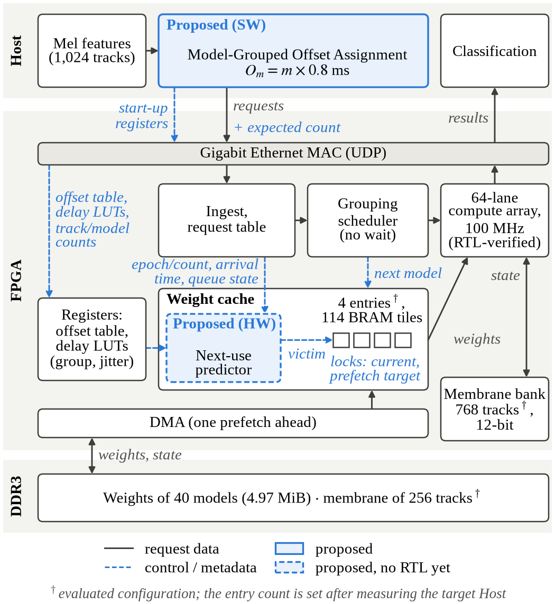

# MultiModel-SpikeSense

**FPGA 하나로 SNN 모델 40개와 mic 트랙 1,024개를 처리하는 다중 모델 실시간 추론 가속기**

---

## 1. 배경

회전 기계는 고장 전에 이상음을 낸다. 같은 기종이라도 장비와 설치 환경에 따라 정상 소리가 달라서 장비마다 SNN 모델을 따로 둔다. 이 연구는 모델 40개와 mic 트랙 1,024개를 FPGA 하나로 처리한다. 트랙마다 32 ms에 추론 요청이 하나 생기고 Host는 frame 마지막 샘플이 Host에 들어온 시각부터 32 ms 안에 결과를 받아야 한다.

병목은 연산이 아니라 weight 전송이다. 모델 40개의 weight는 4.97 MiB라 BRAM(약 1.6 MiB)에 다 들어가지 않는다. weight를 재사용하지 않으면 DDR3에 4.17 GB/s가 필요해 보드의 읽기 대역폭 3.015 GB/s를 넘는다.

| 기법 | 하는 일 |
|---|---|
| Model-Grouped Offset Assignment | Host가 같은 모델을 쓰는 트랙에 같은 frame offset을 배정한다. 같은 모델의 추론 요청이 FPGA에 함께 도착한다 |
| Grouping | FPGA가 추가 추론 요청을 기다리지 않고 이미 도착한 같은 모델 추론 요청을 batch로 묶는다 |
| predicted-next-use weight cache | queue, Host 지연 분포, 예상 추론 요청 수로 다음 사용 시각을 예측해 가장 늦게 쓸 모델을 내보낸다(PNU-count) |
| 12 bit membrane storage | membrane potential을 12 bit로 저장해 남는 BRAM에 일부 트랙(entry 4이면 768트랙)을 둔다 |

---

## 2. 시스템 구성



| 구성 | 역할 |
|---|---|
| Host | 특징 추출(mel 40개), offset 배정, 판정. 최종 Host는 라즈베리파이 5(8 GB)이고, 지금 Host 지연 측정은 Xeon에서 했다 |
| Gigabit Ethernet (UDP) | 추론 요청 64 B, 결과 32 B |
| FPGA (ALINX AX7A200B, XC7A200T) | request table, Grouping scheduler, DMA, next-use predictor와 weight cache entry 4개, membrane bank, 64-lane compute array |
| DDR3 1 GiB | 모델 40개의 weight, 256트랙의 membrane potential |

---

## 3. 모델과 가속기

### 3.1 모델: PLIF SNN

- 입력: 16 kHz 음성, FFT 1,024, hop 512에서 구한 mel 40개. frame은 64 ms이고 32 ms마다 하나씩 만든다
- 구조: `40→384→256→64→2`, 뉴런 706개, bias 없음. DCASE 2020 Task 2의 장비 ID 40개마다 한 모델
- 뉴런: PLIF. 뉴런마다 누설 계수와 threshold를 학습한다
- 판정: 31 frame(992 ms)의 출력 membrane potential 평균 중 큰 쪽(0 정상, 1 이상)
- 양자화: weight는 layer별 대칭 INT8(130,176 B), 누설 계수는 Q0.8. membrane potential은 16 bit 포화 연산, 저장은 12 bit
- 학습: focal loss, Adam(lr 0.002, cosine), batch 512, 60 epoch

| 형식 | 평균 ROC-AUC (40대) | AUC 0.9 이상 |
|---|---:|---:|
| FP32 | 0.9563 | 35대 |
| INT8, membrane potential 12 bit 저장 | 0.9554 | 35대 |

40대는 test 결과를 본 뒤 `fan_id00`을 빼고 고른 것이다. 41대 전체의 FP32 평균은 0.9510이다.

### 3.2 가속기

| 항목 | 값 |
|---|---|
| compute array | 64 lane output-stationary, 100 MHz. layer 2·3은 spike 0 건너뛰기, cycle마다 spike input 2개 |
| 추론 1번 | 실데이터 평균 535.9 cycle(5.36 µs), 모든 spike 발생 1,205 cycle(12.05 µs). control overhead 67 cycle 포함 |
| BRAM 365 tile | weight cache entry 4개 114 tile, membrane potential 768트랙 200.5 tile, 링크·request table·buffer 50 tile, predictor 0.5 tile |
| weight 적재 | 모델 전체 131,648 B, 43.91 µs |
| deadline | hard deadline 보장은 주장하지 않는다. 측정 최대를 넣은 조건부 응답 시간은 CPU 고정 Host에서 19.87~26.62 ms |

RTL은 compute array(P4.1), membrane storage(P4.2), weight cache(P4.3)까지 있다. cycle과 bit 정확도는 RTL simulation, timing은 out-of-context 배치·배선 결과다. 나머지 숫자는 계산과 simulation이며 보드로 확인해야 한다.

### 3.3 Simulation 결과

1,024트랙, entry 4, 같은 BRAM에서 비교했다. Host 처리 지연은 Xeon(CPU 고정·부하 없음)에서 잰 모델 묶음 지연에 추론 요청별 지연 j ~ Uniform(0, 0.8 ms)를 더해 재생했다. 보드 실측이 아니다.

| 방법 | DDR3 KiB/추론 | 응답 시간 최대 ms | 준비 완료 뒤 최대 ms |
|---|---:|---:|---:|
| Dysta Method | 56.62 | 10.58 | 6.90 |
| DeepRT Method | 11.35 | 23.80 | 16.41 |
| 제안 | 6.38 | 9.58 | 1.42 |

세 방법 모두 deadline miss와 drop이 없었다. 응답 시간 최대에는 Host 처리 지연(관측 최대 8.94 ms)이 들어 있다. 비교군은 원 논문의 정책을 같은 FPGA 모델로 옮긴 것이다. 다른 실험은 [08_EVALUATION.md](documents/design_references/08_EVALUATION.md)에 있다.

---

## 4. 폴더 구조

```
MultiModel-SpikeSense/
├── documents/          # 설계 정본(design_references), 보고서, TASKS, 발표·논문 자료
├── software/
│   ├── dataset/        # DCASE data(git 제외)와 전처리·증강 code
│   ├── model/          # SNN 정의, FP32·INT8 reference, export, 평가(eval/)
│   ├── train/          # 학습: train_1unit(장비 1대), train_40unit(40대)
│   ├── weights/        # checkpoint: <학습 이름>/<장비>/
│   ├── train_result/   # 학습 기록과 평가 결과
│   └── host/           # 라즈베리파이 5 Host program(C): 특징 추출, offset 배정, 송신, 판정
├── simulation/
│   ├── engine/         # simulator: 실행기 engine.py, 부품 part_*.py, test_engine.py
│   ├── environment/    # 환경 파일. 파일 하나 = 실험 하나(deadline 분석도 mode 하나)
│   └── result/         # 결과 CSV. 이름 = 환경 파일 이름
├── analysis/
│   ├── develop/        # 그림 code: <주제>/<그림 이름>.py
│   ├── figure/         # 그림: <주제>/<그림 이름>.png
│   └── discards/       # 값이 기준과 다르거나 폐기한 그림과 script
└── hardware/
    ├── board_test/     # LED·MIG·XDMA 시험, DDR3·PCIe 측정 설계와 결과, accel_top 보드 시험
    ├── data/           # INT8 모델 image, golden vector
    ├── src/, testbench/  # 가속기 RTL과 testbench (compute array P4.1, membrane storage P4.2, weight cache P4.3)
    └── constraints/, vivado/
```

### software

| 대상 | 규칙 |
|---|---|
| 장비 이름 | `<종류>_id<번호>`. 예: `fan_id01`, `ToyCar_id03` |
| import하는 모듈 | `<대상>_<구분>`: `snn_torch`(PyTorch 학습), `snn_fp32`, `snn_int8`, `model_format_1lane`, `model_format_64lane` |
| 실행 script | `<동사>_<대상>`: `train_1unit`, `train_40unit`, `export_models`, `export_golden`, `verify_export`, `verify_reference` |
| `model/eval/` | 결과 폴더 `train_result/eval/<이름>/`과 같은 이름 |
| `model/references/` | 선행 저장소 code 사본. 고치지 않는다 |
| `host/` | C program `mmss_host` 하나에 `setup`·`run`·`stop`이 있다. 사용법은 `main.c` 첫머리, 식은 파일마다 첫머리에 적었다. `build/`는 빌드 산출물이다 |

학습 이름은 `<크기>_<용도>_<학습방법>`이다. 크기는 `XS`·`P`·`S`·`M`·`L`·`XL`(layer 구조는 `snn_torch.py`의 `ARCHS`), 용도는 `normal`·`mixed`(섞인 소리), 학습방법은 `noaug`·`aug`(겹침 증강)다.

| 학습 이름 | 장비 | 내용 | 옛 위치 |
|---|---:|---|---|
| `L_normal_noaug` | 40 | 지금 export한 모델(P2.4) | `model_weights/<장비>` |
| `XS`·`P`·`S`·`M_normal_noaug` | 40 | P3.6 크기 비교, 미채택 | `model_weights/_sweep/{XS,P,S,M}` |
| `XL_normal_noaug` | 40 | P3.6 크기 비교 | `model_weights/_sweep/XL` |
| `L_mixed_aug` | 40 | 겹침 증강 학습. 다음 export 후보 | `model_weights/_sweep/L_aug` |
| `XL_mixed_aug` | 40 | 겹침 증강 학습, P3.10 export | `model_weights/_sweep/XL_aug` |
| `L_mixed_aug-easy`, `-b300`, `-b1k`, `-b2k` | 6 | 쉬운 겹침 증강, mel 입력 대역 실험 | `model_weights/_sweep/L_aug_easy`, `L_easy_*` |

2026-10-15 이전 결과 파일에는 옛 이름과 경로가 남아 있다. 위 표로 옮겨 읽는다.

### simulation

| 대상 | 규칙 | 예 |
|---|---|---|
| 환경 파일 | `<결과 접두사>_<실험>.toml`. 접두사는 `p` + 작업 번호 | `p326_final_compare.toml` |
| 환경 키 | `대상_속성[_단위]`. 대상은 sim, model, compute, membrane, bram, ddr, track, host, fpga, cache, scheduler, search, tune | `host_jitter_ms` |
| 점별 결과 | `<환경 이름>.csv`. 점마다 환경 값 전부, BRAM tile, 요약 지표 | `p326_final_compare.csv` |
| 실행별 결과 | `<환경 이름>_runs.csv.gz`. run은 점 × 시나리오 × seed마다 한 줄 | `p326_final_compare_runs.csv.gz` |

키 설명은 `environment/template.toml`, engine 구조와 열 이름은 [simulation_engine.md](documents/design_references/simulation_engine.md)에 있다. 환경 파일을 고치면 결과 CSV를 다시 만든다. 결과 CSV만 따로 고치지 않는다. 옛 스크립트와 결과의 차이는 [P3.14 보고서](<documents/reports/P3.14 Research Report.md>)에 있다.

### analysis

그림 하나를 스크립트 하나가 그린다. 그림 이름은 `fig<번호>_x-<x축>_y-<y축>`이고 색으로 값을 보이면 `_c-<값>`을 붙인다. 주제는 그 실험으로 보려던 것이다. 원자료는 스크립트 첫머리에 적는다. 논문 그림은 `common.paper_style()`(영문 세리프 7 pt, 단 폭 3.5 in)로 그리고 `.pdf`도 만든다.

| 주제 | 그림 | 내용 | 원자료 |
|---|---|---|---|
| `architecture` | `fig1_x-dataflow_y-block` | 시스템 구조. Host offset 배정, next-use predictor, 제어·metadata 경로. entry 4·768/256트랙은 평가 구성(†) | 없음 |
| `offset` | `fig5_x-time_y-track` | frame offset 배정과 실제 도착. (c) FPGA 도착 = 모델 묶음 지연 G + 추론 요청별 지연 | 없음 |
| `offset` | `fig6_x-time_y-arrival-cache` | 묶음 지연을 고려한 cache 교체 예. 묶음 지연을 무시한 예측과 비교 | 없음(설명용 예) |
| `latency` | `fig1_x-host-delay_y-ccdf` | Xeon Host의 모델 묶음 처리 지연 CCDF, 조건 4개 | `hardware/board_test/p325_meas/result/m3_delay_ccdf.csv` |
| `compare` | `fig12_x-ddr_y-max-latency` | offset 배정과 scheduler에 따른 DDR3 전송량과 관측 최대 (a) 응답 시간 (b) 준비 완료 뒤 시간 | `p326_final_compare` |
| `compare` | `fig13_x-jitter_y-ddr-reload` | 추론 요청별 퍼짐에 따른 cache 정책의 DDR3 전송량과 재적재 | `p326_cache_policy` |
| `entry` | `fig1_x-jitter_y-entry_c-ddr` | 추론 요청별 퍼짐 J와 entry 수에 따른 DDR3 전송량(PNU-count), 고른 entry 표시 | `p326_jitter_entry` |
| `cache` | `fig1_x-prediction-error_y-hit-gap` | cache 정책의 hit rate, 다음 사용 예측 오차, Oracle MIN·Belady 하한 대비 전송량 차이 | `p326_cache_policy` |
| `compare` | `fig15_x-jitter_y-method_c-ddr-latency` | 묶음 지연이 없는 합성 조건(G = 0)에서 J를 넓힌 민감도 | `p325_crossover` |
| `compare` | `fig14_x-bw-tracks_y-max-latency` | 합성 조건(G = 0)에서 DDR3 대역폭·트랙 수를 바꾼 관측 최대 응답 시간 | `p325_scale_bw`, `p325_scale_tracks` |

`figure/`에는 설계 정본과 값이 같은 그림만 둔다. 나머지는 `discards/`에 같은 경로로 옮겼다.

시뮬레이션 원자료는 `simulation/result/<이름>.csv`, 모델 원자료는 `software/` 아래에 있다. 논문 그림의 사본은 `documents/papers/journal/image/DAC2027_draft/`에 논문 그림 번호로 둔다.

`discards/`의 스크립트는 그대로 돌지 않는다. 다시 쓰려면 `develop/`·`figure/`로 옮긴다.

### hardware

| 폴더 | 내용 |
|---|---|
| `board_test/` | LED·MIG·XDMA 시험과 DDR3·PCIe 측정. 원자료와 요약은 `p3_meas/result/`, 분석은 `host/analyze_p3.py`. Host 지연 측정(mic–Host 지연, clock drift, Host 처리 지연, Ethernet 지연, P3.25) code는 `host/p325_*.py`·`analyze_p325.py`·`test_p325.py`, 결과는 `p325_meas/result/`. Host 처리 지연 측정 원자료의 모델 묶음 지연 표(`m3_group_<조건>.csv.gz`, simulation `host_group_trace` 입력)는 `host/p326_m3_group.py`가 만든다(P3.26). accel_top 보드 시험(RGMII 보정 `host/p52_link.py`, tb_sys 순서 `host/p52_sys.py`, P5.2) 결과는 `p52_meas/result/`. 목표 부하 정확도·속도(`host/p52_acc.py`, `host/p52_acc_run.sh`, P5.3) 요약은 `p53_meas/result/` |
| `data/models_l64/`, `data/golden_l64/` | L INT8 모델 40개(64 lane slot)와 golden 82개. RTL 기준 |
| `data/golden_l64_m12/` | golden_l64와 같은 입력, membrane potential 12 bit 저장. P4.2 기준(`export_golden.py --format l64 --mem-bits 12`) |
| `data/models/`, `data/golden/` | 1 lane slot(row-major) |
| `data/models_xl/`, `data/golden_xl/` | `XL_mixed_aug`, 256 lane slot(모델 비교용) |

---

## 5. 시작하기

### 요구 사항

Ubuntu 24.04, Python 3.12, PyTorch 2.13(CUDA), Vivado 2026.1(xsim), Verilator 5.020. 세부는 [ENVIRONMENT.md](documents/manual/ENVIRONMENT.md)에 있다.

```bash
pip install torch numpy librosa soundfile scikit-learn matplotlib
```

### 데이터

[DCASE 2020 Task 2](https://dcase.community/challenge2020/task2-unsupervised-detection-of-anomalous-sounds)의 wav를 `software/dataset/dcase/<종류>/{train,test}/`에 둔다. mel cache와 증강 data는 `dataset/dcase_data.py`, `dataset/overlap_aug.py`가 만든다.

### 학습과 export

```bash
cd software/model
python3 ../train/train_40unit.py --name L_normal_noaug         # 40대 학습
python3 export_models.py --format l64                           # INT8 모델과 DDR3 image
python3 export_golden.py --format l64                           # golden vector
python3 verify_export.py --format l64                           # export 검증
```

### Simulation

```bash
python3 simulation/engine/engine.py simulation/environment/p326_final_compare.toml --jobs 11
python3 simulation/engine/test_engine.py                        # 손계산·환경 파일·CSV·P3.25·P3.26·deadline 분석 시험
python3 simulation/engine/test_engine.py p326 env               # 고른 부만(core p325 p326 env csv)
python3 simulation/engine/engine.py simulation/environment/p326_deadline_bound.toml                  # 조건부 응답 시간(bound mode)
python3 simulation/engine/engine.py simulation/environment/p326_deadline_adversarial.toml --jobs 19  # adversarial search
```

오래 걸리는 실험은 계산 서버로 나눠 돌린다([COMPUTE_SERVERS.md](documents/manual/COMPUTE_SERVERS.md)).

### Host program

라즈베리파이 5용으로 개발 서버(LXC 200)에서 크로스 빌드한다. 정적 링크라 Pi OS의 glibc 판과 상관없다. 장치 없이 하는 확인은 `qemu-aarch64`와 FPGA mock(`mock_fpga.py`)으로 한다.

```bash
apt install gcc-11-aarch64-linux-gnu libc6-dev-arm64-cross qemu-user    # 개발 서버에 한 번
make -C software/host                                                   # build/mmss_host (aarch64)
python3 software/host/verify_host.py                                    # qemu-aarch64 + mock_fpga.py, 약 20초
```

Pi에서는 저장소 root에서 돌린다. FPGA는 `192.168.10.2`, Pi NIC는 `192.168.10.1/24`다(06 §4).

```bash
mmss_host setup --models hardware/data/models_l64/models.ddr.bin --map map.txt --group-trace g.csv --jitter-us 800
arecord -D hw:1 -f S16_LE -r 16000 -c 8 | mmss_host run --map map.txt --cpu 3 --log run    # mic 8개
mmss_host run --tracks 1024 --in fan.wav --pace --loop --seconds 300 --cpu 3 --log load      # wav로 1,024트랙 부하
mmss_host stop
```

`map.txt`는 한 줄에 model_id 하나이고 줄 번호가 track_id다. 없으면 트랙 i의 모델은 i % 40이다. `run --log`가 쓰는 `<이름>_bundle.csv`는 묶음 지연 표 형식(`epoch, model_id, delay_us`)이라 `setup --group-trace`와 simulation의 `host_group_trace`에 그대로 넣을 수 있다.

### 그림

```bash
python3 analysis/develop/compare/fig12_x-ddr_y-max-latency.py
```

---

## 6. 개발 현황

| Phase | 내용 | 상태 |
|---|---|---|
| 1. 개발 환경과 보드 | 서버, Vivado, JTAG, MIG DDR3, PCIe XDMA 시험 | 완료 |
| 2. 모델 | 40모델 학습, INT8, export, golden | 완료. checkpoint 교체와 실시간 정규화 남음 |
| 3. 설계 검증 | DDR3 실측, architecture simulation, 비교군 비교, Host 처리 지연 측정(Xeon) | 대부분 완료. 목표 Host 지연 측정, Ethernet interface 설계 남음 |
| 4. RTL | compute array, membrane bank, weight cache, DMA, scheduler, Ethernet | compute array 완료(P4.1). 나머지 예정 |
| 5. 보드 통합 | synthesis·P&R, board test, end-to-end | 예정 |
| 6. 평가와 논문 | 비교 실험, simulation과 보드 대조, 전력 | 예정 |

작업별 상태는 [TASKS.md](documents/TASKS.md)에 있다.

---

## 7. 문서

| 문서 | 내용 |
|---|---|
| [design_references](documents/design_references/01_OVERVIEW.md) | 설계 정본. 기준 수치, 용어, 모델, 구조, 메모리, scheduling, Host interface, simulation, 평가, 선행연구 |
| [TASKS.md](documents/TASKS.md) | 진행 상황과 다음 작업 |
| [보고서](documents/reports/) | 단계별 실험과 결과 |
| [ENVIRONMENT.md](documents/manual/ENVIRONMENT.md) | 개발 서버, FPGA Host, 보드 시험 절차 |
| [COMPUTE_SERVERS.md](documents/manual/COMPUTE_SERVERS.md) | 계산 서버 사용법 |
| [STYLE_GUIDE.md](documents/STYLE_GUIDE.md) | 문서 형식과 문체 |

---

## 8. 참고 자료

- [DCASE 2020 Task 2](https://dcase.community/challenge2020/task2-unsupervised-detection-of-anomalous-sounds): Unsupervised Detection of Anomalous Sounds for Machine Condition Monitoring
- [PLIF](https://arxiv.org/abs/2011.09226): Incorporating Learnable Membrane Time Constant to Enhance Learning of Spiking Neural Networks
- [Sparse-DySta](https://doi.org/10.1145/3613424.3614263): Sparsity-Aware Dynamic and Static Scheduling for Sparse Multi-DNN Workloads (MICRO 2023)
- [DeepRT](https://doi.org/10.1145/3453142.3491278): A Soft Real Time Scheduler for Computer Vision Applications on the Edge (SEC 2021)
- 선행 프로젝트 [SpikeSense-Edge](https://github.com/Git-Junsang/SpikeSense-Edge): 단일 모델 SNN 이상음 탐지 FPGA
