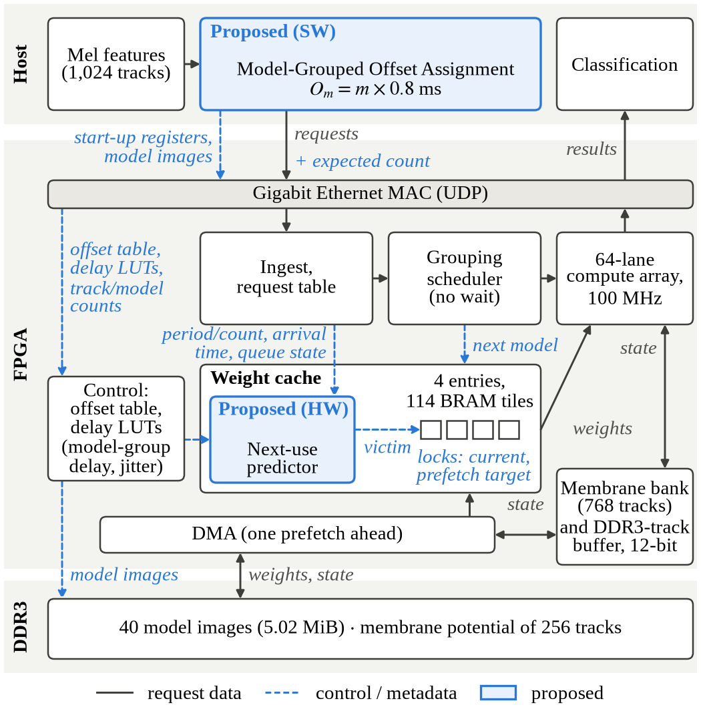

# 03. 가속기 구조와 연산

## 1. 요약

시스템은 Host, Gigabit Ethernet, FPGA, DDR3로 이루어진다. Host는 특징 추출, Offset Assignment, 최종 판정을 맡는다. FPGA는 request table, Grouping scheduler, DMA, weight cache(next-use predictor 포함), membrane bank, 64-lane compute array로 추론 요청을 처리한다. DDR3에는 모델 40개의 weight와 BRAM에 두지 못한 트랙의 membrane potential을 저장한다.

비교 실험에는 entry 4개와 on-chip 768트랙 구성을 썼다. 최종 entry 수는 목표 Host의 지연을 측정한 뒤 정한다([04_MEMORY.md](04_MEMORY.md) §4).

아래 모든 block의 RTL이 있다(P4.1–P4.7). 통합 RTL의 출력은 golden과 bit 단위로 같고(P4.10), MIG·Ethernet을 포함한 전체 설계가 100 MHz에서 배치·배선 timing을 만족한다. 보드에서도 같은 결과를 확인했다(P5.2·P5.3). Host program은 `software/host`에 있다([06_HOST_INTERFACE.md](06_HOST_INTERFACE.md) §2).

## 2. 전체 구조



```text
Host ── Gigabit Ethernet (RGMII) ── eth_mac ─┬─ udp_rx ──► ingest ──► req_table ──► track_scheduler (Grouping)
                                              ├─ udp_tx ◄── result            │               │ 다음 모델
                                              └─ ctrl ◄──► regs              │ 도착 수·첫 도착 │
                                                   (offset table, 지연 예측 표) ▼               ▼
                                                                    next_use_predictor ──► weight_entry ×4
                     dma ── AXI 256 bit ── MIG ── DDR3                              (victim)        │
                      ├──► weight_entry (한 batch 앞 prefetch)                                       ▼
                      └◄─► membrane_buf ◄──► membrane_bank (on-chip 트랙, 12 bit) ◄──► compute_array (64 lane) ──► result
```

| Block | 역할 | 상태 |
|---|---|---|
| `eth_mac`, `udp_rx`, `udp_tx` | Ethernet MAC과 UDP 받기·보내기 | RTL 있음(P4.7, `eth_link`). `verilog-ethernet` 사용, framing은 [06_HOST_INTERFACE.md](06_HOST_INTERFACE.md) §4 |
| `ctrl`, `regs` | 상태·제어·counter를 관리한다. 시작할 때 Host가 offset table, 지연 예측 표(모델 그룹 지연·jitter), 트랙·모델 수를 설정한다 | RTL 있음(P4.6·P4.7). 주소 공간과 제어 packet은 [06_HOST_INTERFACE.md](06_HOST_INTERFACE.md) §7 |
| `ingest` | 받은 추론 요청을 검사해 `req_table`과 모델별 list에 넣는다. 모델·주기마다 도착 수와 첫 도착 시각을 기록한다 | RTL 있음(P4.5) |
| `req_table` | 트랙마다 추론 요청 1개(입력, `t_host`, 도착 시각, 순번, flag) | RTL 있음(P4.5) |
| `track_scheduler` | 다음 batch의 모델과 구성원을 고른다(Grouping) | RTL 있음(P4.5). [05_SCHEDULING.md](05_SCHEDULING.md) §3 |
| `next_use_predictor` | 모델마다 다음 사용 시각을 예측해 victim을 고른다(PNU-Count) | RTL 있음(P4.3, `weight_cache` 안) |
| `weight_entry` | 모델 1벌의 weight와 누설 계수·threshold. 4개, 하나에 28.5 tile | RTL 있음(P4.1) |
| `dma` | weight 적재(한 batch 앞 prefetch), DDR3 트랙의 membrane potential 읽기·쓰기. AXI4 master 256 bit, burst 16 beat를 동시에 4개까지 | RTL 있음(P4.4) |
| `membrane_bank` | on-chip 트랙의 membrane potential(12 bit). 768트랙 187 tile | RTL 있음(P4.2) |
| `membrane_buf` | DDR3 트랙 membrane potential의 준비·연산·되쓰기 buffer 2개 | RTL 있음(P4.2) |
| `compute_array` | 64-lane MAC, spike 0 건너뛰기(cycle마다 spike input 2개), layer 4 reduction | RTL 있음(P4.1) |
| `plif_array` | 누설·적분·발화·soft reset, cycle마다 16뉴런 | RTL 있음(P4.1) |
| `result` | 결과 packet을 연산이 끝나자마자 `udp_tx`로 보낸다 | RTL 있음(P4.5) |

`accel_core`는 compute array, weight cache, Membrane Storage, DMA를 묶고 추론 시작 조건과 정지 cycle counter를 둔다. `accel_sys`는 Ethernet부터 `accel_core`까지를 잇고, 최상위 `accel_top`은 여기에 MIG, clock, 핀을 더한다.

가속기는 MIG의 `ui_clk` 100 MHz에서 동작한다. Ethernet MAC은 RGMII의 125 MHz clock을 쓴다. 두 clock 사이의 데이터는 `verilog-ethernet`의 비동기 FIFO로 전달한다.

## 3. 처리 순서

1. Host는 추론 요청이 준비되면 바로 보낸다(즉시 송신). Packet에는 해당 모델·주기의 예상 추론 요청 수를 싣는다. PNU-Count는 이 값을 예측에 쓴다([06_HOST_INTERFACE.md](06_HOST_INTERFACE.md) §4.1).
2. `ingest`가 추론 요청을 검사한다. 통과한 추론 요청은 `req_table[track_id]`에 넣고 모델별 list 끝에 붙인다. 같은 트랙의 이전 추론 요청 결과를 아직 보내지 않았으면 새 추론 요청을 버린다(drop). 결과 송신 시점은 6번과 같다.
3. Batch i의 연산이 시작되면 scheduler가 batch i+1의 모델을 고른다. 그 모델이 entry에 없으면 predictor가 victim을 고르고 `dma`가 모델 전체를 그 entry로 적재한다. 연산 중인 entry와 적재 대상은 victim 후보에서 뺀다.
4. 적재가 끝나고 compute array가 비면 batch i+1의 구성원을 확정한다. 그 시각까지 도착한 같은 모델의 추론 요청을 모두 포함한다. 연산이 시작된 뒤 도착한 추론 요청은 다음 batch에서 처리한다.
5. Batch에 포함된 추론 요청을 하나씩 처리한다. DDR3 트랙을 처리하는 동안에는 다음 트랙의 membrane potential을 미리 읽는다. On-chip 트랙의 membrane potential은 `membrane_bank`에서 바로 읽는다.
6. 추론이 끝나면 membrane potential을 12 bit로 저장한다. DDR3 트랙은 쓰기 응답을 받은 뒤 결과를 보낸다. 그다음 `req_table`의 그 트랙 칸을 비운다.

2번의 drop 규칙으로 같은 트랙의 이전 추론 요청이 membrane potential을 쓴 뒤에 다음 추론 요청이 읽도록 한다. Drop이 발생했다면 이전 추론 요청은 이미 deadline을 넘긴 것이다. 3–4번은 simulator의 한 batch 앞 prefetch 규칙과 같다([simulation_engine.md](../manual/simulation_engine.md) §5).

## 4. 연산

### 4.1 Dataflow

Lane 64개가 출력 뉴런 64개를 하나씩 맡는 output-stationary 구조다. 매 cycle input 하나와 해당 input의 weight 64개(word 하나, 64 B)를 읽는다. 각 lane은 DSP48E1 하나로 값을 누산한다.

| Layer | 출력 그룹 |             input | dense word | spike 0 건너뛰기    |
| ----- | --------: | ----------------: | ---------: | ------------------- |
| 1     |         6 | mel 40 (8 bit 값) |        240 | 건너뛰지 않음       |
| 2     |         4 | layer 1 spike 384 |      1,536 | spike가 1인 input만 |
| 3     |         1 | layer 2 spike 256 |        256 | spike가 1인 input만 |
| 4     |         2 |  layer 3 spike 64 |          2 | reduction           |

Layer 4의 word k에는 출력 k의 weight 64개를 둔다. Lane j가 `W4[k][j] · s3[j]`를 계산하면 64-input adder tree 하나가 이를 더한다. 출력 2개를 만드는 데 2 cycle이 든다.

### 4.2 Spike 0 건너뛰기

Layer 2·3에서는 spike가 1인 input의 weight만 더한다. Cycle마다 spike input 2개를 처리한다. Entry BRAM의 두 번째 port로 weight word를 하나 더 읽고, DSP pre-adder로 두 값을 함께 더한다. `dma`는 연산 중이 아닌 entry에만 쓰므로 연산 중인 entry의 두 번째 port를 이 읽기에 쓸 수 있다.

```text
추론 1번 = 240 + 4⌈n1/2⌉ + ⌈n2/2⌉ + 2 + 67 cycle
           L1    L2         L3        L4  control overhead
```

| 입력                                 |                            cycle | 100 MHz에서 |
| ------------------------------------ | -------------------------------: | ----------: |
| 실데이터 2,480 추론 평균             |                            535.9 |    5.36 µs |
| 실데이터 최대                        |                              621 |    6.21 µs |
| 모든 spike 발생 (n1 = 384, n2 = 256) | 240 + 768 + 128 + 2 + 67 = 1,205 |   12.05 µs |

n1·n2는 layer 1·2에서 spike가 발생한 뉴런 수다(실데이터 평균 n1 85.6, n2 108.9). 다음 spike는 미리 알 수 없으므로 weight는 모두 적재한다. 따라서 spike 0 건너뛰기는 연산 시간만 줄이고 DDR3 traffic은 바꾸지 않는다.

### 4.3 PLIF와 control overhead

뉴런 그룹 하나의 누산이 끝나면 결과 64개를 shadow register에 저장하고 `plif_array`로 넘긴다. `plif_array`는 cycle마다 뉴런 16개를 갱신하므로 4 cycle이 걸린다. 그동안 `compute_array`는 다음 그룹을 누산한다. 누설 곱셈 뒤에는 timing을 맞추기 위한 register를 하나 두었다.

Layer 경계에서는 앞 layer의 PLIF가 끝나야 다음 layer를 시작할 수 있다. PLIF가 끝나야 다음 layer의 input 목록이 완성되기 때문이다.

| 구간                             |    cycle |
| -------------------------------- | -------: |
| layer 1→2, 2→3, 3→4 경계      | 각 약 17 |
| layer 4 adder tree와 마지막 PLIF |    약 16 |
| 합계(RTL 측정)                   |       67 |

출력은 layer 4 membrane potential 2개이고 soft reset 뒤 값이다. 정수 규칙은 [02_MODEL.md](02_MODEL.md) §4에 있다.

### 4.4 확인 결과

| 항목 | 결과 |
|---|---|
| bit 일치 | compute array는 `golden_l64`(16 bit 저장)와 `golden_l64_m12`(12 bit 저장) 각 82개, 추론 2,542개에서 layer별 값과 출력이 같다(P4.1). 통합 RTL은 트랙 80개(DDR3 20) × 31 = 추론 2,480개의 결과와 DDR3 트랙 membrane potential이 같다(P4.10). 모두 xsim과 Verilator로 확인했다 |
| 연산 cycle | §4.2 표. engine의 cycle 식과 실데이터 2,480 추론 모두 같다 |
| 트랙 분리·초기화 | 같은 모델의 트랙을 번갈아 처리해도 state가 섞이지 않는다. `RESET_STATE`가 있으면 DDR3를 읽지 않는다(P4.2) |
| weight cache | simulator(`PNURTL`)의 교체 계획 187,090개와 결정이 같다. 연산 중 entry를 내보낸 경우는 0이다(P4.3) |
| DMA | 적재 672번 모두 entry가 slot과 같다. 무작위 backpressure와 오류 응답에서도 AXI 규칙 위반이 없다(P4.4) |
| Grouping | simulator 실행 6개(추론 요청 138,122개)를 넣었을 때 batch 구성원·순서와 결과 32 B가 모두 같다(P4.5) |
| timing | MIG·Ethernet을 포함한 전체 배치·배선. 100 MHz WNS 0.466 ns, 전체 WNS 0.231 ns(RGMII 송신 출력), WHS 0.020 ns(P4.10) |
| 자원 | LUT 29,417, FF 20,809, BRAM 317.5 tile, DSP 82. 그중 `compute_array` LUT 6,424, DSP 80. Entry 하나 28.5 tile |
| 보드 | 추론 2,480개의 결과와 DDR3 트랙 membrane potential이 golden과 같고 `CMP_BUSY`가 simulation과 같다(P5.2). 1,024트랙 실시간 입력에서 추론 4,022,405개의 출력이 INT8 software reference와 같다(P5.3) |

## 5. RTL 완료 기준

| 항목 | 기준 | 상태 |
|---|---|---|
| 정수 연산 | `golden_l64` 82개, `golden_l64_m12` 82개와 layer별 bit 일치 | 완료(P4.1, 통합 P4.10) |
| 연산 cycle | 추론마다 `240 + 4⌈n1/2⌉ + ⌈n2/2⌉ + 2 + 67`. 모든 spike 발생에서 1,205 cycle | 완료(P4.1) |
| 트랙 분리 | 같은 모델을 쓰는 트랙의 membrane potential이 섞이지 않음, `RESET_STATE` 동작 | 완료(P4.2) |
| cache | PNU-Count 교체. 연산 중 entry와 적재 대상 보호. 예측이 같으면 queue가 빈 모델, 그다음 오래 안 쓴 모델 | 완료(P4.3) |
| scheduler | Grouping의 모델·구성원 선택이 simulator와 같음 | 완료(P4.5) |
| DMA 대기 | 적재가 늦을 때 연산 정지와 정지 cycle counter | 완료(P4.4) |
| membrane potential 순서 | 이전 추론 요청의 결과를 보내기 전에 온 같은 트랙 추론 요청을 버림(drop, `ERR_CODE` 5) | 완료(P4.5·P4.6) |
| timing | MIG·Ethernet MAC·scheduler를 포함한 전체 설계가 100 MHz | 완료(P4.10·P5.1) |

## 6. 검증과 한계

| 항목 | 내용 |
|---|---|
| timing 여유 | 100 MHz 여유는 0.466 ns다. 가장 느린 경로는 `req_table`의 모델별 대기 수에서 weight cache 교체 순위로 가는 길이다(logic 17단). 여유가 모자라면 이 경로, DMA `wr_paddr`(fanout 652), membrane bank 선택 회로부터 고친다 |
| scheduler 자원 | `track_scheduler`(Grouping)는 LUT 122, FF 609다. 비교군 scheduler는 RTL로 만들지 않아 자원 차이는 확인하지 않았다 |
| RGMII 수신 timing | 보드 PHY는 설명서의 KSZ9031이 아니라 JL2101 계열이다. 수신 STA 제약은 KSZ9031 값 그대로라 실측보다 좁다. 수신 tap과 송신 위상은 보드 실측으로 정했다([06_HOST_INTERFACE.md](06_HOST_INTERFACE.md) §3) |
| 보드 Host | P5.3까지는 sub1(Xeon)이 Host였다. 라즈베리파이 5로 1,024트랙 파일 입력(P3.16)과 USB mic 2개 입력(P5.4)을 300 s씩 돌려 결과 손실과 32 ms 초과가 없었다. Mic 입력에서는 FPGA 출력의 snn_int8 bit 비교를 하지 않았다(P5.3에서 같은 Host → FPGA 경로로 확인) |

## 7. 관련 문서

- [04_MEMORY.md](04_MEMORY.md): entry, PNU 교체, Membrane Storage, DDR3 주소
- [05_SCHEDULING.md](05_SCHEDULING.md): Offset Assignment와 Grouping
- [P4.1 보고서](<../reports/P4.1 Research Report.md>): compute array RTL, cycle, timing
- [P4.2 보고서](<../reports/P4.2 Research Report.md>): Membrane Storage RTL, 트랙 분리, bank 합성
- [P4.3](<../reports/P4.3 Research Report.md>)·[P4.4](<../reports/P4.4 Research Report.md>)·[P4.5·P4.6](<../reports/P4.5~4.6 Research Report.md>)·[P4.7 보고서](<../reports/P4.7 Research Report.md>): weight cache, DMA, scheduler·register, Ethernet RTL
- [P4.10 보고서](<../reports/P4.10 Research Report.md>): 통합 test, 전체 배치·배선과 자원
- [P5.2](<../reports/P5.2 Research Report.md>)·[P5.3 보고서](<../reports/P5.3 Research Report.md>): 보드 동작, 1,024트랙 실시간 시험
- [P3.12 보고서](<../reports/P3.12 Response Time Research Report.md>): spike 0 건너뛰기와 즉시 입출력의 효과
