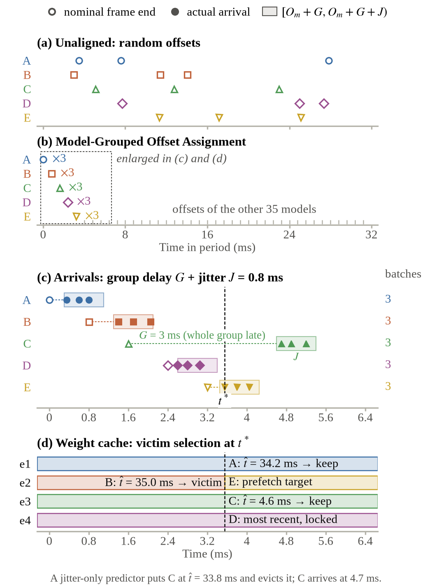

# 04. 메모리

## 1. 요약

BRAM은 weight cache entry와 membrane potential이 나눠 쓴다. entry를 늘리면 재적재가 줄지만 on-chip에 둘 수 있는 트랙이 줄어 DDR3의 membrane potential 읽기·쓰기가 는다. 비교 실험 구성은 entry 4개(114 tile)와 on-chip 768트랙(12 bit)이다. 나머지 256트랙의 membrane potential과 weight 40벌은 DDR3에 둔다.

교체는 predicted-next-use(PNU) 규칙을 쓴다. 정책은 Host가 알려 주는 예상 추론 요청 수까지 쓰는 PNU-count로 정했다(2026-10-24). 비교한 모든 조건에서 PNU-timeout보다 전송량이 같거나 적었다(§3.2). entry 수는 목표 Host의 지연을 잰 뒤 정한다(§4).

## 2. BRAM 배분

XC7A200T의 BRAM은 36 Kib RAMB36 365개, 약 1.6 MiB다. RAMB36 하나를 1 tile, RAMB18 하나를 0.5 tile로 센다. 계산식은 [part_hardware.py](../../simulation/engine/part_hardware.py)의 `bram_tiles()`, `Hardware.split_membrane()`이다.

| 대상 | tile | 근거 |
|---|---:|---|
| 링크·request table·준비 buffer | 50 | 링크 예약 20.5 tile은 PCIe XDMA 실측(P3.2)이다. Ethernet MAC은 아직 재지 않았다 |
| predictor | 0.5 | 예측 표 예약량. predictor 합성 결과가 아니다 |
| weight cache entry | 28.5 × entry 수 | P4.1 합성. RAMB36 28개 + RAMB18 1개, params는 LUTRAM |
| on-chip membrane potential | 나머지 | 12 bit, 16트랙 단위. entry 4개의 768트랙은 P4.2 합성에서 187 tile |

| entry | entry tile | membrane potential tile | on-chip 트랙 | DDR3 트랙 |
|---:|---:|---:|---:|---:|
| 2 | 57 | 257.5 | 992 | 32 |
| 3 | 85.5 | 229 | 880 | 144 |
| **4** | **114** | **200.5** | **768** | **256** |
| 5 | 142.5 | 172 | 656 | 368 |
| 6 | 171 | 143.5 | 544 | 480 |
| 8 | 228 | 86.5 | 320 | 704 |
| 10 | 285 | 29.5 | 96 | 928 |

simulation 예산이다. Ethernet MAC과 predictor를 넣어 전체를 합성한 뒤 다시 확인한다.

## 3. weight cache

| 항목 | 값 |
|---|---|
| entry 구성 | word RAM(64 B word 2,034개) + params(뉴런 706개 × `{β, vth}`) |
| word 주소 | layer 1 0~239, layer 2 240~1,775, layer 3 1,776~2,031, layer 4 2,032~2,033 |
| 적재 단위 | 모델 전체(131,648 B)를 DMA 한 번으로. layer나 slice로 나눠 적재하지 않는다 |
| 적재 시간 | 0.244 µs + 131,648 B ÷ 3.015 GB/s = 43.91 µs |
| 쓰기 | `dma`가 32 B beat 2개를 word 하나로 쓴다. word 주소 = beat 번호 ÷ 2 |
| 읽기 | `compute_array`가 cycle마다 word 2개까지(port 2개) |
| 보호 | 연산 중인 entry와 적재 대상은 교체하지 않는다 |

다음 batch의 모델이 entry에 없으면 지금 batch를 연산하는 동안 그 모델 전체를 빈 entry(또는 victim entry)로 적재한다. 지금 연산할 모델과 바로 다음에 적재할 모델이 있어야 하므로 entry는 최소 2개다.

### 3.1 PNU 교체

nominal offset만으로는 실제 다음 도착을 알 수 없다. 모델 묶음 전체가 늦게 올 수 있기 때문이다. 그래서 현재 queue, 모델 묶음 지연 분포, 추론 요청별 지연 분포, 남은 예상 추론 요청 수로 다음 사용 시각을 예측한다.

```text
el = now − (O_m + kT)            k: 모델 m의 nominal offset이 가장 최근에 지난 주기

t̂_next(m, now) =
  now                                queue[m]에 추론 요청이 있음
  now + δ_G(el)                      첫 추론 요청 전,  r > 0,  el < τ_G
  now + δ_j(now − a1, r)             첫 추론 요청 뒤,  r > 0,  now − a1 < τ_j
  O_m + (k+1)T + E[G] + δ_j(0, n)    그 밖

victim = arg max t̂_next(m, now)     (연산 중 entry와 적재 대상 제외)
```

| 기호 | 뜻 |
|---|---|
| a1 | 이번 주기 첫 추론 요청이 FPGA에 도착한 시각 |
| r | 예상 추론 요청 수 − 실제 도착 수 |
| n | 다음 주기 추론 요청 수 추정값 |
| δ_G(el), τ_G | G > el인 표본에서 구한 G − el의 평균, 분포 추정 구간의 최대 |
| δ_j(x, r), τ_j | Uniform(0, J)이면 (J − x)/(r + 1), τ_j = J |

- 예측이 같으면 queue가 빈 모델, 그다음 오래 안 쓴 모델을 내보낸다. 등록된 활성 트랙이 없는 모델의 다음 사용은 무한대다.
- 첫 도착 시각을 묶음 시작으로 보는 것은 예측 규칙이다. 링크 지연과 첫 추론 요청 자체의 지연까지 넣은 정확한 조건부 기대값은 아니다.
- 묶음 지연 분포는 측정 trace의 앞 절반에서 추정하고 뒤 절반으로 성능을 평가했다.

| 정책 | 예상 추론 요청 수 | 쓰는 정보 |
|---|---|---|
| PNU-count (채택) | 추론 요청 packet에 싣는 이번 주기 예상 추론 요청 수. 첫 추론 요청이 오기 전에는 직전 주기 값이나 처음 등록한 트랙 수를 쓴다. FPGA는 도착한 추론 요청만 센다 | 위 식 전부 |
| PNU-timeout (비교) | 받지 않는다. timeout 안에서는 추론 요청이 남았다고 보고 r = n = 1 | 위 식 |

두 정책 모두 실제 미래 추론 요청 시각을 쓰지 않는다. 예상 추론 요청 수는 추론 요청의 `n_expect` 필드로 받는다([06_HOST_INTERFACE.md](06_HOST_INTERFACE.md) §4.1). 하드웨어에는 모델별 첫 도착 시각(40 × 32 bit), 지연 예측 표, 계수기가 더 든다. 예측 표의 근사 오차와 predictor의 LUT·FF·BRAM은 확인하지 않았다.



예: A와 B는 이번 주기 추론 요청을 모두 처리했고 C의 첫 추론 요청은 아직 오지 않았다. 예측이 A 34.2 ms, B 35.0 ms, C 4.6 ms라면 B를 내보낸다. C의 nominal offset이 지났어도 묶음 지연 때문에 곧 추론 요청이 올 것으로 보기 때문이다. 이 값은 규칙을 설명하는 예이고 실제 미래 도착을 읽어 정한 값이 아니다.

### 3.2 교체 정책 비교

Model-Grouped Offset Assignment, Grouping, entry 4, Xeon CPU 고정·부하 없음의 묶음 지연 재생 조건이다. 칸은 DDR3 KiB/추론 / 모델·주기당 재적재 횟수다.

| 정책 | J = 0 | J = 0.8 ms | J = 1.6 ms | J = 3.2 ms |
|---|---|---|---|---|
| LRU | 6.70 / 0.000 | 6.70 / 0.000 | 6.71 / 0.002 | 16.01 / 1.506 |
| offset-only | 6.58 / 0.000 | 6.63 / 0.004 | 13.08 / 1.037 | 40.11 / 5.405 |
| PNU-timeout | 6.37 / 0.000 | 6.40 / 0.000 | 6.63 / 0.003 | 16.79 / 1.632 |
| PNU-count | 6.37 / 0.000 | 6.38 / 0.000 | 6.56 / 0.000 | 12.37 / 0.917 |
| PNU-count, 묶음 지연 무시 | 6.58 / 0.000 | 6.52 / 0.004 | 10.36 / 0.607 | 22.67 / 2.583 |
| Oracle MIN | 6.37 / 0.000 | 6.38 / 0.000 | 6.56 / 0.000 | 11.04 / 0.703 |
| 고정 batch 순서의 Belady 하한 | 6.36 | 6.38 | 6.56 | 10.94 |

Belady 하한은 PNU-count가 만든 batch 순서의 하한이고 재적재 수는 적지 않는다.

- J = 0.8 ms에서 PNU-count와 PNU-timeout의 차이는 약 0.3 %다.
- 묶음 지연을 무시한 예측식은 J = 1.6 ms에서 PNU-count보다 58 %, J = 3.2 ms에서 83 % 많이 전송한다. nominal offset이 지났다는 이유로 이번 주기가 끝났다고 보면 아직 도착하지 않은 모델을 먼저 내보낸다.
- J = 1.6 ms에서 PNU-count는 Oracle MIN과 같고 재적재가 0이다. J = 3.2 ms에서는 Oracle MIN보다 약 12 %, Belady 하한보다 약 13 % 많다.
- 다음 사용 예측의 평균 절대 오차는 묶음 지연을 무시하면 8,292 µs, 반영하면 395 µs다. Oracle MIN과 다른 victim을 고른 비율은 0.637에서 0.226으로 준다.
- Oracle MIN의 결과도 전체 시스템의 최적은 아니다. cache 결정에 따라 batch 구성이 바뀌기 때문이다.

## 4. entry 수 정하기

entry 수는 jitter를 offset 간격으로 나눠 정하지 않는다. 필요한 entry는 추론 요청별 퍼짐뿐 아니라 모델 묶음끼리의 겹침과 batch 처리 시간에 따라 달라진다. 그래서 전송량과 deadline 여유를 함께 비교해 고른다.

규칙(실험 전에 정함): 그 J에서 deadline miss가 없고 최소 deadline 여유가 양수이며 DDR3 전송량이 시험한 entry(2, 3, 4, 5, 6, 8, 10) 중 최솟값의 110 % 이내인 가장 작은 entry.

| J | entry 2 | 3 | 4 | 5 | 6 | 8 | 10 | 고른 entry |
|---:|---:|---:|---:|---:|---:|---:|---:|---:|
| 0 | 6.24 | 6.31 | 6.37 | 6.43 | 6.49 | 6.62 | 6.75 | 2 |
| 0.8 ms | 6.28 | 6.32 | 6.38 | 6.44 | 6.50 | 6.63 | 6.75 | 2 |
| 1.6 ms | 16.47 | 6.79 | 6.56 | 6.60 | 6.65 | 6.75 | 6.86 | 3 |
| 3.2 ms | 50.91 | 26.61 | 12.37 | 8.23 | 7.13 | 7.08 | 7.15 | 6 |

DDR3 KiB/추론, PNU-count, Xeon CPU 고정·부하 없음의 묶음 지연 재생 조건이다.

- J = 3.2 ms에서는 Oracle MIN도 entry 6을 고른다. 미래 도착을 알아도 모자란 entry를 다 메우지는 못한다.
- J가 작으면 entry를 늘릴수록 DDR3에 둔 트랙의 membrane potential 읽기·쓰기가 늘어 전송량이 조금씩 는다.
- entry 2에서는 연산 중인 entry를 빼면 후보가 하나뿐이라 정책 사이 차이가 없다.
- 고른 entry 6에서는 PNU-timeout과 비교하지 않았다. 교체 정책은 entry 4의 비교(§3.2)로 정했다.

정하는 순서:

1. 목표 Host(라즈베리파이 5 8 GB)에서 1,024트랙 특징 추출 처리량, 모델 묶음 지연 분포, 같은 모델 추론 요청의 도착 퍼짐을 잰다([06_HOST_INTERFACE.md](06_HOST_INTERFACE.md) §9).
2. 그 측정값으로 방법 비교, 교체 정책 비교, entry 수 실험, deadline 분석을 다시 돌린다.
3. 위 규칙으로 entry 수를 정한다.
4. §2 표에서 남는 BRAM에 membrane potential을 둔다.

## 5. membrane storage

| 항목 | 값 |
|---|---|
| 계산 | 16 bit 포화 연산(`sat16`) |
| 저장 | 12 bit, ±2,048로 포화. 다음 추론으로 넘길 때만 줄인다 |
| 트랙당 크기 | 706뉴런 × 12 bit = 1,059 B (16 bit면 1,412 B). DDR3 전송은 32 B beat 34개 = 1,088 B |
| on-chip 트랙 | `track_id < N_ONCHIP`인 트랙. `N_ONCHIP`은 남는 BRAM에 들어가는 만큼이고 합성 parameter다. entry 4면 768트랙 |
| DDR3 트랙 | 나머지. 추론마다 1,088 B 읽기와 쓰기(1.24 µs). read와 write를 모두 센다 |
| 초기화 | 추론 요청에 `RESET_STATE`가 있으면 읽지 않고 0에서 시작. 쓰기는 항상 한다 |

`dma` 우선순위는 membrane potential 읽기, membrane potential 쓰기, weight 적재 순서다. simulation은 DMA 하나를 순서대로 쓴다고 본다.

배치(P4.2 RTL):

```text
membrane bank   row 하나 = 뉴런 16개 × 12 bit = 192 bit, 주소 = track_id × 45 + row
                깊이 2,048짜리 sub memory로 나눈다(sub 하나 = 2K × 18 BRAM 11개)
DDR3            뉴런 n의 12 bit = 트랙 영역 bit [12n+11 : 12n]  (little-endian으로 이어 붙임)
                row 4개 = 768 bit = 32 B beat 3개, 트랙 하나 = beat 34개 = 1,088 B (앞 1,059 B가 유효)
DDR3 트랙 buffer 2개. 하나로 연산하는 동안 다른 하나로 앞 트랙을 되쓰고 다음 트랙을 읽는다
```

- Host는 on-chip에 둘 트랙에 작은 `track_id`를 준다.
- 깊이를 2,048로 나누지 않으면 Vivado가 BRAM을 두 배 가까이 쓴다([P4.2 보고서](<../reports/P4.2 Research Report.md>) §3.3).
- DDR3 트랙의 결과는 쓰기 응답 뒤에 보내고 그 뒤 request table 칸을 비운다. 그래서 같은 트랙의 DDR3 읽기가 앞 쓰기를 앞지르지 않는다.
- simulation은 DDR3 트랙의 membrane potential을 1,059 B로 셌다. RTL 전송 1,088 B와의 차이는 DDR3 전송량의 약 0.2 %다.

## 6. DDR3

| 영역 | 시작 (MIG byte 주소) | 크기 | 주소 |
|---|---|---:|---|
| 모델 slot | `MODEL_BASE` = `0x0000_0000` | 40 × 256 KiB = 10 MiB | `MODEL_BASE + model_id × 0x4_0000` |
| membrane potential | `STATE_BASE` = `0x0200_0000` | 1,024 × 2 KiB = 2 MiB | `STATE_BASE + track_id × 0x800` |
| 여유 | `0x1000_0000` | 768 MiB | 시험 data |

slot 형식은 [02_MODEL.md](02_MODEL.md) §6에 있다. 트랙마다 2 KiB를 잡고 beat 34개(1,088 B)를 전송한다. 앞 1,059 B가 유효하고 배치는 §5에 있다.

| 측정 (P3.1 보드) | 값 |
|---|---|
| 순차 읽기 | 3.015 GB/s |
| read 시간 | 0.244 µs + byte ÷ 3.015 GB/s |
| 쓰기 | 2.768 GB/s |

## 7. 관련 문서

- [P3.25 보고서](<../reports/P3.25 Research Report.md>) §2.6, §4.3: 교체 정책 정의, BRAM 분할
- [P3.26 보고서](<../reports/P3.26 Research Report.md>) §2.2, §3.2, §3.3: 묶음 지연을 넣은 PNU, 정책 비교, entry 수
- [P4.1 보고서](<../reports/P4.1 Research Report.md>): entry 합성
- [P4.2 보고서](<../reports/P4.2 Research Report.md>): membrane storage RTL, DDR3 배치, bank 합성
- [P3.1~P3.4 보고서](<../reports/P3.1~3.4 Research Report.md>): DDR3·BRAM 실측
