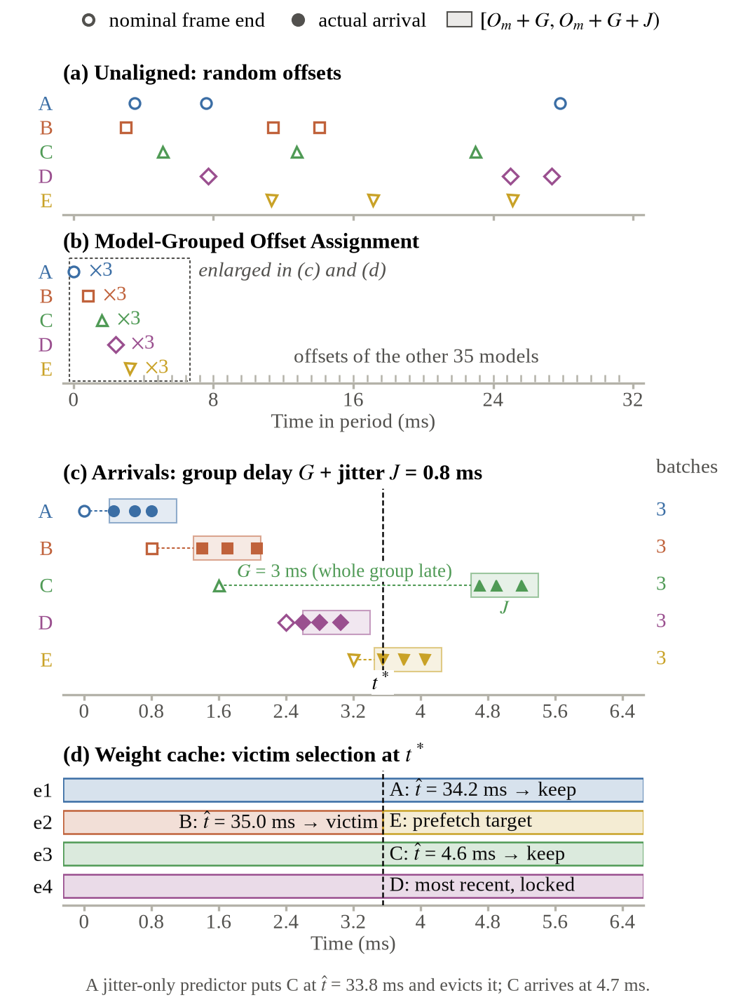

# 04. 메모리

## 1. 요약

BRAM은 weight cache entry와 membrane potential 저장에 나눠 쓴다. Entry를 늘리면 weight 재적재는 줄지만, on-chip에 둘 수 있는 트랙도 줄어든다. 그만큼 DDR3에서 membrane potential을 읽고 쓰는 양이 늘어난다. 비교 실험에는 entry 4개(114 tile)와 on-chip 768트랙(12 bit) 구성을 썼다. 나머지 256트랙의 membrane potential과 weight 40벌은 DDR3에 둔다.

Weight cache는 다음 사용 시각을 예측하는 Predicted-Next-Use (PNU) Weight Cache다. 교체 정책은 Host가 알려 주는 예상 추론 요청 수까지 쓰는 PNU-Count로 정했다. 비교한 모든 조건에서 PNU-Count의 DDR3 traffic은 PNU-Timeout과 같거나 적었다(§3.2). 최종 entry 수는 목표 Host의 지연을 측정한 뒤 정한다(§4).

## 2. BRAM 배분

XC7A200T의 BRAM은 36 Kib RAMB36 365개, 약 1.6 MiB다. RAMB36 하나를 1 tile, RAMB18 하나를 0.5 tile로 센다. 계산식은 [part_hardware.py](../../simulation/engine/part_hardware.py)의 `bram_tiles()`, `Hardware.split_membrane()`이다.

| 대상 | tile | 근거 |
|---|---:|---|
| 링크·request table·준비 buffer | 50 | Simulation 예산. 링크 예약 20.5 tile은 PCIe XDMA 실측(P3.2)이다. 배치·배선에서는 15.5 tile(Ethernet 4, frontend 11.5)을 쓴다(P4.10) |
| predictor | 0.5 | Simulation 예약량. 합성은 1 tile(RAMB18 2개, P4.3) |
| weight cache entry | 28.5 × entry 수 | P4.1 합성. RAMB36 28개 + RAMB18 1개, params는 LUTRAM |
| on-chip membrane potential | 나머지 | 12 bit, 16트랙 단위로 배정. Entry 4개 구성의 768트랙은 P4.2 합성에서 187 tile |

| entry 수 | entry (tile) | membrane potential 예산 (tile) | on-chip 트랙 수 | DDR3 트랙 수 |
|---:|---:|---:|---:|---:|
| 2 | 57 | 257.5 | 992 | 32 |
| 3 | 85.5 | 229 | 880 | 144 |
| **4** | **114** | **200.5** | **768** | **256** |
| 5 | 142.5 | 172 | 656 | 368 |
| 6 | 171 | 143.5 | 544 | 480 |
| 8 | 228 | 86.5 | 320 | 704 |
| 10 | 285 | 29.5 | 96 | 928 |

위 표는 simulation의 BRAM 예산이다. Membrane potential 예산은 남는 BRAM 전체이며, 실제 사용 tile과 구분한다. Entry 4개 구성의 전체 배치·배선(P4.10)은 317.5 tile을 쓴다(entry와 predictor 115, membrane bank 187, Ethernet·frontend 15.5). 남은 47.5 tile을 on-chip 트랙에 더 줄지는 entry 수와 함께 정한다(§4).

## 3. Weight cache

| 항목 | 값 |
|---|---|
| entry 구성 | word RAM(64 B word 2,034개) + params(뉴런 706개 × `{β, vth}`) |
| word 주소 | layer 1 0–239, layer 2 240–1,775, layer 3 1,776–2,031, layer 4 2,032–2,033 |
| 적재 단위 | 모델 전체(131,648 B)를 DMA 한 번으로 적재. Layer나 slice로 나누지 않는다 |
| 적재 시간 | 0.244 µs + 131,648 B ÷ 3.015 GB/s = 43.91 µs |
| 쓰기 | slot beat 0–45는 params다. 그 뒤로는 `dma`가 32 B beat 2개를 word 하나로 쓴다. word 주소 = (beat 번호 − 46) ÷ 2 |
| 읽기 | `compute_array`가 port 2개로 cycle마다 word를 최대 2개 읽음 |
| 보호 | 연산 중인 entry와 적재 대상은 교체하지 않는다 |

다음 batch의 모델이 entry에 없으면, 현재 batch를 연산하는 동안 그 모델 전체를 빈 entry나 victim entry로 적재한다. 현재 연산 중인 모델과 다음에 연산할 모델을 함께 저장해야 하므로 entry는 최소 2개가 필요하다.

### 3.1 PNU 교체

Nominal offset만으로는 다음 추론 요청의 실제 도착 시각을 알 수 없다. 모델 그룹 전체가 늦게 도착할 수 있기 때문이다. PNU Cache는 현재 queue, 모델 그룹 지연 분포, 추론 요청별 지연 분포, 남은 예상 추론 요청 수로 다음 사용 시각을 예측한다.

```text
el = now − (O_m + kT)            k: 모델 m의 nominal offset이 가장 최근에 지난 주기

t̂_next(m, now) =
  now                                queue[m]에 추론 요청이 있음
  now + δ_G(el)                      첫 추론 요청 전,  r > 0,  el < τ_G
  now + δ_j(now − a1, r)             첫 추론 요청 뒤,  r > 0,  now − a1 < τ_j
  O_m + (k+1)T + E[G] + δ_j(0, n)    그 밖

victim = arg max t̂_next(m, now)     (연산 중 entry와 적재 대상 제외)
```

| 기호 | 뜻 |
|---|---|
| a1 | 이번 주기 첫 추론 요청이 FPGA에 도착한 시각 |
| r | 예상 추론 요청 수 − 실제 도착 수 |
| n | 다음 주기 추론 요청 수 추정값 |
| δ_G(el), τ_G | G > el인 표본에서 구한 G − el의 평균, 분포 추정 구간의 최대 |
| δ_j(x, r), τ_j | Uniform(0, J)이면 (J − x)/(r + 1), τ_j = J |

- 예측 시각이 같으면 queue가 빈 모델을 먼저 내보낸다. 그래도 같으면 가장 오래 쓰지 않은 모델을 내보낸다. 등록된 활성 트랙이 없는 모델의 다음 사용 시각은 무한대로 둔다.
- 첫 도착 시각을 모델 그룹 시작으로 보는 것은 예측 규칙이다. 링크 지연과 첫 추론 요청 자체의 지연까지 넣은 정확한 조건부 기대값은 아니다.
- 모델 그룹 지연 분포는 측정 trace의 앞 절반에서 추정하고 뒤 절반으로 성능을 평가했다.

| 정책 | 예상 추론 요청 수 | 쓰는 정보 |
|---|---|---|
| PNU-Count (채택) | 추론 요청 packet에 싣는 이번 주기 예상 추론 요청 수. 첫 추론 요청이 오기 전에는 직전 주기 값이나 처음 등록한 트랙 수를 쓴다. FPGA는 도착한 추론 요청만 센다 | 위 식 전부 |
| PNU-Timeout (비교) | 받지 않는다. Timeout 안에서는 추론 요청이 남았다고 보고 r = n = 1로 둔다 | 위 식 |

두 정책 모두 실제 미래 추론 요청의 시각을 쓰지 않는다. PNU-Count는 추론 요청의 `n_expect` 필드로 예상 추론 요청 수를 받는다([06_HOST_INTERFACE.md](06_HOST_INTERFACE.md) §4.1). Hardware에는 모델별 첫 도착 시각(40 × 32 bit)을 저장할 공간, 지연 예측 표, 계수기가 추가로 필요하다. RTL(P4.3)은 시각을 정수 µs로 내림하고 δ를 256 µs 간격 표에서 읽는다. 이 근사로 DDR3 traffic은 J ≤ 1.6 ms에서 정확한 식과 같고 J = 3.2 ms에서 0.67% 늘었다. Predictor는 LUT 812, FF 481, BRAM 1 tile을 쓴다.



예를 들어 A와 B는 이번 주기의 추론 요청을 모두 처리했고, C의 첫 추론 요청은 아직 오지 않았다고 하자. 다음 사용 예측 시각이 A 34.2 ms, B 35.0 ms, C 4.6 ms라면 가장 늦게 쓸 B를 내보낸다. C는 nominal offset이 지났어도 모델 그룹 지연 때문에 곧 추론 요청이 도착할 것으로 예측한다. 이 값은 규칙을 설명하기 위한 예시이며, 실제 미래 도착 시각을 읽어 정한 값이 아니다.

### 3.2 교체 정책 비교

Model-Grouped Offset Assignment, Grouping, entry 4개 조건에서 비교했다. 모델 그룹 지연에는 Xeon의 CPU 고정·부하 없음 조건에서 측정한 값을 넣었다. 각 칸은 `DDR3 traffic (KiB/추론) / 모델·주기당 재적재 횟수`다.

| 정책 | J = 0 | J = 0.8 ms | J = 1.6 ms | J = 3.2 ms |
|---|---|---|---|---|
| LRU | 6.70 / 0.000 | 6.70 / 0.000 | 6.71 / 0.002 | 16.01 / 1.506 |
| offset-only | 6.58 / 0.000 | 6.63 / 0.004 | 13.08 / 1.037 | 40.11 / 5.405 |
| PNU-Timeout | 6.37 / 0.000 | 6.40 / 0.000 | 6.63 / 0.003 | 16.79 / 1.632 |
| PNU-Count | 6.37 / 0.000 | 6.38 / 0.000 | 6.56 / 0.000 | 12.37 / 0.917 |
| PNU-Count, 모델 그룹 지연 무시 | 6.58 / 0.000 | 6.52 / 0.004 | 10.36 / 0.607 | 22.67 / 2.583 |
| Oracle Belady MIN (이하 Oracle MIN) | 6.37 / 0.000 | 6.38 / 0.000 | 6.56 / 0.000 | 11.04 / 0.703 |
| 고정 batch 순서의 Belady 하한 | 6.36 | 6.38 | 6.56 | 10.94 |

Belady 하한은 PNU-Count가 만든 batch 순서에 대한 값이다. 해당 행에는 DDR3 traffic만 적었다.

- J = 0.8 ms에서 PNU-Count와 PNU-Timeout의 DDR3 traffic 차이는 약 0.3%다.
- 모델 그룹 지연을 무시한 예측식은 J = 1.6 ms에서 PNU-Count보다 58%, J = 3.2 ms에서 83% 많이 전송한다. nominal offset이 지났다는 이유로 이번 주기가 끝났다고 보면 아직 도착하지 않은 모델을 먼저 내보낸다.
- J = 1.6 ms에서 PNU-Count의 DDR3 traffic은 Oracle MIN과 같고 재적재는 0이다. J = 3.2 ms에서는 Oracle MIN보다 약 12%, Belady 하한보다 약 13% 많다.
- 다음 사용 예측의 평균 절대 오차는 모델 그룹 지연을 무시하면 8,292 µs, 반영하면 395 µs다. Oracle MIN과 다른 victim을 고른 비율은 0.637에서 0.226으로 준다.
- Oracle MIN의 결과도 전체 시스템의 최적은 아니다. Cache 결정에 따라 batch 구성이 바뀌기 때문이다.

## 4. Entry 수 정하기

Entry 수는 jitter를 offset 간격으로 나눈 값만으로 정할 수 없다. 필요한 entry 수는 추론 요청별 도착 퍼짐, 모델 그룹 사이의 겹침, batch 처리 시간에 따라 달라진다. 따라서 DDR3 traffic과 deadline 여유를 함께 비교해 정한다.

실험 전에 정한 선택 규칙은 다음과 같다. 각 J에서 아래 조건을 모두 만족하는 가장 작은 entry 수를 고른다.

- Deadline miss가 없다.
- 최소 deadline 여유가 양수다.
- DDR3 traffic이 시험한 entry 수(2, 3, 4, 5, 6, 8, 10) 중 최솟값의 110% 이내다.

| J | entry 2 | 3 | 4 | 5 | 6 | 8 | 10 | 고른 entry |
|---:|---:|---:|---:|---:|---:|---:|---:|---:|
| 0 | 6.24 | 6.31 | 6.37 | 6.43 | 6.49 | 6.62 | 6.75 | 2 |
| 0.8 ms | 6.28 | 6.32 | 6.38 | 6.44 | 6.50 | 6.63 | 6.75 | 2 |
| 1.6 ms | 16.47 | 6.79 | 6.56 | 6.60 | 6.65 | 6.75 | 6.86 | 3 |
| 3.2 ms | 50.91 | 26.61 | 12.37 | 8.23 | 7.13 | 7.08 | 7.15 | 6 |

표의 값은 DDR3 traffic(KiB/추론)이다. 교체 정책은 PNU-Count이며, 모델 그룹 지연에는 Xeon의 CPU 고정·부하 없음 조건에서 측정한 값을 넣었다.

- J = 3.2 ms에서는 Oracle MIN에도 같은 선택 규칙을 적용하면 entry 6개를 고른다. 미래 도착 시각을 알아도 부족한 저장 공간을 모두 보완할 수는 없다.
- J가 작으면 entry를 늘릴수록 DDR3에 둔 트랙의 membrane potential 읽기·쓰기가 늘어 DDR3 traffic이 조금씩 는다.
- Entry 2개에서는 연산 중인 entry를 제외하면 victim 후보가 하나뿐이므로 정책 사이에 차이가 없다.
- 선택된 entry 6개 구성에서는 PNU-Timeout과 비교하지 않았다. 교체 정책은 entry 4개 구성의 비교(§3.2)로 정했다.

최종 entry 수와 on-chip 트랙 수는 다음 순서로 정한다.

1. 목표 Host(라즈베리파이 5 8 GiB)에서 1,024트랙 특징 추출 처리량, 모델 그룹 지연 분포, 같은 모델 추론 요청의 도착 퍼짐을 잰다([06_HOST_INTERFACE.md](06_HOST_INTERFACE.md) §9).
2. 그 측정값으로 방법 비교, 교체 정책 비교, entry 수 실험, deadline 분석을 다시 돌린다.
3. 위 규칙으로 entry 수를 정한다.
4. §2 표에서 남는 BRAM에 membrane potential을 둔다.

## 5. Membrane Storage

| 항목 | 값 |
|---|---|
| 계산 | 16 bit 포화 연산(`sat16`) |
| 저장 | 12 bit 범위로 포화([02_MODEL.md](02_MODEL.md) §4). 다음 추론으로 넘길 state를 저장할 때만 줄인다 |
| 트랙당 크기 | 706뉴런 × 12 bit = 1,059 B (16 bit면 1,412 B). DDR3 전송은 32 B beat 34개 = 1,088 B |
| on-chip 트랙 | `track_id < N_ON_CHIP`인 트랙. `N_ON_CHIP`은 남는 BRAM에 들어가는 만큼이고 합성 parameter다. Entry 4면 768트랙 |
| DDR3 트랙 | on-chip에 두지 않은 트랙. 추론마다 1,088 B를 읽고 같은 양을 쓴다(총 1.24 µs). Read와 write를 모두 센다 |
| 초기화 | 추론 요청에 `RESET_STATE`가 있으면 읽지 않고 0에서 시작. 쓰기는 항상 한다 |

`dma`의 우선순위는 membrane potential 읽기 → membrane potential 쓰기 → weight 적재 순서다. RTL은 membrane potential 쓰기가 기다리거나 진행 중이면 weight burst를 새로 내지 않는다. Simulation에서는 DMA 하나가 전송을 순서대로 처리한다고 가정한다.

P4.2 RTL의 메모리 배치는 다음과 같다.

```text
membrane bank   row 하나 = 뉴런 16개 × 12 bit = 192 bit, 주소 = track_id × 45 + row
                깊이 2,048짜리 sub memory로 나눈다(sub 하나 = 2K × 18 BRAM 11개)
DDR3            뉴런 n의 12 bit = 트랙 영역 bit [12n+11 : 12n]  (little-endian으로 이어 붙임)
                row 4개 = 768 bit = 32 B beat 3개, 트랙 하나 = beat 34개 = 1,088 B (앞 1,059 B가 유효)
DDR3 트랙 buffer 2개. 하나로 연산하는 동안 다른 하나로 앞 트랙을 되쓰고 다음 트랙을 읽는다
```

- Host는 on-chip에 둘 트랙에 작은 `track_id`를 준다.
- 깊이를 2,048로 나누지 않으면 Vivado가 BRAM을 두 배 가까이 쓴다([P4.2 보고서](<../reports/P4.2 Research Report.md>) §3.3).
- DDR3 트랙의 결과는 쓰기 응답을 받은 뒤 보내고, 그다음 request table의 해당 칸을 비운다. 따라서 같은 트랙의 다음 DDR3 읽기는 이전 쓰기가 끝난 뒤에 일어난다.

## 6. DDR3

| 영역 | 시작 (MIG byte 주소) | 크기 | 주소 |
|---|---|---:|---|
| 모델 slot | `MODEL_BASE` = `0x0000_0000` | 40 × 256 KiB = 10 MiB | `MODEL_BASE + model_id × 0x4_0000` |
| membrane potential | `STATE_BASE` = `0x0200_0000` | 1,024 × 2 KiB = 2 MiB | `STATE_BASE + track_id × 0x800` |
| 여유 | `0x1000_0000` | 768 MiB | 시험 데이터 |

Slot 형식은 [02_MODEL.md](02_MODEL.md) §6에 있다. Membrane potential은 트랙마다 2 KiB를 예약하고 beat 34개(1,088 B)를 전송한다. 앞의 1,059 B가 유효 데이터이며, 배치는 §5에 있다.

DDR3 측정값과 전송 시간 식은 [01_OVERVIEW.md](01_OVERVIEW.md) §2, §5.2에 있다.

## 7. 관련 문서

- [P3.25 보고서](<../reports/P3.25 Research Report.md>) §2.6, §4.3: 교체 정책 정의, BRAM 분할
- [P3.26 보고서](<../reports/P3.26 Research Report.md>) §2.2, §3.2, §3.3: 모델 그룹 지연을 넣은 PNU, 정책 비교, entry 수
- [P4.1 보고서](<../reports/P4.1 Research Report.md>): entry 합성
- [P4.2 보고서](<../reports/P4.2 Research Report.md>): Membrane Storage RTL, DDR3 배치, bank 합성
- [P4.3 보고서](<../reports/P4.3 Research Report.md>): weight cache·predictor RTL, 예측 표 근사
- [P4.10 보고서](<../reports/P4.10 Research Report.md>): 전체 BRAM 배치·배선
- [P3.1~P3.4 보고서](<../reports/P3.1~3.4 Research Report.md>): DDR3·BRAM 실측
