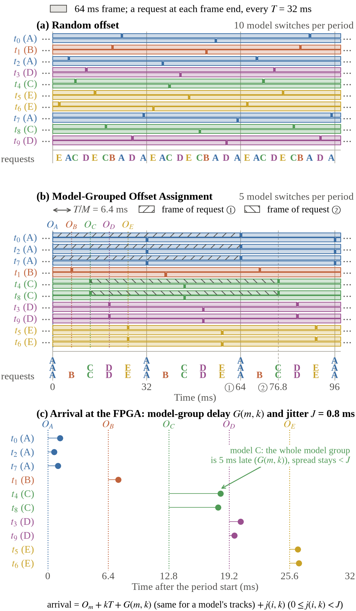

# 05. Model-Grouped Offset Assignment와 Grouping

## 1. 요약

기존 multi-DNN scheduler와 inference serving 시스템은 이미 도착한 추론 요청의 실행 순서나 batch를 조정한다. 추론 요청을 바로 처리하면 같은 모델의 다음 추론 요청이 오기 전에 weight가 cache에서 교체될 수 있다. 그러면 weight를 다시 읽어야 한다. 같은 모델의 추가 추론 요청을 기다려 batch를 키우면 weight 재사용은 늘지만, 대기 시간이 response time에 더해진다.

이 설계에서는 Host가 같은 모델을 쓰는 트랙에 같은 offset을 주어 nominal frame 끝 시각을 맞춘다. 같은 모델의 추론 요청이 비슷한 시각에 도착하면 FPGA는 추가 추론 요청을 기다리지 않고도 한 번 읽은 weight로 여러 추론 요청을 처리할 수 있다(Grouping). 도착 시각이 퍼질 때는 Predicted-Next-Use (PNU) Weight Cache가 곧 사용할 weight를 남긴다([04_MEMORY.md](04_MEMORY.md) §3.1).

Hard deadline 보장은 주장하지 않는다. 측정 최댓값을 넣은 조건부 response time과 simulation의 관측 최대를 보고한다(§6).

## 2. Model-Grouped Offset Assignment

Mic가 연속으로 수음한 소리의 frame 경계는 Host가 정한다. Offset은 frame을 기준 트랙보다 얼마나 뒤에서 자를지를 나타낸다.

```text
O_m             = m × T/M = m × 0.8 ms        (T = 32 ms, M = 40, m = 0–39)
frame_end(i, k) = O_m(i) + k × T
```

m = 0이 기준 모델이다. i는 트랙 번호, m(i)는 트랙 i가 쓰는 모델 번호, k는 frame 번호다.

| 항목 | 내용 |
|---|---|
| Host가 할 일 | 트랙마다 64 ms frame을 만들고, 모델의 offset을 기준으로 frame 끝 시각을 32 ms 간격으로 정한다. 같은 모델의 트랙은 같은 offset을 받는다 |
| offset 간격 | 인접 모델 사이 0.8 ms. 기준 모델과 offset이 가장 큰 모델의 nominal frame 끝 시각은 최대 31.2 ms 차이 난다 |
| 실제 도착 | Host 처리 지연과 링크 지연만큼 늦다. 모델 그룹끼리 겹칠 수 있다 |
| 바뀌지 않는 것 | 계산량, frame 길이, deadline(frame 마지막 샘플의 Host 도착 + 32 ms) |
| 가정 | frame 경계와 Host clock이 맞는다. 오디오 장치마다 다른 sample clock drift는 따로 검증한다 |



그림은 모델 5개와 트랙 10개를 사용한 예시다. 모델 사이의 offset 간격은 6.4 ms다.

- (a) 트랙마다 offset이 다르면 같은 모델의 추론 요청도 서로 다른 시각에 생성된다.
- (b) 같은 모델에 같은 offset을 주면 nominal frame 끝 시각이 같아진다. 모델 A의 세 트랙은 64 ms(offset 0 ms)에, 모델 C의 두 트랙은 76.8 ms(offset 12.8 ms)에 frame이 끝난다.
- (c) 모델 그룹 전체가 늦어지는 모델 그룹 지연 G와 모델 그룹 안에서 완료 시각이 퍼지는 폭 J는 다르다. 도착 시각의 차이가 작으면 같은 모델의 추론 요청을 batch 하나로 묶을 수 있다. Batch가 시작된 뒤 도착한 추론 요청은 다음 batch에서 처리한다.

## 3. Grouping

Grouping은 다음 규칙으로 batch의 모델과 구성원을 고른다.

| 결정 | 규칙 |
|---|---|
| 모델 | queue에서 가장 오래 기다린 추론 요청의 모델 |
| 구성원 | 그때 queue에 있는 그 모델의 추론 요청 전부. Queue에서 이어져 있을 필요는 없다 |
| 기다림 | 없다. Batch를 키우려고 기다리지 않는다 |
| 선점 | 없다. Batch 연산이 시작된 뒤 도착한 같은 모델 추론 요청은 다음 batch에서 처리한다 |
| 적재 | 연산하는 동안 다음 batch의 모델 전체를 빈 entry로 prefetch한다. Layer나 slice로 나누지 않는다 |

Grouping은 batch를 키우기 위한 대기 시간이나 deadline 점수를 계산하지 않아 제어가 단순하다. 다만 controller 자원이 얼마나 줄어드는지는 아직 RTL로 확인하지 않았다. 모델 선택, 적재, 구성원 확정 시점은 [03_ARCHITECTURE.md](03_ARCHITECTURE.md) §3에 있다.

같은 모델을 쓰는 트랙도 membrane potential, 입력 순서, 판정 상태는 따로 둔다. Batch는 weight만 함께 쓴다.

## 4. Offset Assignment와 scheduler

모델 그룹 지연에는 Xeon의 CPU 고정·부하 없음 조건에서 측정한 값을 넣었다. Entry 4개, 시나리오 6개 × seed 30개 조건이다. 각 결과 칸은 `DDR3 traffic (KiB/추론) / response time의 관측 최대 (ms)`다.

| 도착 조건 | scheduler | cache | J = 0.8 ms | J = 3.2 ms |
|---|---|---|---|---|
| Model-Grouped Offset Assignment | Grouping | PNU-Count | 6.38 / 9.58 | 12.37 / 11.53 |
| Model-Grouped Offset Assignment | Dysta Method | PNU-Count | 6.38 / 9.58 | 11.99 / 11.48 |
| Model-Grouped Offset Assignment | DeepRT Method | PNU-Count | 6.41 / 21.91 | 7.31 / 26.10 |
| unaligned | Dysta Method | LRU | 56.62 / 10.58 | 58.74 / 12.11 |
| unaligned | DeepRT Method | LRU | 11.35 / 23.80 | 11.63 / 26.02 |

- 같은 Offset Assignment와 PNU-Count를 쓰면, J = 0.8 ms에서 Grouping과 Dysta Method의 두 지표가 같다. 이 조건에서는 제어가 가장 단순한 Grouping을 선택한다.
- J = 3.2 ms에서는 scheduler마다 DDR3 traffic이 다르다. DeepRT Method의 DDR3 traffic은 더 적지만, response time의 관측 최대는 26.10 ms로 Grouping의 11.53 ms보다 길다. Offset Assignment의 효과가 scheduler와 무관하다고 일반화하지 않는다.
- 모든 트랙에 같은 nominal offset을 준 global alignment는 J = 0에서 Grouping·Dysta Method·DeepRT Method 모두 6.59–6.66 KiB/추론이다. 이 값에는 모델별 offset을 배정한 Host에서 잰 지연을 그대로 넣었다. 1,024트랙의 계산이 한꺼번에 준비되는 실제 Host의 지연은 반영하지 않았다.
- 제안 기법의 준비 완료 뒤 response time은 J가 커질수록 관측 최대가 짧아졌다(J = 0에서 1.75 ms, J = 3.2 ms에서 0.77 ms). 편중 시나리오에서는 트랙이 많은 모델(약 240트랙)의 추론 요청이 한꺼번에 도착하면 batch 뒤쪽의 추론 요청이 앞쪽 연산을 기다린다. 도착 시각이 퍼지면 batch가 작아져 이 대기는 줄지만, weight 적재는 늘어난다.

비교군을 옮긴 방법과 조정은 [08_EVALUATION.md](08_EVALUATION.md) §3에 있다.

## 5. Host 처리 지연과 도착

```text
t_ready(i, k) = t_host(i, k) + G(m(i), k) + j(i, k),   j(i, k) ~ Uniform(0, J)
```

- G는 모델 그룹 전체에 공통인 모델 그룹 지연이다. Xeon에서 측정한 값을 넣는다. j는 추론 요청·주기마다 새로 뽑는 추론 요청별 지연이다.
- J는 합성 추론 요청별 지연의 상한이다. 모든 추론 요청이 J만큼 늦는다는 뜻이 아니다.
- 모델 그룹 전체가 5 ms 늦어도 모델 그룹 안 퍼짐은 0일 수 있다. 그래서 nominal offset에 J만 더해서는 다음 도착 시각을 알 수 없다. Cache 예측식은 모델 그룹 지연까지 넣는다([04_MEMORY.md](04_MEMORY.md) §3.1).
- 같은 트랙에서 뒤 주기 추론 요청이 먼저 준비되면, 그 준비 시각을 앞 주기의 준비 시각보다 이르지 않게 조정한다.

PNU Cache의 역할은 jitter가 있을 때도 Offset Assignment로 얻은 weight 재사용 기회를 유지하는 것이다.

## 6. Deadline 분석

Hard worst case는 명시한 운용 제약 안에서 가능한 모든 입력과 추론 요청 도착 과정 중 가장 긴 response time이다. 시간 기준은 frame 마지막 샘플의 Host 도착부터 결과 수신까지다. 유한한 상한을 구하려면 Host 처리 지연, 링크 지연, packet 분할, cache 초기 상태, 이전 주기의 잔여 작업을 제한해야 한다. 측정이나 탐색에서 관측한 최댓값만으로 이 상한을 대신할 수는 없다.

### 6.1 조건부 response time

```text
R_single = N·C_dense + M·L_weight + N_DDR·C_state ≈ 14.41 ms      (01_OVERVIEW §5.4)
R_cond   = H + d_in,max + R_single + d_out,max ≈ H + 0.116 + 14.41 + 0.147 ms
H        = G_max + J
```

H와 링크 지연에는 측정 표본의 최댓값을 넣었다. 보장된 상한은 아니다. CPU 고정·부하 없음, J = 0.8 ms에서 R_cond는 24.22 ms다. CPU 고정 두 조건(부하 없음, busy process 8개)과 J = 0·0.8·3.2 ms를 조합하면 19.87–26.62 ms다.

이 계산은 모델·주기마다 단일 적재를 전제로 한다. 추론 요청이 여러 batch로 나뉘면 같은 모델을 다시 적재할 수 있다. 실제 적재 횟수를 N_load라 하면 그 추론 요청 집합의 작업량은 `N·C_dense + N_load·L_weight + N_DDR·C_state`다. 이것도 이전 주기의 잔여 작업을 넣은 개별 response time 상한은 아니다.

### 6.2 Adversarial search

단일 적재 가정이 깨지는 경우를 찾으려고 모든 입력 spike를 발생시키고, 모델 그룹 지연과 추론 요청별 지연의 패턴을 바꿔 송신 뒤 response time(`t_recv − t_send`)을 키웠다. 결과는 탐색에서 관측한 값이며 상한을 증명하지 않는다. 패턴과 탐색 방법은 [P3.26 보고서](<../reports/P3.26 Research Report.md>) §3.4에 있다.

| J (ms) | 송신 방식 | response time 관측 최대 (ms) | 송신 뒤 response time 관측 최대 (ms) | 모델·주기당 최대 적재 횟수 |
|---:|---|---:|---:|---:|
| 0.8 | 즉시 송신 | 16.95 | 8.56 | 4 |
| 3.2 | 즉시 송신 | 17.86 | 8.52 | 15 |
| 0.8 | 모아 보내기, packet 간격 0.1 ms | 17.62 | 8.49 | 1 |
| 0.8 | 모아 보내기, packet 간격 1 ms | 15.07 | 14.20 | 8 |

CPU 고정·부하 없음, entry 4개 조건이다. 시간과 적재 횟수는 조건별 최댓값이라 같은 패턴에서 나온 값이 아닐 수 있다. 모든 조건에서 deadline miss와 drop은 0이다.

- 즉시 송신은 J = 3.2 ms에서 모델·주기당 최대 15–16번 적재한다. Response time이 32 ms보다 짧아도 단일 적재 가정은 성립하지 않는다.
- 모아 보내기에서 약 240트랙의 모델 그룹은 packet 11개로 나뉜다. Packet 간격이 0.1 ms면 적재는 1번이지만, 1 ms면 도착이 최대 10 ms 퍼져 여러 번 적재한다. Packet 간격은 R_cond 식에 없다.
- CPU 고정이 없으면 모델 그룹 지연 최대가 31.07 ms다. 이 값을 매 주기 반복하는 패턴에서는 response time이 43.27 ms까지 늘고 deadline miss와 drop이 생긴다. 측정 trace를 시간 순서대로 넣으면 deadline miss는 없고 response time 관측 최대는 24.19–27.19 ms다. 그래서 계산 thread의 CPU 고정을 Host 설계 가정으로 둔다.

### 6.3 Hard deadline 보장에 필요한 조건

| 조건 | 지금 상태 |
|---|---|
| Host 처리 지연 상한 | 현재는 Xeon의 측정 최댓값뿐이다. 목표 Host에서 thread와 성능 설정을 고정하고 긴 지연이 발생하는 경우를 측정해야 한다 |
| 링크 지연 상한 | PCIe 64 B 표본 최대(입력 0.116 ms, 결과 0.147 ms)뿐이다. Ethernet은 재지 않았다 |
| packet 분할 뒤 적재 | 모아 보내기에서 packet 간격 0.1 ms면 성립, 1 ms면 깨진다. 즉시 송신은 packet 분할 없이도 깨진다 |
| 주기 사이 잔여 작업 | 제한하는 운용 규칙이 없다 |

실행 중 deadline을 따로 확인하는 장치는 두지 않는다. 같은 트랙의 이전 추론 요청이 FPGA 연산을 마치기 전에 새 추론 요청이 오면 새 추론 요청을 버린다(drop). Drop은 결과가 없는 deadline miss로 센다.

## 7. 한계

- Host 처리 지연은 Xeon W-2255에서 Python 계산 thread 하나로 쟀다. 최종 Host(라즈베리파이 5 8 GiB)의 처리량과 지연은 다를 수 있다.
- 측정 Host는 모델당 25–26트랙을 offset 순서로 계산했다. 트랙이 많은 편중 배정 모델, global alignment, unaligned 조건에서는 실제 Host 작업이 다르지만 같은 모델·주기별 지연 G를 넣었다. 따라서 방법 비교는 각 방법의 완성된 Host 시스템을 실측한 결과가 아니다.
- 측정한 추론 요청별 퍼짐은 모델 그룹 완료 시각을 한 번만 기록해서 0이다. j는 합성 값이다.

## 8. 관련 문서

- [P3.26 보고서](<../reports/P3.26 Research Report.md>): 모델 그룹 지연을 넣은 방법 비교, deadline 분석, adversarial search
- [P3.25 보고서](<../reports/P3.25 Research Report.md>): 시간 기준·jitter 정의, 추론 요청별 지연만 둔 합성 조건 결과
- [P3.13 보고서](<../reports/P3.13 Research Report.md>), [P3.13 배경 설명](<../reports/P3.13 Scheduling Primer.md>): Offset Assignment를 처음 정한 실험과 예시
- [P3.11 보고서](<../reports/P3.11 Research Report.md>): 비교군 정책 옮기기와 조절값
