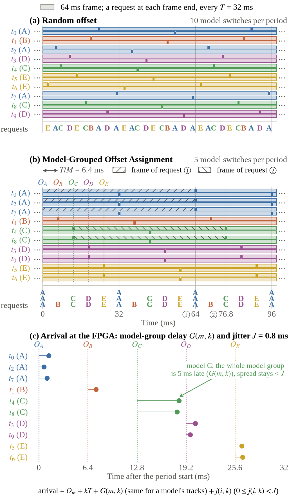

# 05. Model-Grouped Offset Assignment와 Grouping

## 1. 요약

기존 multi-DNN scheduler와 inference serving 시스템은 이미 도착한 추론 요청의 실행 순서나 batch를 조정한다. 추론 요청을 바로 처리하면 같은 모델의 다음 추론 요청이 오기 전에 weight가 cache에서 밀려나 다시 읽어야 한다. 같은 모델 추론 요청을 기다려 batch를 키우면 weight 재사용은 늘지만 기다린 시간이 response time에 더해진다.

이 설계는 Host에서 frame 경계를 정한다. 같은 모델을 쓰는 트랙에 같은 offset을 주면 같은 모델 추론 요청의 nominal frame 끝 시각이 같아진다. 추론 요청이 비슷한 시각에 도착할수록 FPGA는 뒤에 올 추론 요청을 기다리지 않고도 한 번 읽은 weight로 여러 추론 요청을 이어서 처리한다(Grouping). 도착이 퍼지면 Predicted-Next-Use Weight Cache가 곧 쓸 weight를 남긴다([04_MEMORY.md](04_MEMORY.md) §3.1).

Hard deadline 보장은 주장하지 않는다. 측정 최대를 쓴 조건부 계산과 관측 최대만 보고한다(§6).

## 2. Model-Grouped Offset Assignment

Mic는 쉬지 않고 수음하므로 frame 경계를 어디에 둘지는 Host가 정한다. Offset은 소리를 frame 단위로 자를 때 기준 트랙보다 얼마나 뒤에 자를지를 나타낸다.

```text
O_m             = m × T/M = m × 0.8 ms        (T = 32 ms, M = 40, m = 0~39)
frame_end(i, k) = O_m(i) + k × T
```

m = 0이 기준 모델이다. i는 트랙 번호, m(i)는 트랙 i가 쓰는 모델 번호, k는 frame 번호다.

| 항목 | 내용 |
|---|---|
| Host가 할 일 | 트랙마다 64 ms frame을 만들고, 모델의 offset을 기준으로 frame 끝 시각을 32 ms 간격으로 정한다. 같은 모델의 트랙은 같은 offset을 받는다 |
| offset 간격 | 인접 모델 사이 0.8 ms. 기준 모델과 offset이 가장 큰 모델의 nominal frame 끝은 최대 31.2 ms 차이 난다 |
| 실제 도착 | Host 처리 지연과 링크 지연만큼 늦다. 모델 그룹끼리 겹칠 수 있다 |
| 바뀌지 않는 것 | 계산량, frame 길이, deadline(frame 마지막 샘플의 Host 도착 + 32 ms) |
| 가정 | frame 경계와 Host clock이 맞는다. 오디오 장치마다 다른 sample clock drift는 따로 검증한다 |



그림은 모델 5개와 트랙 10개로 그린 예다(모델 간격 6.4 ms). (a) 트랙마다 offset이 다르면 같은 모델 추론 요청이 흩어진다. (b) 같은 모델에 같은 offset을 주면 nominal frame 끝 시각이 모인다. 64 ms(offset 0 ms)의 frame은 모델 A이고 세 트랙의 nominal frame 끝 시각이 같다. 76.8 ms(offset 12.8 ms)의 frame은 모델 C이고 두 트랙이 같다. (c) 모델 그룹 전체가 늦는 모델 그룹 지연 G와 모델 그룹 안의 퍼짐 J는 다르다. 도착 시각의 차이가 작으면 같은 모델 추론 요청이 batch 하나로 묶이고 batch가 시작된 뒤 도착한 추론 요청은 다음 batch에서 처리된다.

## 3. Grouping

Compute array가 다음 batch를 받을 수 있게 되면 아래 규칙으로 고른다.

| 결정 | 규칙 |
|---|---|
| 모델 | queue에서 가장 오래 기다린 추론 요청의 모델 |
| 구성원 | 그때 queue에 있는 그 모델의 추론 요청 전부. Queue에서 이어져 있을 필요는 없다 |
| 기다림 | 없다. Batch를 키우려고 기다리지 않는다 |
| 선점 | 없다. Batch 연산이 시작된 뒤 도착한 같은 모델 추론 요청은 다음 batch에서 처리한다 |
| 적재 | 연산하는 동안 다음 batch의 모델 전체를 빈 entry로 prefetch한다. layer나 slice로 나누지 않는다 |

Grouping은 batch를 키우기 위한 대기 시간이나 deadline 점수 계산이 없어 제어가 단순하다. 줄어든 controller 자원은 아직 RTL로 확인하지 않았다. 판단 시점과 적재의 관계는 [03_ARCHITECTURE.md](03_ARCHITECTURE.md) §3에 있다.

같은 모델을 쓰는 트랙도 membrane potential, 입력 순서, 판정 상태는 따로 둔다. Batch는 weight만 함께 쓴다.

## 4. Offset Assignment와 scheduler

Xeon CPU 고정·부하 없음의 모델 그룹 지연 재생, entry 4, 시나리오 6개 × seed 30개 조건이다.

| 도착 | scheduler | cache | J = 0.8 ms: DDR3 KiB/추론 / 관측 최대 ms | J = 3.2 ms |
|---|---|---|---|---|
| Model-Grouped Offset Assignment | Grouping | PNU-Count | 6.38 / 9.58 | 12.37 / 11.53 |
| Model-Grouped Offset Assignment | Dysta Method | PNU-Count | 6.38 / 9.58 | 11.99 / 11.48 |
| Model-Grouped Offset Assignment | DeepRT Method | PNU-Count | 6.41 / 21.91 | 7.31 / 26.10 |
| unaligned | Dysta Method | LRU | 56.62 / 10.58 | 58.74 / 12.11 |
| unaligned | DeepRT Method | LRU | 11.35 / 23.80 | 11.63 / 26.02 |

- 같은 Offset Assignment와 PNU-Count에서 Grouping과 Dysta Method는 J = 0.8 ms에서 같다. 그래서 제어가 가장 단순한 Grouping을 쓴다.
- J = 3.2 ms에서는 scheduler마다 traffic이 다르다. DeepRT Method는 더 적게 전송하지만 최대 response time이 26.10 ms로 Grouping의 11.53 ms보다 길다. Offset Assignment의 효과가 scheduler와 무관하다고 일반화하지 않는다.
- 모든 트랙에 같은 nominal offset을 준 global alignment는 J = 0에서 Grouping·Dysta Method·DeepRT Method 모두 6.59–6.66 KiB/추론이다. 이 값에는 모델별 offset을 배정한 Host에서 잰 지연을 그대로 넣었다. 1,024트랙의 계산이 한꺼번에 준비되는 실제 Host의 지연은 반영하지 않았다.
- 제안의 준비 완료 뒤 최대는 J가 클수록 짧다(J = 0 1.75 ms, 3.2 ms 0.77 ms). 편중 시나리오에서 큰 모델(약 240트랙)의 추론 요청이 한꺼번에 오면 마지막 추론 요청이 batch 연산을 기다리기 때문이다. 모델 그룹이 퍼져 오면 batch가 작아져 이 대기가 줄고 적재가 는다.

비교군을 옮긴 방법과 조정은 [08_EVALUATION.md](08_EVALUATION.md) §3에 있다.

## 5. Host 처리 지연과 도착

```text
t_ready(i, k) = t_host(i, k) + G(m(i), k) + j(i, k),   j(i, k) ~ Uniform(0, J)
```

- G는 모델 그룹 전체의 지연이다. 측정한 모델 그룹 지연을 재생한다. j는 추론 요청·주기마다 새로 뽑는다.
- J는 합성 추론 요청별 지연의 상한이다. 모든 추론 요청이 J만큼 늦는다는 뜻이 아니다.
- 모델 그룹 전체가 5 ms 늦어도 모델 그룹 안 퍼짐은 0일 수 있다. 그래서 nominal offset에 J만 더해서는 다음 도착 시각을 알 수 없다. Cache 예측식은 모델 그룹 지연까지 넣는다([04_MEMORY.md](04_MEMORY.md) §3.1).
- 같은 트랙의 준비 순서가 뒤집히면 앞 주기의 준비 시각보다 이르지 않게 맞춘다.

Cache는 jitter가 생겨도 Offset Assignment의 이득이 무너지지 않게 하는 장치로 주장한다.

## 6. Deadline 분석

hard worst case는 명시한 운용 제약 안에서 허용되는 모든 입력과 추론 요청 도착 과정 중, frame 마지막 샘플의 Host 도착부터 결과 수신까지가 가장 긴 경우다. 이를 유한한 상한으로 보이려면 Host 처리와 링크 지연, packet 분할, cache 초기 상태, 이전 주기의 잔여 작업을 제한해야 한다. 측정 최대와 탐색에서 본 최대는 이 상한을 대신하지 않는다.

### 6.1 조건부 response time

```text
R_single = N·C_dense + M·L_weight + N_DDR·C_state ≈ 14.41 ms      (01_OVERVIEW §5.4)
R_cond   = H + d_in,max + R_single + d_out,max ≈ H + 0.116 + 14.41 + 0.147 ms
H        = G_max + J
```

H와 링크 지연에는 보장된 상한이 아니라 측정 표본의 최대를 넣었다. CPU 고정·부하 없음, J = 0.8 ms의 R_cond는 24.22 ms다. CPU 고정 두 조건(부하 없음, busy process 8개)과 J = 0·0.8·3.2 ms를 합친 범위는 19.87–26.62 ms다.

이 계산은 모델·주기마다 단일 적재를 전제로 한다. 추론 요청이 여러 batch로 나뉘면 같은 모델을 다시 적재할 수 있다. 실제 적재 횟수를 N_load라 하면 그 추론 요청 집합의 작업량은 `N·C_dense + N_load·L_weight + N_DDR·C_state`다. 이것도 이전 주기의 잔여 작업을 넣은 개별 response time 상한은 아니다.

### 6.2 adversarial search

단일 적재 가정이 깨지는 경우를 찾으려고 모든 입력 spike를 발생시키고 모델 그룹 지연과 추론 요청별 지연의 패턴을 바꿔 탐색했다. 모델 그룹 지연 패턴에는 측정 최대를 주기마다 반복하는 것, 주기마다 번갈아 늦게 하는 것, 여러 모델의 도착을 한 시각에 모으는 것을 넣었다. 균등·편중 트랙 배정과 빈 cache·정상 상태 cache에서 송신 뒤 최대 response time을 키우는 쪽으로 찾았다. 결과는 관측 최대이고 증명이 아니다.

| J (ms) | 송신 방식 | 전체 응답 최대 (ms) | 송신 뒤 최대 (ms) | 모델·주기 최대 적재 |
|---:|---|---:|---:|---:|
| 0.8 | 즉시 송신 | 16.95 | 8.56 | 4 |
| 3.2 | 즉시 송신 | 17.86 | 8.52 | 15 |
| 0.8 | 모아 보내기, packet 간격 0.1 ms | 17.62 | 8.49 | 1 |
| 0.8 | 모아 보내기, packet 간격 1 ms | 15.07 | 14.20 | 8 |

CPU 고정·부하 없음, entry 4다. 시간과 적재 횟수는 탐색한 조건별 최대이고 같은 추론 요청 패턴에서 나온 값이 아닐 수 있다. 표의 모든 조건에서 miss와 drop은 0이다.

- CPU 고정 두 조건에서 관측 최대 response time은 17.86 ms였고 miss와 drop은 없었다.
- 즉시 송신, J = 3.2 ms에서 모델·주기당 최대 적재는 entry 4에서 15–16번, entry 2에서 22–24번이다. 24번은 첫 적재와 재적재 23번을 더한 값이다. 관측한 response time이 32 ms보다 짧아도 단일 적재 가정이 성립한 것은 아니다.
- 모아 보내기는 같은 모델의 그 주기 추론 요청을 Host가 모아 보낸다. packet 간격이 0.1 ms이면 적재가 entry 4에서 1번, entry 2에서 최대 2번이다. 1 ms로 늘리면 7–10번이다. 64 B 추론 요청 23개를 packet 하나로 묶고 packet마다 도착 간격을 준 모델이다. 약 240트랙의 모델 그룹은 packet 11개로 나뉘어 packet 간격만으로 최대 10 ms 차이가 난다. 이 간격은 R_cond 식에 없으므로 14.20 ms와 단일 적재 계산값을 직접 비교해 보장 여부를 판단하지 않는다.

### 6.3 CPU 고정 없음

CPU 고정 없음·부하 없음에서 잰 모델 그룹 지연 최대는 31.07 ms다. 이 값을 주기마다 반복하는 패턴까지 탐색하면 entry 4, J = 0.8 ms에서 response time이 43.27 ms까지 늘고 miss와 drop이 난다. 측정 trace를 시간 순서대로 재생하면 J = 0·0.8·3.2 ms 모두 miss와 drop이 없고 관측 최대는 24.19–27.19 ms다. 계산 thread의 CPU 고정은 Host 설계 가정으로 둔다.

### 6.4 보장에 필요한 것

| 조건 | 지금 상태 |
|---|---|
| Host 처리 지연 상한 | Xeon 측정 최대뿐이다. 목표 Host에서 thread 고정·성능 설정과 꼬리를 재야 한다 |
| 링크 지연 상한 | PCIe 64 B 표본 최대(입력 0.116 ms, 결과 0.147 ms)뿐이다. Ethernet은 재지 않았다 |
| packet 분할 뒤 적재 | 모아 보내기에서 packet 간격 0.1 ms면 성립, 1 ms면 깨진다. 즉시 송신은 packet 분할 없이도 깨진다 |
| 주기 사이 잔여 작업 | 제한하는 운용 규칙이 없다 |

실행 중 deadline을 따로 확인하는 장치는 두지 않는다. 같은 트랙의 이전 추론 요청이 FPGA 연산을 마치기 전에 새 추론 요청이 오면 새 추론 요청을 버린다(drop). Drop은 결과가 없는 deadline miss로 센다.

## 7. 한계

- Host 처리 지연은 Xeon W-2255에서 Python 계산 thread 하나로 쟀다. 최종 Host(라즈베리파이 5 8 GiB)의 처리량과 지연은 다를 수 있다.
- 측정 Host는 모델당 25–26트랙을 offset 순서로 계산했다. 편중 배정의 큰 모델, global alignment, unaligned 조건은 실제 Host 작업이 다른데 같은 모델·주기별 지연 G를 넣었다. 그래서 방법 비교는 각 방법의 완성된 Host 시스템을 실측 비교한 것이 아니다.
- 측정한 추론 요청별 퍼짐은 모델 그룹 완료 시각을 한 번만 기록해서 0이다. j는 합성 값이다.

## 8. 관련 문서

- [P3.26 보고서](<../reports/P3.26 Research Report.md>): 모델 그룹 지연을 넣은 방법 비교, deadline 분석, adversarial search
- [P3.25 보고서](<../reports/P3.25 Research Report.md>): 시간 기준·jitter 정의, 추론 요청별 지연만 둔 합성 조건 결과
- [P3.13 보고서](<../reports/P3.13 Research Report.md>), [P3.13 배경 설명](<../reports/P3.13 Scheduling Primer.md>): Offset Assignment를 처음 정한 실험과 예시
- [P3.11 보고서](<../reports/P3.11 Research Report.md>): 비교군 정책 옮기기와 조절값
