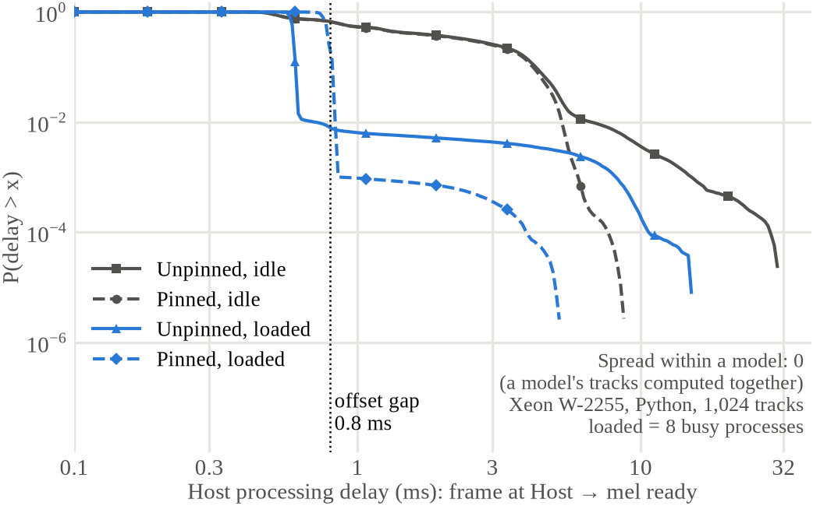

# 06. Host와 통신

## 1. 요약

Host는 mic 입력을 모델의 offset에 맞춰 frame으로 자르고 mel을 구한다. 추론 요청이 준비되면 바로 보내고(즉시 송신), 결과를 받아 판정하며 deadline miss를 센다.

최종 Host는 라즈베리파이 5(8 GiB)로 확정했다. Gigabit Ethernet으로 보드와 직접 연결한다. 현재 문서의 Host 처리 지연은 Xeon W-2255에서 측정한 값이다.

FPGA와의 통신에는 UDP를 쓴다. 추론 요청과 결과의 필드는 P3.9에서 정한 형식을 따른다. 추론 요청에는 PNU-Count가 사용할 예상 추론 요청 수(`n_expect`)도 싣는다. UDP framing은 §4, register·DDR3 주소 공간과 제어 packet은 §7에 있다.

## 2. Host 역할

| 일 | 내용 |
|---|---|
| 입력 | USB mic 또는 다채널 오디오 장치. 1,024트랙 부하 시험은 track generator가 대신한다 |
| mic 입력 | ALSA로 48 kHz mono를 받는다(시험한 USB mic는 44.1·48 kHz만 지원). Period 4 ms(16 kHz 64샘플 block), buffer 16 ms. `t_host`는 block 마지막 샘플의 ALSA 도착 시각(`htstamp` − `avail`/48 kHz)이다 |
| mic + wav 입력 | 트랙 0 … (mic 수 − 1)은 mic, 나머지 트랙(가상 트랙)은 16 kHz wav를 반복해 읽는다. 가상 트랙 i는 wav 채널 (i − mic 수) % (wav 채널 수)를 (i − mic 수) × 104,729샘플(mod wav 길이)만큼 늦춰 읽는다. 같은 채널을 쓰는 트랙도 위상이 달라 같은 소리를 동시에 듣지 않는다. wav 전체를 채널마다 메모리에 올리고, 읽는 위치 = (mic 0 샘플 번호 + 늦춤) mod wav 길이다. Frame 경계 보정(§5)과 `t_host`는 mic 0을 따른다 |
| resampler | 48 → 16 kHz. scipy `resample_poly(x, 1, 3)`과 같은 61 tap Kaiser(β 5) FIR을 지난 샘플만 써서 계산한다. 계산 시간은 Host 처리 지연에, group delay 0.625 ms는 mic–Host 지연에 들어간다 |
| 특징 추출 | 16 kHz 입력의 64 ms frame에서 mel 40개 추출. Hop은 32 ms이며, 0–127로 양자화 ([02_MODEL.md](02_MODEL.md) §4) |
| Offset Assignment | 트랙마다 frame 끝을 모델의 offset에 맞춘다 ([05_SCHEDULING.md](05_SCHEDULING.md) §2) |
| frame 경계 | 샘플 번호로 정한다. 모델 m의 offset은 12.8m에 가장 가까운 정수 샘플 위치다(nominal offset과 25 µs 이하 차이). 마지막 샘플이 늦게 도착하면 송신 시각만 늦어진다. Frame 경계는 FPGA 주기에 맞춘다(§5) |
| 송신 | 즉시 송신. 모아 보내기는 비교 구성이다 |
| 예상 추론 요청 수 | 추론 요청 packet에 그 모델·주기의 추론 요청 수를 싣는다(§4.1) |
| 시각 | FPGA 시각과의 차이를 1초마다 구한다(§5) |
| 판정 | 트랙마다 결과 31개의 평균으로 판정한다 ([02_MODEL.md](02_MODEL.md) §5) |
| deadline 확인 | 보낸 `(track_id, seq)`와 받은 결과를 대조한다. `t_host + 32 ms`까지 결과가 없으면 deadline miss로 센다 |
| 시작 설정 | 모델 image 적재, 트랙·모델 수, offset table, 지연 예측 표(모델 그룹 지연·jitter), on-chip 트랙 수 |

추론 요청별 도착 퍼짐과 긴 Host 처리 지연을 줄이기 위해 다음을 Host 설계 가정으로 둔다.

1. 계산 thread를 CPU에 고정하고 성능 설정을 고정한다. 고정하지 않은 Xeon 측정에서는 모델 그룹 지연 최대가 31.07 ms였다.
2. 한 모델의 트랙은 한 Host가 맡고 그 트랙들의 mel을 한 번에 계산한다.
3. 계산을 마친 모델 그룹의 추론 요청은 packet 수를 줄여 이어서 보낸다.

전처리는 Host에서 한다. ATtiny급 MCU로는 트랙 하나도 처리하지 못한다. 실시간 입력은 트랙마다 정규화 기준을 유지한다([02_MODEL.md](02_MODEL.md) §5).

트랙별 하한은 map 파일의 둘째 칸으로 지정한다(기본 −80 dB). Membrane potential 초기화를 위한 `RESET_STATE`는 판정 주기마다 보낸다.

Host program은 `software/host`의 `mmss_host`다. C로 작성했고, 라즈베리파이 5용 aarch64 정적 빌드다. `setup`은 §6의 1–6번 시작 절차를, `run`은 입력부터 deadline 확인까지를, `stop`은 종료 절차를 수행한다. Qemu-aarch64와 FPGA mock에서 특징 추출·판정 결과가 Python 기준과 일치했다([P4.8 보고서](<../reports/P4.8 Research Report.md>)). x86으로 빌드해 sub1(Xeon)에서 보드와 1,024트랙 실시간으로 돌렸을 때도 판정이 Python 기준과 같았다([P5.3 보고서](<../reports/P5.3 Research Report.md>)). 라즈베리파이 5에서는 아직 실행하지 않았다.

## 3. 링크

링크는 Gigabit Ethernet(RGMII)과 UDP로 정했다. MAC과 IP·UDP에는 MIT 라이선스의 무료 공개 core인 `verilog-ethernet`을 쓴다. 유료 Xilinx TEMAC은 쓰지 않는다. 이 저장소는 더 이상 관리되지 않으므로 가져온 버전을 고정한다. FPGA 핀은 보드 설명서 Part 3.2를 따른다(RGMII 12개, MDC·MDIO·RESET).

보드 PHY는 설명서에 KSZ9031(주소 011)로 나와 있다. 실제 MDIO 읽기에서는 주소 1에서 ID 0x937C·0x4032(JLSemi JL2101 계열)로 응답했다. 송신 clock은 90°를 기준으로 MMCM 미세 위상을 조절하고, 수신은 FPGA IDELAY로 맞춘다. 두 보정값은 실행 중 `LINK_TUNE`(§7.2)으로 바꿀 수 있다. 기본값은 보드에서 frame 손실을 재서 수신 tap 8, 송신 90°에서 −80단계(−1.43 ns)로 정했다(P5.2). Host가 바뀌어도 이 기본값으로 붙으므로 시작 절차(§6)에서 `LINK_TUNE`을 쓰지 않는다.

UDP bandwidth는 약 100 MB/s로 추정한다. 필요한 bandwidth는 1,024트랙 × 31.25 Hz × (추론 요청 64 B + 결과 32 B) = 3.07 MB/s다.

Ethernet 지연과 packet 간격은 아직 측정하지 않았다. Simulation의 링크 지연에는 PCIe 64 B 전송의 실측 표본을 쓴다(입력 p50 27.2 µs, 표본 최대 입력 0.116 ms·결과 0.147 ms).

MTU 1,500 B에는 64 B 추론 요청이 최대 23개 들어간다. 따라서 약 240트랙의 모델 그룹은 packet 11개로 나뉜다. Packet 사이 간격이 길면 같은 모델을 여러 번 적재할 수 있다([05_SCHEDULING.md](05_SCHEDULING.md) §6.2).

## 4. Packet 내용

Packet의 필드는 little-endian으로 보낸다. UDP 전송 규칙은 다음과 같다.

| 항목 | 정한 것 |
|---|---|
| 주소 | Host와 FPGA를 cable 하나로 직접 잇는다. FPGA는 MAC `02:00:00:00:00:01`, IP `192.168.10.2/24`(합성 parameter), Host는 `192.168.10.1`. ARP는 Ethernet core가 답한다 |
| 추론 요청 | UDP port 5000. datagram 하나에 추론 요청 1–23개를 64 B씩 이어 붙인다. Host는 모델 그룹을 23개씩 나눠 보낸다(simulation의 packet 분할과 같다) |
| 결과 | 결과 하나를 datagram 하나에 담아 연산이 끝나자마자 보낸다. 목적지는 가장 최근 추론 요청 datagram을 보낸 IP·port다 |
| 무결성 검사 | FPGA가 보내는 UDP checksum은 0(계산 안 함)이다. Ethernet FCS는 사용하며, FCS가 틀린 frame은 MAC이 버린다 |
| 손실·순서 | 추론 요청은 재전송하지 않는다. 손실된 추론 요청은 결과가 없으므로 Host가 deadline miss로 센다. 직접 연결에서는 순서가 바뀌지 않는 것으로 둔다 |
| IP 조각 | IP 조각은 쓰지 않는다(MTU 1,500 B). 조각난 datagram은 버린다 |
| 제어 | UDP port 5001. §7.6 |

가져온 Ethernet core의 UDP checksum 생성기에는 header를 잃는 결함이 있어 사용하지 않는다.

결과 32 B 중 동작에 꼭 필요한 값은 `track_id`·`seq`·`out0`·`out1`의 8 B다. 나머지 필드는 구간별 지연 측정과 동작 확인에 쓴다. 결과를 하나씩 즉시 보내므로 전송 비용은 packet header(Ethernet·IP·UDP 42 B, 최소 frame 64 B)의 영향을 크게 받는다. 결과를 8 B로 줄여도 전송 크기는 결과 하나당 14 B(1 Gb/s에서 0.11 µs)만 줄어든다. 따라서 결과 형식은 32 B로 유지한다.

### 4.1 추론 요청 (64 B)

| Byte | 크기 | 이름 | 내용 |
|---:|---:|---|---|
| 0 | 1 | `magic` | `0xA5` |
| 1 | 1 | `flags` | bit0 `RESET_STATE` |
| 2 | 2 | `track_id` | 0–`N_TRACKS − 1` |
| 4 | 2 | `seq` | 트랙별 순번, Host가 증가 |
| 6 | 1 | `model_id` | 0–`N_MODELS − 1` |
| 7 | 1 | — | 0 |
| 8 | 4 | `t_host_us` | frame 마지막 샘플의 Host 도착 시각, FPGA 시각 기준 |
| 12 | 4 | `n_expect` | 이 모델·주기의 예상 추론 요청 수. PNU-Count가 쓴다. P3.9 원안에 없던 필드다 |
| 16 | 40 | `x` | mel 40개, uint8 0–127 |
| 56 | 8 | — | 0 |

`t_host_us`는 P3.9의 시각 필드 위치에 두며, frame 마지막 샘플의 Host 도착 시각을 담는다. 트랙과 모델의 대응은 Host가 정한다. 같은 트랙에는 항상 같은 `model_id`를 써야 한다. FPGA는 이 대응이 유지되는지 검사하지 않는다.

FPGA는 `n_expect`를 그 모델·주기의 첫 추론 요청에서 읽는다. 그 전에는 직전 주기 값이나 처음 등록한 트랙 수를 쓴다. 도착한 추론 요청 수는 FPGA가 센다.

### 4.2 결과 (32 B)

| Byte | 크기 | 이름 | 내용 |
|---:|---:|---|---|
| 0 | 2 | `track_id` | |
| 2 | 2 | `seq` | 추론 요청 값 그대로 |
| 4 | 1 | `model_id` | |
| 5 | 1 | `flags` | bit0 state reset 적용, bit1 16 bit 연산 포화 발생, bit2 `LATE` |
| 6 | 2 | `batch_n` | 이 추론 요청이 속한 batch 크기 |
| 8 | 4 | `t_host_us` | 추론 요청 값 그대로 |
| 12 | 4 | `t_in_us` | `ingest` 시각 |
| 16 | 4 | `t_start_us` | 연산 시작 |
| 20 | 4 | `t_done_us` | 연산 완료 |
| 24 | 2 | `out0` | layer 4 membrane potential 0, int16 |
| 26 | 2 | `out1` | layer 4 membrane potential 1, int16 |
| 28 | 4 | — | 0 |

`LATE`는 `t_done_us > t_host_us + DEADLINE_US − MARGIN_US`일 때 켠다. 실제 deadline miss는 Host가 수신 시각으로 판정한다.

### 4.3 입력 검사

`ingest`는 아래 오류 조건에 해당하는 추론 요청을 버리고 `REQ_DROP`을 증가시킨다. 첫 오류는 `ERR_CODE`, `ERR_INFO`에 기록한다. 버린 추론 요청은 결과가 없으므로 Host가 deadline miss로 센다.

| ERR_CODE | 조건 | ERR_INFO |
|---:|---|---|
| 1 | `magic` ≠ `0xA5` | 수신 순번 |
| 2 | `track_id` ≥ `N_TRACKS` | `track_id` |
| 3 | `model_id` ≥ `N_MODELS` | `track_id` |
| 4 | `x` 중 하나 > 127 | `track_id` |
| 5 | 같은 트랙의 이전 추론 요청 결과를 아직 보내지 않음(drop). 결과는 연산 뒤, DDR3 트랙은 쓰기 응답 뒤에 나간다. Simulator는 연산 완료 시각으로 판정해 수 µs 차이가 난다 | `track_id` |
| 6 | DDR3 AXI 오류 응답 | 전송 시작 주소. weight는 slot 주소 |
| 7 | datagram 길이가 64 B의 배수가 아니거나 0, 또는 추론 요청 23개 초과(datagram 전체를 버림) | 길이 B |

오류 5가 발생했다면 같은 트랙의 이전 추론 요청은 이미 deadline을 넘긴 것이다. 다음 추론 요청은 32 ms 뒤 frame의 `t_host` 이후에 도착하기 때문이다.

## 5. 시각

FPGA는 µs counter `NOW_US`와 100 MHz counter `NOW_CYC`를 둔다. Host는 이 값으로 자기 clock과의 차이를 구한다. `SOFT_RESET`에서 두 counter가 0이 되므로 Host는 그 뒤에 clock 차이를 구한다.

```text
h1 = host_now() ; f = read(NOW_US) ; h2 = host_now()
clock_diff = f − (h1 + h2) / 2
t_host_us  = host_t_host + clock_diff
```

`host_t_host`는 frame 마지막 샘플이 든 audio block이 Host에 들어온 시각이다. Mic–Host 지연(ADC, USB, audio buffer)은 이 기준에 들어가지 않는다. 따로 잰다(§9).

Host는 1초마다 clock 차이를 다시 구한다. 오차 예산은 100 µs다. ±50 ppm의 clock 차이는 1초에 50 µs의 오차를 만든다. Ethernet 왕복 시간이 길거나 변동이 크면 오차도 커진다. 이를 줄이기 위해 `NOW_US`를 5번 읽고 왕복 시간이 가장 짧은 표본을 쓴다. 시각이 32 bit µs 값이므로 clock 차이를 더할 때는 2^32 wrap-around를 반영한다.

Host는 audio 시작을 FPGA 주기에 맞춘다. 첫 audio block을 FPGA 주기 경계(`NOW_US` mod 32,000 = 0)에서 시작하면 모델 m의 frame 끝 샘플이 nominal frame 끝 시각 `O_m + kT`에 들어오고, `t_host`는 그 뒤 audio block 하나 안에 든다. 실행 중에는 처음 구한 clock 차이에서 바뀐 만큼 audio block 시각을 옮겨 FPGA clock 속도를 따른다. 맞추지 않으면 시작 위상이 주기 안 아무 곳에나 놓이고(P3.16 보드 기록 −11.8 ms, +8.7 ms), Host와 FPGA의 clock 차이(5–7 ppm)만큼 계속 밀린다. 그러면 PNU가 쓰는 경과 시간과 추론 요청의 주기 판정(±16 ms)이 틀린다. USB mic는 sample clock이 Pi clock과 약 59 ppm 다르므로(P3.16) mic 입력에서는 frame 경계도 옮긴다. Host는 mic마다 block 도착 시각(FPGA 시각)에서 받은 샘플 수 / 16 kHz를 뺀 값의 1초 창 최솟값으로 샘플 0의 도착 시각을 추정하고, frame 끝 샘플 번호를 그 차이만큼 옮겨 frame 끝 샘플이 nominal frame 끝 시각에 도착하게 한다. 오디오 값은 고치지 않고 자르는 위치만 옮기므로 hop이 가끔 511·513샘플이 된다(65 ppm이면 약 1초에 한 번).

Response time과 deadline miss는 Host clock으로 측정한다. `t_in_us`, `t_start_us`, `t_done_us`는 FPGA 내부의 구간별 지연을 구하는 데 쓴다.

## 6. 시작과 종료

```text
1. bitstream 적재(QSPI). STATUS의 MIG_CALIB 확인
2. 정보 블록에서 N_ENTRY·N_ON_CHIP 확인(합성 parameter)
3. 모델 image(hardware/data/models_l64/models.ddr3.bin)를 DDR3 창의 MODEL_BASE에 쓰고 다시 읽어 확인
4. 설정 블록(N_TRACKS, N_MODELS, DDR3 주소, deadline)과 PNU 표(offset table, 모델별 등록 트랙 수, 지연 예측 표) 쓰기
5. SOFT_RESET: entry 무효화, request table·counter 초기화
6. RUN = 1
7. 트랙마다 판정 주기 첫 추론 요청에 RESET_STATE
종료: 추론 요청 중단 → IDLE = 1 대기 → RUN = 0
```

## 7. Register와 주소 공간

Host는 32 bit byte 주소 공간 하나로 register, PNU 표, DDR3에 접근한다. 각 영역은 용도별로 나누고 시작 절차에서 쓰는 순서대로 배치했다. Host는 주소·길이·읽기/쓰기를 지정한 제어 packet으로 각 영역에 접근한다(§7.6). Register block은 AXI4-Lite slave로 구현한다. 초기 동작 확인 때는 JTAG-to-AXI로 같은 주소에 접근한다.

| 블록 | 주소 | 용도 | 접근 |
|---|---|---|---|
| 정보 | `0x0000`~`0x00FF` | 설계 확인, 합성 parameter | R |
| 상태·제어 | `0x0100`~`0x01FF` | 동작 상태, 시작·초기화 | R, RW |
| 시각 | `0x0200`~`0x02FF` | FPGA 시각(§5) | R |
| 설정 | `0x0300`~`0x03FF` | 트랙·모델 수, DDR3 주소, deadline | RW |
| counter | `0x0400`~`0x04FF` | 계측 | R |
| 오류 | `0x0500`~`0x05FF` | 첫 오류 | R |
| PNU 표 | `0x1000`~`0x2FFF` | offset table, 등록 트랙 수, 지연 예측 표 | W |
| DDR3 | `0x8000_0000`~`0xBFFF_FFFF` | 모델 image 적재와 확인 | RW |

- register는 32 bit이고 주소는 4 B 단위다. 없는 주소를 읽으면 0이고 쓰면 무시한다.
- 64 bit 값은 LO 다음 주소에 HI를 둔다. LO를 읽을 때 HI를 고정한다.
- `RUN = 1`일 때 설정·PNU 표·DDR3 쓰기는 무시한다. DDR3 읽기도 `RUN = 0`일 때만 한다.
- PNU 표는 쓰기 전용이다(읽으면 0). 시작할 때 한 번만 쓴다.

### 7.1 정보·상태·제어·시각

| 주소 | 이름 | 접근 | 내용 |
|---|---|---|---|
| `0x0000` | `ID` | R | `0x534E_4E58` |
| `0x0004` | `VERSION` | R | 설계 버전 |
| `0x0008` | `N_ENTRY` | R | weight cache entry 수(합성 parameter) |
| `0x000C` | `N_ON_CHIP` | R | on-chip membrane potential 트랙 수(합성 parameter). Host는 on-chip에 둘 트랙에 이보다 작은 `track_id`를 준다 |
| `0x0100` | `STATUS` | R | bit0 `RUN`, bit1 `IDLE`, bit2 `MIG_CALIB`, bit3 `ERR` |
| `0x0104` | `CTRL` | RW | bit0 `RUN`, bit1 `SOFT_RESET`, bit2 `CNT_CLEAR`, bit3 `ERR_CLEAR` |
| `0x0200` | `NOW_US` | R | µs counter |
| `0x0208`, `0x020C` | `NOW_CYC_LO/HI` | R | 100 MHz counter |

### 7.2 설정

| 주소 | 이름 | 내용 |
|---|---|---|
| `0x0300` | `N_TRACKS` | 1~1,024 |
| `0x0304` | `N_MODELS` | 1~40 |
| `0x0308` | `MODEL_BASE` | `0x0000_0000`(MIG 주소) |
| `0x030C` | `STATE_BASE` | `0x0200_0000`(MIG 주소) |
| `0x0310` | `DEADLINE_US` | 32,000 |
| `0x0314` | `MARGIN_US` | `LATE` 판정 여유. 250 µs = 결과 링크 지연 최대 126 µs(P3.16) + 시각 오차 예산 100 µs(§5), 올림. Host가 setup에서 쓴다 |
| `0x0318` | `LINK_TUNE` | RGMII 보정값. bit[4:0] 수신 IDELAY tap(1 tap ≈ 78 ps), bit[31:16] 송신 clock 위상(90°에서 옮길 MMCM 미세 단계, 1단계 ≈ 17.9 ps, 부호 있음). 기본값은 수신 tap 8, 송신 −80단계(P5.2) |

### 7.3 Counter와 오류

`CNT_CLEAR`는 counter를 0으로 초기화한다. Counter 이름은 simulator 지표와 맞췄다. 오류 기록은 `ERR_CLEAR`로 지운다.

| 주소 | 이름 | 내용 |
|---|---|---|
| `0x0400` | `REQ_IN` | 통과한 추론 요청 |
| `0x0404` | `REQ_DROP` | 버린 추론 요청(drop 포함) |
| `0x0408` | `RES_OUT` | 보낸 결과 |
| `0x040C` | `LATE` | `LATE` flag 결과 |
| `0x0410` | `MAX_PENDING` | 최대 대기 추론 요청 수 |
| `0x0414` | `BATCHES` | batch 수 |
| `0x0418` | `MODEL_LOADS` | weight 적재 수 |
| `0x041C` | `SAT_COUNT` | 16 bit 연산 포화가 한 번 이상 발생한 추론 수. 12 bit 저장 포화는 제외 |
| `0x0420` | `WEIGHT_BYTES_LO/HI` | weight DMA byte |
| `0x0428` | `STATE_BYTES_LO/HI` | membrane potential DMA byte |
| `0x0430` | `CMP_BUSY_LO/HI` | 연산 cycle |
| `0x0438` | `CMP_STALL_LO/HI` | scheduler가 추론 시작을 냈는데 compute array가 빈 채로 적재나 membrane potential 준비를 기다린 cycle |
| `0x0500` | `ERR_CODE` | 첫 오류(§4.3) |
| `0x0504` | `ERR_INFO` | 첫 오류 정보 |

16 bit 연산 포화는 실데이터 2,400 추론에서 0이었고, 포화 시험 vector에서만 발생했다. 12 bit 저장 포화는 layer 3 저장값의 43%에서 발생한다. 이는 설계에 포함된 양자화이므로 `SAT_COUNT`에 세지 않는다.

### 7.4 PNU 표

주소는 `0x1000 + 4 × (predictor 설정 주소)`다. Predictor 설정 주소는 `next_use_predictor.v`(P4.3)의 주소를 쓰며, register block은 이를 바꾸지 않고 전달한다. 값은 16 bit이며 32 bit 칸의 하위 bit에 둔다.

| 주소 | 이름 | 개수 | 내용 |
|---|---|---:|---|
| `0x1000 + 4m` | `OFFSET_TABLE[m]` | 40 | 모델 m의 offset 번호 0–39 |
| `0x1100 + 4m` | `N_REG[m]` | 40 | 모델 m의 등록 트랙 수. 첫 주기의 예상 추론 요청 수로 쓰고, 0이면 그 모델은 다음 사용이 없다 |
| `0x1200`, `0x1204`, `0x1208` | `TAU_G`, `TAU_U`, `EG` | 3 | 모델 그룹 지연 G의 최대, 추론 요청별 지연 j의 최대, G의 평균(µs) |
| `0x1400 + 4i` | `LUT_G[i]` | 128 | `δ_G((i + 0.5) × 256 µs)` |
| `0x2000 + 32i + 4rb` | `LUT_U[i][rb]` | 128 × 6 | `δ_j((i + 0.5) × 256 µs, 남은 수 칸 rb)`. rb 6·7 자리는 비운다 |

표 값은 [04_MEMORY.md](04_MEMORY.md) §3.1의 식으로 구한다. 칸 구성은 engine의 `PNURTL._tables`(`part_cache.py`)와 같다. Host program에서는 `setup --model-group-delay-trace <모델 그룹 지연 표> --jitter-us J`로 표를 만든다. 라즈베리파이 5에서는 CPU 고정·performance·부하 없음에서 잰 표(`hardware/board_test/p316_meas/result/pi_group_pin3_performance_load0.csv.gz`, gzip을 풀어 넘긴다)와 J = 0을 쓴다. 이 조건에서 PNU-Count RTL은 Oracle MIN과 같은 DDR3 traffic을 냈다(P3.17).

`LUT_G`는 G > e인 표본에서 (G − e)의 평균을 직접 구한다. Engine은 5 µs 간격의 수치 적분을 사용한다. 두 방식의 차이는 Xeon 모델 그룹 지연 표에서 최대 6 µs다.

### 7.5 DDR3 창

Host 주소 `0x8000_0000 + a`는 MIG 주소 `a`에 대응한다. 모델 image는 `0x8000_0000 + MODEL_BASE`부터 쓴다(배치는 [04_MEMORY.md](04_MEMORY.md) §6). `RUN = 0`이면 Host 경로가, `RUN = 1`이면 DMA가 MIG를 사용한다. 선택 회로는 `RUN` 값에 따라 두 경로를 전환한다.

### 7.6 제어 packet

UDP port 5001로 §7 주소 공간을 읽고 쓴다. Host가 보낸 packet마다 FPGA가 응답 하나를 같은 IP·port로 보낸다.

| Byte | 크기 | 이름 | 내용 |
|---:|---:|---|---|
| 0 | 1 | `magic` | `0x5C` |
| 1 | 1 | `op` | 1 읽기, 2 쓰기 |
| 2 | 2 | `tag` | Host 순번. 응답에 그대로 싣는다 |
| 4 | 4 | `addr` | byte 주소, 4 B 정렬 |
| 8 | 2 | `count` | 32 bit word 수, 1–256(1 KiB) |
| 10 | 2 | `status` | 요청은 0. 응답은 0 성공, 1 주소·정렬 오류, 2 `RUN = 1`이라 거부, 3 길이 오류 |
| 12 | 4 × `count` | `data` | 쓰기 요청과 읽기 응답에만 있다 |

- Host는 응답을 받은 뒤 다음 제어 요청을 보낸다. 응답을 기다리는 동안 온 제어 요청은 FPGA가 버린다. 응답이 없으면 Host가 같은 `tag`로 다시 보낸다. 같은 주소에 같은 값을 다시 쓰므로 재전송해도 결과가 같다.
- DDR3 창은 32 B 단위로 읽고 쓴다(`addr`가 32 B 정렬, `count`가 8의 배수). 모델 image는 slot마다 유효한 앞 131,648 B만 보내면 된다(1 KiB 쓰기 129개, 40개 모델이면 5,160개). 보낸 뒤 다시 읽어 확인한다.

## 8. 미정 사항

| 항목 | 정할 것 |
|---|---|
| 부하 조건의 꼬리 | busy loop 3개에서 모델 그룹 지연 최대 17–20 ms, 추론 요청별 퍼짐 최대 2.2–5.5 ms(P3.16). 원인을 찾고 실시간 우선순위(SCHED_FIFO)·수신 thread 고정과 비교한다 |
| mic–Host 고정 지연 | ADC·USB 고정 지연은 재지 못했다. 스피커와 mic를 붙인 loopback으로 잰다 |

Ethernet 지연·packet 간격(P3.16), `MARGIN_US`(§7.2), 단일 적재 여부(P3.17에서 모델·주기당 최대 1번), 결과 손실(라즈베리파이 5에서 0, P3.16), 라즈베리파이 5 실행과 mic 입력(P3.16, P5.4)은 정했다.

## 9. Host 처리 지연 측정

### 9.1 Xeon Host 측정 결과

Xeon W-2255에서 Python 계산 thread 하나로 1,024트랙의 mel을 계산했다. 모델당 25–26트랙을 배정하고, 모델 사이에 0.8 ms 간격을 두어 offset 순서대로 계산했다. 조건마다 300 s를 측정하고 처음 0.5 s는 제외했다.

| 조건 | 모델 그룹 지연 G p50 (ms) | p99 (ms) | p99.9 (ms) | 관측 최대 (ms) |
|---|---:|---:|---:|---:|
| CPU 고정·부하 없음 | 1.17 | 5.27 | 6.01 | 8.75 |
| CPU 고정 없음·부하 없음 | 1.19 | 6.70 | 15.16 | 31.07 |
| CPU 고정·busy process 8개 | 0.78 | 0.83 | 0.89 | 5.20 |
| CPU 고정 없음·busy process 8개 | 0.59 | 0.71 | 8.18 | 15.13 |



- 모델 그룹의 완료 시각 하나를 해당 그룹의 모든 트랙에 기록했으므로 기록상 완료 시각의 퍼짐은 0이다. 실제 추론 요청별 송신 시각이나 FPGA 도착 시각의 퍼짐은 측정하지 않았다. Simulation에서는 추론 요청별 지연을 Uniform(0, J)로 따로 생성해 더한다.
- Simulation은 앞 절반 4,679주기로 모델 그룹 지연 분포를 추정한다. 뒤 절반 4,680주기에서는 seed마다 겹치지 않는 80주기의 값을 입력으로 쓴다([07_SIMULATION.md](07_SIMULATION.md) §3).
- Xeon 값은 최종 Host의 성능 근거가 아니다.

### 9.2 라즈베리파이 5 측정 결과

라즈베리파이 5와 보드를 직결하고 `mmss_host run --pace --loop`로 1,024트랙을 조건마다 300 s 돌렸다([P3.16 보고서](<../reports/P3.16 Research Report.md>)). 6조건 모두 결과 손실과 32 ms 초과가 0이었다.

| 항목 | 부하 없음 | busy loop 3개 |
|---|---|---|
| 모델 그룹 지연 G | p99 2.04–2.64 ms, 최대 3.15–7.23 ms | p99.9 9.1–9.9 ms, 최대 17.1–20.1 ms |
| 추론 요청별 지연 j(같은 모델·주기 FPGA 도착 퍼짐) | p99.9 17 µs, 최대 18–40 µs | p99.9 17 µs, 최대 2.2–5.5 ms |
| response time | p99 2.26–2.84 ms, 최대 6.46–7.47 ms | p99 5.37–5.64 ms, 최대 17.7–21.7 ms |
| 링크 지연 | 입력 p50 22 µs·최대 50 µs, 결과 p50 38 µs·최대 126 µs | 재지 않음 |
| mic sample clock | Pi clock보다 57.5–59.8 ppm 느림, mic 2개 사이 0.002 ppm 이하 | 같음 |

특징 추출은 추론 요청당 14.8–18.1 µs로 계산 core 하나의 47–58%를 쓴다. 이 측정의 모델 그룹 지연 표와 링크 지연 표본을 simulation에 넣어 entry 수와 PNU 표를 정했다(P3.17).

같은 모델의 추론 요청이 서로 다른 시각에 도착하게 만드는 요인은 다음과 같다. 지연 크기는 추정값이다.

| 위치 | 요인 | 크기 |
|---|---|---|
| Host 송신 | 모델 그룹이 여러 packet으로 나뉨, packet 송신 사이에 OS 작업이 실행됨 | 수 µs–수 ms |
| Host 계산 | 한 모델의 트랙을 여러 core나 조각으로 나눠 계산 | 조각 계산 시간 |
| Host 구성 | 같은 모델 트랙이 Host 여러 대에 나뉨 | Host 사이 시계 오차와 처리 속도 차이 |
| 네트워크 | switch 공유, 재전송을 쓰는 구성의 packet 손실, NIC interrupt coalescing | 수십 µs–수 ms |
| 오디오 | clock drift에 따른 frame 경계 조정, buffer 넘침·부족 | audio block 하나(1–20 ms) |

## 10. 관련 문서

- [P3.25 보고서](<../reports/P3.25 Research Report.md>) §2, §4.11: 시간 기준, Host 처리 지연 측정
- [P3.26 보고서](<../reports/P3.26 Research Report.md>) §2.4: 모델 그룹 지연 표
- [P3.9 보고서](<../reports/P3.9 Research Report.md>): packet·register 원안
- [P4.7 보고서](<../reports/P4.7 Research Report.md>): Ethernet 경로와 제어 packet
- [P5.2 보고서](<../reports/P5.2 Research Report.md>): RGMII 보정과 `LINK_TUNE`
- [P5.3 결과 손실 보고서](<../reports/P5.3 Result Loss Research Report.md>): 결과 손실, 보드 PHY
