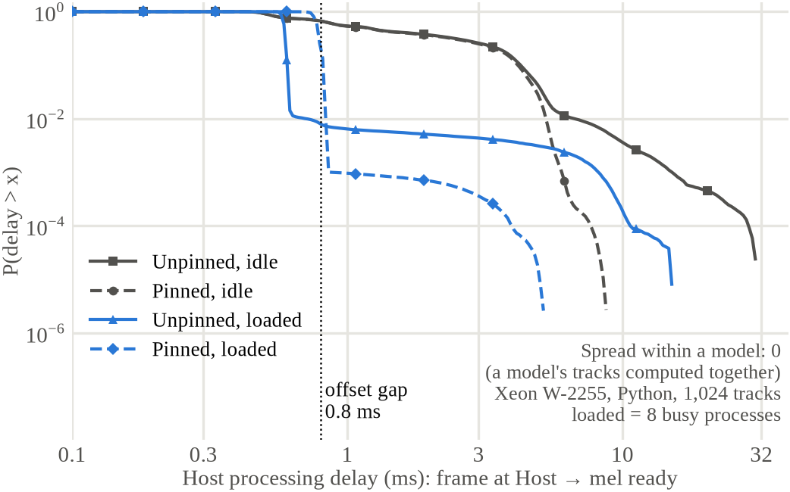

# 06. Host와 통신

## 1. 요약

Host는 mic 입력에서 mel을 구하고(특징 추출), 모델의 offset에 맞춰 frame을 잘라 추론 요청이 준비되면 바로 보낸다(즉시 송신). 결과를 받아 판정하고 deadline miss를 센다. 최종 Host는 라즈베리파이 5(8 GiB)다(2026-10-24 확정). 이 기기도 Gigabit Ethernet이 있어 보드와 cable로 직접 잇는다. 지금 있는 Host 처리 지연 측정은 Xeon W-2255에서 한 것이다.

FPGA와는 Gigabit Ethernet(UDP)으로 연결한다. 추론 요청과 결과의 필드는 P3.9에서 정한 것을 쓴다. PNU-Count가 쓸 예상 추론 요청 수(`n_expect`)를 추론 요청에 싣는다. UDP framing은 §4, register와 DDR3를 읽고 쓰는 주소 공간과 제어 packet은 §7에 있다.

## 2. Host 역할

| 일 | 내용 |
|---|---|
| 입력 | USB mic 또는 다채널 오디오 장치. 1,024트랙 부하 시험은 track generator가 대신한다 |
| 특징 추출 | 16 kHz, 64 ms 구간에서 mel 40개, 32 ms씩 이동. 0–127로 양자화 ([02_MODEL.md](02_MODEL.md) §4) |
| Offset Assignment | 트랙마다 frame 끝을 모델의 offset에 맞춘다 ([05_SCHEDULING.md](05_SCHEDULING.md) §2) |
| frame 경계 | 샘플 번호로 정한다. 모델 m의 offset은 12.8m 샘플에 가장 가까운 샘플이다(nominal offset과 25 µs 이하 차이). 마지막 샘플이 늦게 들어오면 보내는 시각만 늦어진다. Frame 경계와 Host clock이 맞는다고 가정한다 |
| 송신 | 즉시 송신. 모아 보내기는 비교 구성이다 |
| 예상 추론 요청 수 | 추론 요청 packet에 그 모델·주기의 추론 요청 수를 싣는다(§4.1) |
| 시각 | FPGA 시각과의 차이를 1초마다 구한다(§5) |
| 판정 | 트랙마다 결과 31개의 평균으로 판정한다 ([02_MODEL.md](02_MODEL.md) §5) |
| deadline 확인 | 보낸 `(track_id, seq)`와 받은 결과를 대조한다. `t_host + 32 ms`까지 결과가 없으면 deadline miss로 센다 |
| 시작 설정 | 모델 image 적재, 트랙·모델 수, offset table, 지연 예측 표(모델 그룹 지연·jitter), on-chip 트랙 수 |

Host 설계 가정은 다음과 같다. 추론 요청별 퍼짐과 Host 처리 지연 꼬리를 줄이기 위한 것이다.

1. 계산 thread를 CPU에 고정하고 성능 설정을 고정한다. 고정하지 않은 Xeon 측정에서는 모델 그룹 지연 최대가 31.07 ms였다.
2. 한 모델의 트랙은 한 Host가 맡고 그 트랙들의 mel을 한 번에 계산한다.
3. 계산을 마친 모델 그룹의 추론 요청은 packet 수를 줄여 이어서 보낸다.

전처리는 Host에서 한다. ATtiny급 MCU로는 트랙 하나도 처리하지 못한다. 학습 특징은 파일 단위로 정규화했으므로 Host는 mel dB를 트랙의 하한 아래로 자르고, 트랙마다 정규화 기준을 이어 가며 τ = 5 s로 잊는다. 무음 frame은 기준을, 조용한 frame은 최소를 바꾸지 않는다([02_MODEL.md](02_MODEL.md) §5). 하한은 map 파일 둘째 칸으로 트랙마다 준다(기본 −80 dB). Mic를 쓰는 데모에서는 장비 끈 채 mic마다 바닥 잡음의 mel dB를 재고 그 위로 하한을 정한다. `RESET_STATE`는 판정 주기마다 낸다.

Host program은 `software/host`의 `mmss_host`다(C, 라즈베리파이 5용 aarch64 정적 빌드). `setup`이 §6 1–6을, `run`이 입력부터 deadline 확인까지를, `stop`이 종료를 한다. qemu-aarch64와 FPGA mock에서 특징 추출과 판정이 Python 기준과 같았고, Pi와 보드에서는 아직 돌리지 않았다([P4.8 보고서](<../reports/P4.8 Research Report.md>)).

## 3. 링크

Gigabit Ethernet(RGMII), UDP를 쓴다(2026-10-13). MAC과 IP·UDP는 무료 공개 core인 `verilog-ethernet`(MIT)을 쓴다(2026-10-24). 유료 Xilinx TEMAC은 쓰지 않는다. `verilog-ethernet`은 더 관리되지 않는 저장소라 가져온 버전을 고정해 둔다. FPGA 핀은 보드 설명서 Part 3.2를 따른다(RGMII 12개, MDC·MDIO·RESET). 보드 PHY는 설명서에 KSZ9031(주소 011)로 나오지만, MDIO로 읽으면 주소 1에서 ID 0x937C·0x4032(JLSemi JL2101 계열)로 응답한다(2026-10-26). 송신 clock은 FPGA가 90°에서 MMCM 미세 위상만큼 옮겨 내고, 수신은 FPGA IDELAY로 맞춘다. 두 값은 `LINK_TUNE`(§7.2)으로 실행 중에 바꾸고, 보드에서 frame 손실을 재어 기본값을 정한다(P4.10). UDP bandwidth는 약 100 MB/s로 추정한다. 필요한 bandwidth는 1,024트랙 × 31.25 Hz × (추론 요청 64 B + 결과 32 B) = 3.07 MB/s다.

Ethernet 지연과 packet 간격은 아직 재지 않았다. Simulation의 링크 지연은 PCIe 64 B 실측 표본이다(입력 p50 27.2 µs, 표본 최대 입력 0.116 ms·결과 0.147 ms). MTU 1,500 B에는 64 B 추론 요청이 23개까지 들어가므로 트랙이 약 240개인 모델 그룹은 packet 11개로 나뉜다. packet 간격이 길면 같은 모델을 여러 번 적재할 수 있다([05_SCHEDULING.md](05_SCHEDULING.md) §6.2).

## 4. Packet 내용

little-endian이다. UDP로 이렇게 보낸다(2026-10-24).

| 항목 | 정한 것 |
|---|---|
| 주소 | Host와 FPGA를 cable 하나로 직접 잇는다. FPGA는 MAC `02:00:00:00:00:01`, IP `192.168.10.2/24`(합성 parameter), Host는 `192.168.10.1`. ARP는 Ethernet core가 답한다 |
| 추론 요청 | UDP port 5000. datagram 하나에 추론 요청 1–23개를 64 B씩 이어 붙인다. Host는 모델 그룹을 23개씩 나눠 보낸다(simulation의 packet 분할과 같다) |
| 결과 | 결과 하나를 datagram 하나로 연산이 끝나자마자 보낸다. 받는 곳은 가장 최근 추론 요청 datagram을 보낸 IP·port다. FPGA가 보내는 UDP checksum은 0(계산 안 함)이다. 가져온 Ethernet core의 checksum 생성기에 header를 잃는 결함이 있어 껐다. Ethernet FCS는 있다 |
| 손실 | 재전송하지 않는다. 잃은 추론 요청은 결과가 없으므로 Host가 deadline miss로 센다. FCS가 틀린 frame은 MAC이 버린다. 직접 연결이라 순서는 바뀌지 않는다. IP 조각은 쓰지 않는다(MTU 1,500 B). 조각난 datagram은 버린다 |
| 제어 | UDP port 5001. §7.6 |

결과 32 B 가운데 동작에 꼭 필요한 것은 `track_id`·`seq`·`out0`·`out1` 8 B다. 나머지는 지연을 나누는 시각과 확인용 값이다. 결과는 하나씩 바로 보내므로 선로 비용은 packet 머리말(Ethernet·IP·UDP 42 B, 최소 frame 64 B)이 정한다. 8 B로 줄여도 결과 하나당 14 B(1 Gb/s에서 0.11 µs)만 줄어 32 B를 그대로 쓴다.

### 4.1 추론 요청 (64 B)

| Byte | 크기 | 이름 | 내용 |
|---:|---:|---|---|
| 0 | 1 | `magic` | `0xA5` |
| 1 | 1 | `flags` | bit0 `RESET_STATE` |
| 2 | 2 | `track_id` | 0 ~ `N_TRACKS − 1` |
| 4 | 2 | `seq` | 트랙별 순번, Host가 증가 |
| 6 | 1 | `model_id` | 0 ~ `N_MODELS − 1` |
| 7 | 1 | — | 0 |
| 8 | 4 | `t_host_us` | frame 마지막 샘플의 Host 도착 시각, FPGA 시각 기준 |
| 12 | 4 | `n_expect` | 이 모델·주기의 예상 추론 요청 수. PNU-Count가 쓴다. P3.9 원안에 없던 필드다 |
| 16 | 40 | `x` | mel 40개, uint8 0–127 |
| 56 | 8 | — | 0 |

`t_host_us`는 P3.9의 `t_host_us` 자리다. 시각 기준이 frame 마지막 샘플의 Host 도착으로 바뀌어 이름을 바꿨다. 트랙과 모델의 대응은 Host가 정한다. 같은 트랙에는 항상 같은 `model_id`를 쓴다. FPGA는 이 일관성을 검사하지 않는다.

FPGA는 `n_expect`를 그 모델·주기의 첫 추론 요청에서 읽는다. 그 전에는 직전 주기 값이나 처음 등록한 트랙 수를 쓴다. 도착한 추론 요청 수는 FPGA가 센다.

### 4.2 결과 (32 B)

| Byte | 크기 | 이름 | 내용 |
|---:|---:|---|---|
| 0 | 2 | `track_id` | |
| 2 | 2 | `seq` | 추론 요청 값 그대로 |
| 4 | 1 | `model_id` | |
| 5 | 1 | `flags` | bit0 state reset 적용, bit1 16 bit 연산 포화 발생, bit2 `LATE` |
| 6 | 2 | `batch_n` | 이 추론 요청이 속한 batch 크기 |
| 8 | 4 | `t_host_us` | 추론 요청 값 그대로 |
| 12 | 4 | `t_in_us` | `ingest` 시각 |
| 16 | 4 | `t_start_us` | 연산 시작 |
| 20 | 4 | `t_done_us` | 연산 완료 |
| 24 | 2 | `out0` | layer 4 membrane potential 0, int16 |
| 26 | 2 | `out1` | layer 4 membrane potential 1, int16 |
| 28 | 4 | — | 0 |

`LATE`는 `t_done_us > t_host_us + DEADLINE_US − MARGIN_US`일 때 켠다. 실제 deadline miss는 Host가 수신 시각으로 판정한다.

### 4.3 입력 검사

`ingest`는 아래 추론 요청을 버리고 `REQ_DROP`을 올린다. 첫 오류는 `ERR_CODE`, `ERR_INFO`에 남긴다. 버린 추론 요청은 결과가 없으므로 Host가 deadline miss로 센다.

| ERR_CODE | 조건 | ERR_INFO |
|---:|---|---|
| 1 | `magic` ≠ `0xA5` | 수신 순번 |
| 2 | `track_id` ≥ `N_TRACKS` | `track_id` |
| 3 | `model_id` ≥ `N_MODELS` | `track_id` |
| 4 | `x` 중 하나 > 127 | `track_id` |
| 5 | 같은 트랙의 이전 추론 요청 결과를 아직 보내지 않음(drop). 결과는 연산 뒤, DDR3 트랙은 쓰기 응답 뒤에 나간다. Simulator는 연산 완료 시각으로 판정해 수 µs 차이가 난다 | `track_id` |
| 6 | DDR3 AXI 오류 응답 | 전송 시작 주소 |
| 7 | datagram 길이가 64 B의 배수가 아니거나 0, 또는 추론 요청 23개 초과(datagram 전체를 버림) | 길이 B |

5가 나면 같은 트랙의 앞 추론 요청은 이미 deadline을 넘긴 것이다. 다음 추론 요청은 32 ms 뒤 frame의 `t_host` 다음에 오기 때문이다.

## 5. 시각

FPGA는 µs counter `NOW_US`와 100 MHz counter `NOW_CYC`를 둔다. Host는 이 값으로 자기 clock과의 차이를 구한다.

```text
h1 = host_now() ; f = read(NOW_US) ; h2 = host_now()
clock_diff = f − (h1 + h2) / 2
t_host_us  = host_t_host + clock_diff
```

`host_t_host`는 frame 마지막 샘플이 든 audio block이 Host에 들어온 시각이다. Mic–Host 지연(ADC, USB, audio buffer)은 이 기준에 들어가지 않는다. 따로 잰다(§9).

Host는 1초마다 clock 차이를 다시 구한다. 오차 예산은 100 µs다. ±50 ppm clock 차이가 1초에 50 µs를 만든다. Ethernet 왕복 시간이 길거나 들쭉날쭉하면 오차가 커지므로 `NOW_US`를 5번 읽어 왕복이 가장 짧은 값을 쓴다. 32 bit µs라 차이도 2^32로 되감아 더한다. Response time과 deadline miss는 Host clock으로 잰다. `t_in_us`, `t_start_us`, `t_done_us`는 FPGA 안의 지연을 나누는 데 쓴다.

## 6. 시작과 종료

```text
1. bitstream 적재(QSPI). STATUS의 MIG_CALIB 확인
2. 정보 블록에서 N_ENTRY·N_ON_CHIP 확인(합성 parameter)
3. 모델 image(hardware/data/models_l64/models.ddr3.bin)를 DDR3 창의 MODEL_BASE에 쓰고 다시 읽어 확인
4. 설정 블록(N_TRACKS, N_MODELS, DDR3 주소, deadline)과 PNU 표(offset table, 모델별 등록 트랙 수, 지연 예측 표) 쓰기
5. SOFT_RESET: entry 무효화, request table·counter 초기화
6. RUN = 1
7. 트랙마다 판정 주기 첫 추론 요청에 RESET_STATE
종료: 추론 요청 중단 → IDLE = 1 대기 → RUN = 0
```

## 7. Register와 주소 공간

Host가 읽고 쓰는 것은 32 bit byte 주소 공간 하나다. register, PNU 표, DDR3를 용도별 블록으로 나눠 시작 순서대로 쌓았다. Host는 주소·길이·읽기/쓰기만 담은 제어 packet으로 모든 블록을 다룬다(§7.6). register block은 AXI4-Lite slave로 만들어 bring-up 때는 JTAG-to-AXI로 같은 주소에 접근한다.

| 블록 | 주소 | 용도 | 접근 |
|---|---|---|---|
| 정보 | `0x0000`~`0x00FF` | 설계 확인, 합성 parameter | R |
| 상태·제어 | `0x0100`~`0x01FF` | 동작 상태, 시작·초기화 | R, RW |
| 시각 | `0x0200`~`0x02FF` | FPGA 시각(§5) | R |
| 설정 | `0x0300`~`0x03FF` | 트랙·모델 수, DDR3 주소, deadline | RW |
| counter | `0x0400`~`0x04FF` | 계측 | R |
| 오류 | `0x0500`~`0x05FF` | 첫 오류 | R |
| PNU 표 | `0x1000`~`0x2FFF` | offset table, 등록 트랙 수, 지연 예측 표 | W |
| DDR3 | `0x8000_0000`~`0xBFFF_FFFF` | 모델 image 적재와 확인 | RW |

- register는 32 bit이고 주소는 4 B 단위다. 없는 주소를 읽으면 0이고 쓰면 무시한다.
- 64 bit 값은 LO 다음 주소에 HI를 둔다. LO를 읽을 때 HI를 고정한다.
- `RUN = 1`일 때 설정·PNU 표·DDR3 쓰기는 무시한다. DDR3 읽기도 `RUN = 0`일 때만 한다.
- PNU 표는 쓰기 전용이다(읽으면 0). 시작할 때 한 번만 쓴다.

### 7.1 정보·상태·제어·시각

| 주소 | 이름 | 접근 | 내용 |
|---|---|---|---|
| `0x0000` | `ID` | R | `0x534E_4E58` |
| `0x0004` | `VERSION` | R | 설계 버전 |
| `0x0008` | `N_ENTRY` | R | weight cache entry 수(합성 parameter) |
| `0x000C` | `N_ON_CHIP` | R | on-chip membrane potential 트랙 수(합성 parameter). Host는 on-chip에 둘 트랙에 이보다 작은 `track_id`를 준다 |
| `0x0100` | `STATUS` | R | bit0 `RUN`, bit1 `IDLE`, bit2 `MIG_CALIB`, bit3 `ERR` |
| `0x0104` | `CTRL` | RW | bit0 `RUN`, bit1 `SOFT_RESET`, bit2 `CNT_CLEAR`, bit3 `ERR_CLEAR` |
| `0x0200` | `NOW_US` | R | µs counter |
| `0x0208`, `0x020C` | `NOW_CYC_LO/HI` | R | 100 MHz counter |

### 7.2 설정

| 주소 | 이름 | 내용 |
|---|---|---|
| `0x0300` | `N_TRACKS` | 1~1,024 |
| `0x0304` | `N_MODELS` | 1~40 |
| `0x0308` | `MODEL_BASE` | `0x0000_0000`(MIG 주소) |
| `0x030C` | `STATE_BASE` | `0x0200_0000`(MIG 주소) |
| `0x0310` | `DEADLINE_US` | 32,000 |
| `0x0314` | `MARGIN_US` | `LATE` 판정 여유. 값은 Ethernet 측정 뒤 정한다 |
| `0x0318` | `LINK_TUNE` | RGMII 보정값. bit[4:0] 수신 IDELAY tap(1 tap ≈ 78 ps), bit[31:16] 송신 clock 위상(90°에서 옮길 MMCM 미세 단계, 1단계 ≈ 17.9 ps, 부호 있음). 기본값은 보드에서 frame 손실을 재어 정한다 |

### 7.3 counter와 오류

counter는 `CNT_CLEAR`로 0이 된다. 이름은 simulator 지표와 맞췄다. 오류는 `ERR_CLEAR`로 지운다.

| 주소 | 이름 | 내용 |
|---|---|---|
| `0x0400` | `REQ_IN` | 통과한 추론 요청 |
| `0x0404` | `REQ_DROP` | 버린 추론 요청(drop 포함) |
| `0x0408` | `RES_OUT` | 보낸 결과 |
| `0x040C` | `LATE` | `LATE` flag 결과 |
| `0x0410` | `MAX_PENDING` | 최대 대기 추론 요청 수 |
| `0x0414` | `BATCHES` | batch 수 |
| `0x0418` | `MODEL_LOADS` | weight 적재 수 |
| `0x041C` | `SAT_COUNT` | 16 bit 연산 포화가 한 번 이상 난 추론 수. 실데이터 2,400 추론에서 0, 포화 시험 vector에서만 난다. 12 bit 저장 포화는 layer 3 저장값의 43%에서 나는 설계상 양자화라 세지 않는다 |
| `0x0420` | `WEIGHT_BYTES_LO/HI` | weight DMA byte |
| `0x0428` | `STATE_BYTES_LO/HI` | membrane potential DMA byte |
| `0x0430` | `CMP_BUSY_LO/HI` | 연산 cycle |
| `0x0438` | `CMP_STALL_LO/HI` | 추론 요청이 있는데 DMA를 기다린 cycle |
| `0x0500` | `ERR_CODE` | 첫 오류(§4.3) |
| `0x0504` | `ERR_INFO` | 첫 오류 정보 |

### 7.4 PNU 표

주소는 `0x1000 + 4 × (predictor 설정 주소)`다. predictor 설정 주소는 `next_use_predictor.v`(P4.3)의 것이라 register block이 주소를 바꾸지 않고 넘긴다. 값은 16 bit이고 32 bit 칸의 아래쪽에 둔다.

| 주소 | 이름 | 개수 | 내용 |
|---|---|---:|---|
| `0x1000 + 4m` | `OFFSET_TABLE[m]` | 40 | 모델 m의 offset 번호 0–39 |
| `0x1100 + 4m` | `N_REG[m]` | 40 | 모델 m의 등록 트랙 수. 첫 주기의 예상 추론 요청 수로 쓰고, 0이면 그 모델은 다음 사용이 없다 |
| `0x1200`, `0x1204`, `0x1208` | `TAU_G`, `TAU_U`, `EG` | 3 | 모델 그룹 지연 G의 최대, 추론 요청별 지연 j의 최대, G의 평균(µs) |
| `0x1400 + 4i` | `LUT_G[i]` | 128 | `δ_G((i + 0.5) × 256 µs)` |
| `0x2000 + 32i + 4rb` | `LUT_U[i][rb]` | 128 × 6 | `δ_j((i + 0.5) × 256 µs, 남은 수 칸 rb)`. rb 6·7 자리는 비운다 |

표 값은 [04_MEMORY.md](04_MEMORY.md) §3.1 식이고 engine `PNURTL._tables`(`part_cache.py`)와 같은 칸이다. Host program은 `setup --model-group-delay-trace <묶음 지연 표> --jitter-us J`로 만든다. `LUT_G`는 G > e인 표본의 (G − e) 평균을 그대로 구한다. engine은 5 µs 칸 수치 적분이라 Xeon 모델 그룹 지연 표에서 최대 6 µs 다르다.

### 7.5 DDR3 창

`0x8000_0000 + a`는 MIG 주소 `a`다. 모델 image는 `0x8000_0000 + MODEL_BASE`부터 쓴다(배치는 [04_MEMORY.md](04_MEMORY.md) §6). `RUN = 0`일 때는 Host 쪽 경로가 MIG를 쓰고, `RUN = 1`이면 DMA가 쓴다. 이 전환은 `RUN`으로 고르는 선택 회로다.

### 7.6 제어 packet

UDP port 5001로 §7 주소 공간을 읽고 쓴다. Host가 보낸 packet마다 FPGA가 응답 하나를 같은 IP·port로 보낸다.

| Byte | 크기 | 이름 | 내용 |
|---:|---:|---|---|
| 0 | 1 | `magic` | `0x5C` |
| 1 | 1 | `op` | 1 읽기, 2 쓰기 |
| 2 | 2 | `tag` | Host 순번. 응답에 그대로 싣는다 |
| 4 | 4 | `addr` | byte 주소, 4 B 정렬 |
| 8 | 2 | `count` | 32 bit word 수, 1–256(1 KiB) |
| 10 | 2 | `status` | 요청은 0. 응답은 0 성공, 1 주소·정렬 오류, 2 `RUN = 1`이라 거부, 3 길이 오류 |
| 12 | 4 × `count` | `data` | 쓰기 요청과 읽기 응답에만 있다 |

- Host는 응답을 받은 뒤 다음 제어 요청을 보낸다. 응답을 기다리는 동안 온 제어 요청은 FPGA가 버린다. 응답이 없으면 Host가 같은 `tag`로 다시 보낸다. 같은 주소에 같은 값을 다시 쓰므로 재전송해도 결과가 같다.
- DDR3 창은 32 B 단위로 읽고 쓴다(`addr`가 32 B 정렬, `count`가 8의 배수). 모델 image는 slot마다 유효한 앞 131,648 B만 보내면 된다(1 KiB 쓰기 129개, 40개 모델이면 5,160개). 보낸 뒤 다시 읽어 확인한다.

## 8. 미정

| 항목 | 정할 것 |
|---|---|
| Ethernet 지연·packet 간격 | 측정(§9). `MARGIN_US`, 단일 적재 여부, simulation 링크 표본에 반영 |
| Ethernet MAC 자원 | BRAM·LUT, clock 경계, RGMII 수신 delay 값(보드에서 맞춤) |
| Host program 실행 | 라즈베리파이 5에서 실행(§9.2 측정 1). Mic 입력의 `t_host`를 ALSA timestamp로 잡기 |

## 9. Host 처리 지연 측정

### 9.1 한 것: Xeon Host 처리 지연

Xeon W-2255에서 Python 계산 thread 하나로 1,024트랙의 mel을 계산했다. 모델당 25–26트랙을 0.8 ms 간격, offset 순서로 계산했다. 조건마다 300 s를 재고 처음 0.5 s를 뺐다.

| 조건 | 모델 그룹 지연 G p50 ms | p99 | p99.9 | 최대 |
|---|---:|---:|---:|---:|
| CPU 고정·부하 없음 | 1.17 | 5.27 | 6.01 | 8.75 |
| CPU 고정 없음·부하 없음 | 1.19 | 6.70 | 15.16 | 31.07 |
| CPU 고정·busy process 8개 | 0.78 | 0.83 | 0.89 | 5.20 |
| CPU 고정 없음·busy process 8개 | 0.59 | 0.71 | 8.18 | 15.13 |



- 모델 그룹 완료 시각 하나를 그 모델 그룹의 모든 트랙에 적었으므로 기록된 모델 그룹 안 퍼짐은 0이다. 실제 추론 요청별 송신이나 FPGA 도착의 퍼짐을 잰 것은 아니다. Simulation은 이를 Uniform(0, J)로 따로 바꿔 넣는다.
- Simulation은 앞 절반 4,679주기로 모델 그룹 지연 분포를 추정하고 뒤 절반 4,680주기에서 seed마다 겹치지 않는 80주기를 재생한다([07_SIMULATION.md](07_SIMULATION.md) §3).
- Xeon 값은 최종 Host의 성능 근거가 아니다.

### 9.2 남은 측정

| 순서 | 측정 | 결과 | 필요한 것 |
|---:|---|---|---|
| 1 | 라즈베리파이 5 Host에서 1,024트랙 특징 추출 처리량, 모델 그룹 지연 분포, UDP 송신까지 포함한 같은 모델 추론 요청의 도착 퍼짐. CPU 고정·성능 설정·부하 조건 | entry 수 결정, Host 처리 지연 상한 | 라즈베리파이 5 |
| 2 | Ethernet 지연과 packet 간격. 처음엔 PC 2대 직접 연결, Ethernet RTL이 생기면 보드 | 링크 지연 상한, 단일 적재 여부 | PC 2대, 이후 보드 |
| 3 | mic–Host 지연과 sample clock drift | response time과 따로 보고할 지연, frame 경계 가정 확인 | USB mic 2개 이상 |

측정 1은 Host program의 `run --pace --loop --log`가 남기는 모델 그룹 표(`epoch, model_id, delay_us`)로 잰다. 1과 2의 값을 simulation 입력(모델 그룹 지연 표, 링크 표본)으로 넣고 방법 비교, 교체 정책 비교, entry 수 실험, deadline 분석을 다시 돌린다.

같은 모델 추론 요청의 도착을 벌릴 수 있는 요인은 다음과 같다. 크기는 추정이다.

| 위치 | 요인 | 크기 |
|---|---|---|
| Host 송신 | 모델 그룹이 packet 여러 개로 나뉨, packet 사이 OS 끼어듦 | 수 µs~수 ms |
| Host 계산 | 한 모델의 트랙을 여러 core나 조각으로 나눠 계산 | 조각 계산 시간 |
| Host 구성 | 같은 모델 트랙이 Host 여러 대에 나뉨 | Host 사이 시계 오차와 처리 속도 차이 |
| 네트워크 | switch 공유, packet 손실 뒤 재전송, NIC interrupt coalescing | 수십 µs~ms |
| 오디오 | clock drift로 끊는 위치를 다시 맞출 때, buffer 넘침·비어 있음 | 한 block(1–20 ms) |

## 10. 관련 문서

- [P3.25 보고서](<../reports/P3.25 Research Report.md>) §2, §4.11: 시간 기준, Host 처리 지연 측정
- [P3.26 보고서](<../reports/P3.26 Research Report.md>) §2.4: 모델 그룹 지연 표
- [P3.9 보고서](<../reports/P3.9 Research Report.md>): packet·register 원안
