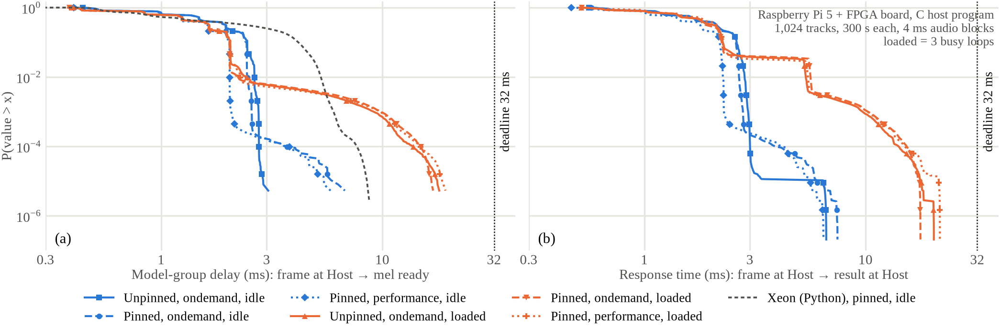

# P3.16 보고서: 라즈베리파이 5 Host 처리 지연, Ethernet 링크 지연, mic 입력

작성일: 2026-11-12 (mic 측정 2026-11-13 추가)

라즈베리파이 5를 FPGA 보드와 Ethernet으로 직결하고, Host program `mmss_host`(P4.8)로 1,024트랙을 실시간으로 보냈다. 06 §9.2의 남은 측정 세 가지를 쟀다. 측정 1은 처리량, 모델 그룹 지연, 추론 요청별 도착 퍼짐이고, 측정 2는 Ethernet 링크 지연과 packet 간격이다. 측정 3은 USB mic 2개로 block 전달 지연, xrun, sample clock drift를 쟀다. 스피커 loopback이 없어 ADC·USB 고정 지연은 재지 못했다.

## 1. 요약

### 1.1 환경

| 구분 | 내용 |
|---|---|
| Host | 라즈베리파이 5(Cortex-A76 4코어 2.4 GHz, 7.9 GiB), Debian 13, 커널 6.18.50, 냉각 fan 동작([ENVIRONMENT.md](../manual/ENVIRONMENT.md) §4) |
| Host program | `software/host/build/mmss_host`(aarch64 정적 빌드, P4.8 그대로). setup의 PNU 표는 Xeon 모델 그룹 지연 표(P3.25 CPU 고정·부하 없음)와 J = 800 µs |
| 보드 | P5.2 최종 bitstream(수신 tap 8, 송신 −80단계). sub1에서 JTAG로 쓰고 Pi `eth0`(macb, 1000 Mb/s, EEE 비활성, 수신 interrupt coalescing 49 µs)과 직결 |
| 입력 | `fan/train/normal_id_01_00000000.wav`(P3.25와 같다)를 1,024트랙에 복제. `--pace --loop`, block 64샘플(4 ms). 트랙 i의 모델은 i % 40(모델마다 25–26트랙) |
| 조건 | CPU 고정(없음, 계산 thread를 CPU 3에) × governor(ondemand, performance) × 부하(없음, busy loop 3개) 중 6개, 조건마다 300 s. 처음 16주기(0.5 s)는 뺀다 |
| 링크 측정 | CPU 3 고정·performance·부하 없음에서 120 s 동안 Pi `eth0`를 tcpdump로 기록(kernel software timestamp, ns) |
| mic 측정 | 같은 제품 USB mic 2개(Generalplus MUSIC-BOOST, USB full speed, 서로 다른 USB bus). 44.1·48 kHz만 지원해 48 kHz로 받는다. ALSA를 직접 열어(`p316_alsa_rec.py`) period 1·2·10 ms(부하 없음)와 1·2·4·10 ms(busy loop 3개)에서 5분씩. ALSA buffer = period × 4. Pi clock은 NTP 동기(systemd-timesyncd) |

### 1.2 결과

| 질문 | 답 |
|---|---|
| Pi가 1,024트랙을 실시간으로 처리하는가 | 6조건 모두 추론 요청 9,597,978개를 보내고 결과를 모두 받았다. 손실, 32 ms 초과, `REQ_DROP`, UDP 수신 buffer 오류, NIC 수신 오류가 모두 0이다(§3.1) |
| 특징 추출 비용 | 추론 요청당 14.8 µs(performance)–18.1 µs(ondemand). 계산 thread가 core 하나의 47–58%를 쓴다(§3.1) |
| 모델 그룹 지연 G | 부하 없음: p99 2.04–2.64 ms, 최대 3.15–7.23 ms. 부하 3개: p99.9 9.1–9.9 ms, 최대 17.1–20.1 ms(§3.2) |
| G는 어디서 생기는가 | 4 ms block 하나마다 모델 5개의 frame이 끝나고, 계산 thread 하나가 차례로 계산한다. block 안 k번째 모델의 G p50은 약 0.49k ms이고, G의 69%가 앞 모델을 기다린 시간이다(§3.2) |
| 추론 요청별 지연 j(같은 모델·주기 FPGA 도착 퍼짐) | 모든 조건 p99.9 17 µs. 최대는 부하 없음 18–40 µs, 부하 3개 2.2–5.5 ms(§3.3) |
| response time | 부하 없음: p99 2.26–2.84 ms, 최대 6.46–7.47 ms. 부하 3개: p99 5.37–5.64 ms, 최대 17.7–21.7 ms(§3.4) |
| 링크 지연 | 입력(`t_arr − t_send`) p50 22 µs·최대 50 µs, 결과(`t_recv − t_done`) p50 38 µs·최대 126 µs(대칭 가정). 왕복은 가정 없이 p50 61 µs·최대 148 µs(§3.5) |
| packet 간격 | 모델 그룹마다 datagram 2개(23개 + 2–3개). Host 송신 간격 p50 9.6 µs, FPGA 도착 간격 p50 15 µs·최대 18 µs(§3.5) |
| FPGA | FPGA 시간(`t_done − t_in`) 최대 190 µs. 모델 그룹당 weight 적재 0.947–1.000번(추론당 weight 4,872–5,142 B)(§3.6) |
| mic sample clock drift | 두 mic 모두 Pi clock보다 57.5–59.8 ppm 느리다(1시간에 frame 경계가 207–215 ms 어긋남). 두 mic 사이 차이는 0.002 ppm 이하다(§3.7) |
| mic block 전달 | ALSA timestamp부터 program이 block을 받기까지 p99 14–58 µs, 최대 부하 없음 0.07–0.97 ms·부하 3개 0.88–3.14 ms(§3.7) |
| xrun | period 1 ms(buffer 4 ms)·부하 3개에서만 5분에 25·35번. 나머지 조건은 0(§3.7) |



### 1.3 결론

1. 라즈베리파이 5 한 대로 1,024트랙을 실시간으로 처리할 수 있다. 조건 6개를 300 s씩 돌리는 동안 결과 손실과 deadline miss가 없었다. sub1(Intel I219)에서 100만 개당 약 7개씩 생기던 결과 손실도 Pi NIC에서는 0이다. 특징 추출은 core 하나의 절반 정도를 쓰므로 여유는 약 2배다. Ethernet 링크 지연은 입력 p50 22 µs, 결과 p50 38 µs로 PCIe 64 B 전송(P3.3, H2C p50 27.2 µs)과 같은 수준이다.
2. 같은 모델 추론 요청의 FPGA 도착 퍼짐은 p99.9 17 µs다. 이 값은 datagram 2개(추론 요청 25–26개)를 1 Gb/s로 보내는 시간이다. Simulation의 J(0.8–3.2 ms)와 PNU 표의 J(800 µs)보다 훨씬 작다. 다만 다른 core가 모두 바쁘면 드물게 2–5 ms까지 퍼진다. 모델 그룹 374,281개 중 송신이 0.1 ms 넘게 걸린 것이 19–35개였다.
3. 부하가 없으면 G는 block 안 계산 순서로 거의 정해진다(0.5–2.5 ms). Xeon Python 측정(CPU 고정 p99 5.27 ms, 최대 8.75 ms)보다 꼬리가 짧다. performance 설정은 특징 추출 시간을 18% 줄여 G p50을 1.48 ms에서 1.24 ms로 줄였다. 계산 thread를 CPU에 고정해도 최대는 줄지 않았다(고정 없음 3.15 ms, 고정 6.22–7.23 ms).
4. busy loop 3개로 다른 core를 채우면 CPU 고정이나 performance와 관계없이 G 최대가 17–20 ms, response time 최대가 18–22 ms다. 결과의 약 3%는 Pi가 받기까지 약 3 ms를 더 기다렸다. 원인은 확인하지 않았다(§4). 이 조건에서도 weight 적재는 모델 그룹당 1번을 넘지 않았다.
5. 두 USB mic는 같은 clock을 따른다(차이 0.002 ppm 이하). 하지만 Pi clock보다는 약 59 ppm 느려서, 샘플 번호로 frame을 자르면 frame 경계가 Host clock의 offset 시각에서 1시간에 약 0.21 s 밀린다. 그래서 "frame 경계와 Host clock이 맞는다"는 가정(01 §4)은 보정 없이는 성립하지 않는다. 모든 mic가 함께 밀리므로 보정은 Pi 하나에 한 값이면 된다. mic가 16 kHz를 지원하지 않아 48 kHz를 1/3로 줄이는 resampler가 필요하므로, drift 보정은 이 resampler에 함께 넣을 수 있다. block 전달은 period 2 ms 이상이면 부하가 있어도 xrun이 없었다.

### 1.4 한계와 남은 결정

- ADC·USB 고정 지연은 스피커 loopback이 없어 재지 못했다. Pi의 소리 출력은 HDMI뿐이다.
- resampler 지연을 Host 처리 지연과 mic–Host 지연 중 어디에 넣을지는 미정이다(§3.7).
- 부하 꼬리의 원인은 확인하지 않았다. 실시간 우선순위(SCHED_FIFO) 조건은 Pi의 sudo 인증이 만료되어 돌리지 못했다.
- Entry 수, PNU 표, `MARGIN_US`는 이 측정값으로 simulation을 다시 돌린 뒤 정한다(P3.17, P3.20).

## 2. 방법

### 2.1 구성

```text
sub1   bitstream(JTAG). 보드 Ethernet은 Pi eth0에 직결(Pi 192.168.10.1, FPGA 192.168.10.2)
Pi     조건마다: governor 설정 → mmss_host stop·setup(모델 image 40개 적재·확인 1.07 s, PNU 표, RUN)
       → busy loop 시작 → mmss_host run --tracks 1024 --pace --loop --seconds 300 [--cpu 3] --log /tmp/...
       → busy loop 종료 → mmss_host stop(FPGA counter) → 결과 CSV를 gzip해 SD로 옮김
main   analyze_p316.py(sub2에서 실행): 요약, 모델 그룹 지연 표, CCDF, 링크 지연 표본
```

결과 CSV는 측정 중에 tmpfs(`/tmp`)에 쓰고, 조건이 끝난 뒤 SD card로 옮겼다. 측정 중의 SD 쓰기가 수신 thread를 늦추지 않게 하려는 것이다. 조건 앞뒤로 governor, 온도, `get_throttled`, ARM clock, UDP·NIC counter를 기록했다.

### 2.2 조건

| 이름 | 계산 thread | governor | 부하 | 시간 |
|---|---|---|---|---:|
| `pin-none_ondemand_load0` | 고정 없음 | ondemand(기본값) | 없음 | 300 s |
| `pin3_ondemand_load0` | CPU 3 | ondemand | 없음 | 300 s |
| `pin3_performance_load0` | CPU 3 | performance | 없음 | 300 s |
| `pin-none_ondemand_load3` | 고정 없음 | ondemand | busy loop 3개(고정 없음) | 300 s |
| `pin3_ondemand_load3` | CPU 3 | ondemand | busy loop 3개(CPU 0–2) | 300 s |
| `pin3_performance_load3` | CPU 3 | performance | busy loop 3개(CPU 0–2) | 300 s |
| `cap_pin3_performance_load0` | CPU 3 | performance | 없음 + tcpdump(CPU 0–2) | 120 s |

부하는 `sh -c 'while :; do :; done'`이다. 계산만 하므로 memory bandwidth나 interrupt 부하는 주지 않는다. 수신 thread와 시각 thread는 어느 조건에서도 고정하지 않았다(06 §2 가정 1).

### 2.3 계산

| 값 | 식 |
|---|---|
| 모델 그룹 지연 G | `t_ready − t_host`. `t_host`는 frame 마지막 샘플이 든 4 ms block의 도착 예정 시각(`--pace`)이다 |
| 계산 전 대기, 계산 | `t_start − t_host`, `t_ready − t_start` |
| 추론 요청별 지연 j | FPGA 도착 시각 `t_in` − 같은 모델·주기 안에서 가장 이른 `t_in`. FPGA 시각은 µs 정수다 |
| response time | `t_recv − t_host`(Host clock) |
| 링크 왕복 | (결과 수신 pcap 시각 − 그 추론 요청이 든 datagram의 송신 pcap 시각) − (`t_done − t_in`) |
| 링크 지연(입력, 결과) | 입력 = `t_in` − 송신 pcap 시각, 결과 = 수신 pcap 시각 − `t_done`. 두 clock 차이는 1초 창마다 양방향 최솟값이 같다고 보고(대칭 가정) 구한 뒤 창 사이를 선형 보간한다. 추정한 clock 차이의 기울기는 6.8 ppm이다 |
| packet 간격 | 같은 모델·주기의 datagram 0 → 1. Host는 송신 pcap 시각, FPGA는 각 datagram 첫 추론 요청의 `t_in` |

### 2.4 mic 측정

Pi에는 PortAudio가 없고 설치에 root가 필요해서, `p325_audio_rec.py`(PortAudio)의 기록 부분(`Recorder`, 같은 열)만 쓰고 장치는 `libasound`를 ctypes로 직접 열었다(`p316_alsa_rec.py`). 장치마다 thread 하나가 `snd_pcm_readi`로 period 하나씩 읽고, 읽은 직후의 CLOCK_MONOTONIC(`t_ret`), ALSA status의 `htstamp`(마지막 hw pointer 갱신 시각, CLOCK_MONOTONIC), `avail`(buffer에 남은 frame)을 남긴다. Mic 두 개는 한 process에서 함께 돌았다. Host program(`mmss_host`)은 이 측정에서 돌리지 않았다.

| 값 | 식 |
|---|---|
| sample clock drift | `htstamp` 시점까지 들어온 샘플 수 N = `sample_index + 1 + avail`. 1초 창마다 (`htstamp` − N / 48 kHz)의 최솟값으로 직선을 맞춘 기울기. xrun 사이 구간마다 절편을 따로 둔다 |
| read 지연 | `t_ret − htstamp` |
| block 전달 지연 | `t_ret` − 위 직선으로 구한 그 block 마지막 샘플의 가장 이른 도착 시각 |
| xrun | `snd_pcm_readi`가 EPIPE(buffer 넘침)를 돌려준 횟수 |

`analyze_p325.py --m1`(read 시각 기준, P3.25 방법)으로도 drift를 구해 같은 값을 얻었다(period 4 ms·부하 3개 −59.19 ppm, period 1 ms·부하 없음 −57.47 ppm).

## 3. 결과

### 3.1 처리량과 손실

| 조건 | 특징 추출(µs/추론 요청) | core 사용 | overrun(block 75,000개 중) | 손실 | 온도 전→후 |
|---|---:|---:|---:|---:|---|
| 고정 없음·ondemand·부하 없음 | 18.1 | 58% | 0 | 0 | 50.5 → 57.6 °C |
| CPU 3·ondemand·부하 없음 | 17.8 | 57% | 12 | 0 | 62.0 → 58.7 °C |
| CPU 3·performance·부하 없음 | 14.8 | 47% | 11 | 0 | 57.1 → 59.3 °C |
| 고정 없음·ondemand·부하 3 | 15.1 | 48% | 438 | 0 | 58.2 → 76.8 °C |
| CPU 3·ondemand·부하 3 | 14.9 | 48% | 455 | 0 | 67.0 → 79.0 °C |
| CPU 3·performance·부하 3 | 15.1 | 48% | 410 | 0 | 69.2 → 78.5 °C |
| tcpdump(120 s) | 14.8 | 47% | 2 | 0 | 70.3 → 63.1 °C |

- `overrun`은 다음 block이 들어올 때까지 계산을 마치지 못한 횟수다.
- ondemand에서도 부하가 있으면 clock이 2.4 GHz로 올라가 특징 추출 시간이 performance와 같아진다.
- 손실은 보낸 추론 요청 수 − 받은 결과 수다. FPGA counter로도 모든 조건에서 `REQ_IN` = `RES_OUT`, `REQ_DROP` = 0, `LATE` = 0이다.

### 3.2 모델 그룹 지연

| 조건 | p50 (ms) | p99 (ms) | p99.9 (ms) | 최대 (ms) | 계산 전 대기 p50 (ms) |
|---|---:|---:|---:|---:|---:|
| 고정 없음·ondemand·부하 없음 | 1.49 | 2.64 | 2.76 | 3.15 | 1.02 |
| CPU 3·ondemand·부하 없음 | 1.48 | 2.45 | 2.56 | 7.23 | 1.02 |
| CPU 3·performance·부하 없음 | 1.24 | 2.04 | 2.07 | 6.22 | 0.86 |
| 고정 없음·ondemand·부하 3 | 1.25 | 2.43 | 9.12 | 20.09 | 0.86 |
| CPU 3·ondemand·부하 3 | 1.24 | 2.23 | 9.85 | 17.06 | 0.85 |
| CPU 3·performance·부하 3 | 1.25 | 2.28 | 9.76 | 19.72 | 0.86 |
| 참고: Xeon, Python, CPU 고정·부하 없음(P3.25) | 1.17 | 5.27 | 6.01 | 8.75 | |
| 참고: Xeon, Python, 고정 없음·부하 없음(P3.25) | 1.19 | 6.70 | 15.16 | 31.07 | |

Xeon 값은 Python program이고 frame 끝 시각마다 timer로 깨어나 계산했다. Pi 값은 C program이고 4 ms block 단위로 계산한다. 그래서 두 값은 Host 성능 비교가 아니다.

Block 안 계산 순서별 G(고정 없음·ondemand·부하 없음)는 아래와 같다. 4 ms block 74,856개 모두에서 frame이 끝나는 모델이 정확히 5개였다.

| block 안 순서 | 계산 전 대기 p50 (ms) | 계산 p50 (ms) | G p50 (ms) | G 최대 (ms) |
|---:|---:|---:|---:|---:|
| 1 | 0.06 | 0.45 | 0.50 | 2.38 |
| 2 | 0.52 | 0.47 | 1.00 | 1.34 |
| 3 | 1.02 | 0.47 | 1.49 | 1.96 |
| 4 | 1.50 | 0.47 | 1.97 | 2.55 |
| 5 | 1.99 | 0.47 | 2.45 | 3.15 |

- Offset Assignment는 frame을 자를 샘플 번호만 정하므로 실행 비용이 없다. G는 특징 추출 시간과, 같은 block에 걸린 앞 모델의 특징 추출을 기다리는 시간으로 이루어진다.
- FPGA에는 모델이 0.8 ms 간격으로 오지 않는다. 4 ms마다 모델 5개가 약 0.47 ms 간격으로 온다.
- 부하가 없을 때 G가 5 ms를 넘은 모델 그룹은 CPU 3 고정 두 조건에서만 17개, 9개였다. 이때 모델 그룹 하나의 계산이 3.0–3.7 ms까지 늘었다. 고정하지 않은 조건에서는 0개다.

부하 3개 조건의 꼬리는 아래와 같다(모델 그룹 374,281개 중).

| 조건 | 송신이 0.1 ms 넘게 걸림 | 계산이 5 ms 넘게 걸림 | G > 10 ms | G > 15 ms |
|---|---:|---:|---:|---:|
| 고정 없음·ondemand | 35 | 13 | 265 | 22 |
| CPU 3·ondemand | 19 | 27 | 356 | 35 |
| CPU 3·performance | 30 | 20 | 342 | 34 |

### 3.3 추론 요청별 지연

| 조건 | p50 (µs) | p99 (µs) | p99.9 (µs) | 최대 (µs) |
|---|---:|---:|---:|---:|
| 부하 없음 3조건 | 8 | 17 | 17 | 18–40 |
| 부하 3개 3조건 | 8 | 17 | 17 | 2,163–5,487 |

- 같은 모델·주기의 FPGA 도착 퍼짐(최대 − 최소)은 모든 조건에서 p99.9 17 µs다. Host가 모델 하나의 트랙을 모두 계산한 뒤 datagram 2개로 이어 보내기 때문이다. 퍼짐의 대부분은 첫 datagram(1,514 B)을 1 Gb/s로 보내는 시간이다.
- 부하가 있으면 두 datagram 사이에서 송신 thread가 멈춰 같은 모델 그룹이 ms 단위로 나뉘어 도착한 경우가 있다(§3.2의 송신 0.1 ms 초과).
- Host 계산 완료 시각의 퍼짐은 정의상 0이다. 모델 그룹 계산이 끝나는 시각 하나를 그 모델의 모든 트랙에 쓴다.

### 3.4 response time

| 조건 | FPGA 도착 − `t_host` p99 (ms) | response time p50 (ms) | p99 (ms) | p99.9 (ms) | 최대 (ms) |
|---|---:|---:|---:|---:|---:|
| 고정 없음·ondemand·부하 없음 | 2.68 | 1.66 | 2.84 | 2.95 | 6.65 |
| CPU 3·ondemand·부하 없음 | 2.49 | 1.65 | 2.68 | 2.79 | 7.47 |
| CPU 3·performance·부하 없음 | 2.08 | 1.40 | 2.26 | 2.29 | 6.46 |
| 고정 없음·ondemand·부하 3 | 2.48 | 1.54 | 5.37 | 9.71 | 20.37 |
| CPU 3·ondemand·부하 3 | 2.28 | 1.63 | 5.64 | 10.24 | 17.71 |
| CPU 3·performance·부하 3 | 2.32 | 1.80 | 5.49 | 10.24 | 21.69 |

- 부하 3개 조건에서는 FPGA 도착까지의 p99가 부하 없음과 비슷하다. 그런데 response time p99는 약 3 ms 크다. FPGA 시간 p99는 모든 조건에서 172 µs이므로, 늘어난 시간은 결과가 Pi에 돌아와 수신 thread가 받기까지의 구간에서 생긴다. 결과의 약 3%가 이렇게 늦었다(그림 (b)의 5.5 ms 계단).
- 부하가 없을 때 최대 6.5–7.5 ms는 0.1 s 안에 몰린 한 번의 사건이다. 고정 없음·ondemand에서는 292 s 지점에서 결과 104개가 FPGA 완료부터 Pi 수신까지 약 3.9 ms 걸렸다. 평소 이 구간은 p50 41 µs, p99.99 0.3 ms다.

### 3.5 링크 지연과 packet 간격

CPU 3 고정·performance·부하 없음, 120 s. tcpdump가 packet 4,139,040개를 잡았고 kernel에서 버린 packet은 0개다. 추론 요청 3,837,978개가 모두 결과와 짝을 이뤘다.

| 값 | p50 (µs) | p99 (µs) | p99.9 (µs) | 최대 (µs) |
|---|---:|---:|---:|---:|
| 링크 왕복(가정 없음) | 60.7 | 86.0 | 87.0 | 147.6 |
| 링크 지연, 입력(`t_arr − t_send`, 대칭 가정) | 22.0 | 30.0 | 32.5 | 50.3 |
| 링크 지연, 결과(`t_recv − t_done`, 대칭 가정) | 37.5 | 70.8 | 71.5 | 126.0 |
| 제어 packet 왕복(시각 맞추기 610번) | 17.8 | 88.0 | 91.3 | 91.6 |
| datagram 간격, Host 송신 | 9.6 | 10.3 | 14.5 | 40.0 |
| datagram 간격, FPGA 도착 | 15 | 16 | 16 | 18 |
| 참고: PCIe 64 B H2C(P3.3) | 27.2 | | | |

- 입력 링크 지연에는 Pi kernel의 송신 기록 시점 뒤 NIC 전송, 케이블, FPGA MAC·UDP 수신, `t_in` 기록까지가 들어간다. 결과 링크 지연에는 FPGA 결과 송신 대기와 Pi NIC 수신 interrupt coalescing(49 µs)이 들어간다. 결과 쪽이 큰 것은 이 coalescing 때문으로 보인다.
- 모델 그룹 149,921개 모두 datagram 2개로 나뉘었다(23개 + 2–3개).
- Simulation 입력용 표본은 `eth_up_ns.txt`(입력), `eth_down_ns.txt`(결과)다. 측정한 381만 개를 최소부터 최대까지 고른 분위수 20,000개로 줄였다. PCIe 표본과 형식(ns, 한 줄에 하나)과 줄 수가 같다.

### 3.6 FPGA counter

| 조건 | batch / 모델 그룹 | weight 적재 / 모델 그룹 | 추론당 weight (B) | 연산 busy | 연산 정지 |
|---|---:|---:|---:|---:|---:|
| 고정 없음·ondemand·부하 없음 | 1.105 | 0.947 | 4,872 | 17.2% | 5.20% |
| CPU 3·ondemand·부하 없음 | 1.013 | 0.993 | 5,109 | 17.2% | 5.45% |
| CPU 3·performance·부하 없음 | 1.058 | 0.971 | 4,993 | 17.2% | 5.33% |
| 고정 없음·ondemand·부하 3 | 1.005 | 0.998 | 5,131 | 17.2% | 5.47% |
| CPU 3·ondemand·부하 3 | 1.003 | 0.998 | 5,134 | 17.2% | 5.48% |
| CPU 3·performance·부하 3 | 1.000 | 1.000 | 5,142 | 17.2% | 5.49% |

- 모델 그룹 하나는 모델 image 하나(131,648 B)를 많아야 한 번 적재한다. 1번이면 추론당 5,142 B다. 부하가 없을 때는 cache hit로 0.7–5.3% 적었고, 부하가 있으면 이 hit가 사라졌다. 부하나 overrun 때문에 적재가 1번을 넘은 조건은 없다.
- batch가 모델 그룹보다 많은 것은 둘째 datagram(2–3개)이 따로 batch가 된 경우로 보인다. 확인은 하지 않았다. 이때도 적재는 늘지 않았다.
- 추론당 membrane potential 전송은 535 B, `MAX_PENDING`은 모든 조건에서 26이다.

### 3.7 mic 입력

조건마다 5분, mic 2개의 범위다.

| period | 부하 | drift (ppm) | xrun | read 지연 p99 / 최대 (µs) | block 전달 지연 p99 / 최대 (µs) |
|---:|---|---:|---:|---|---|
| 1 ms | 없음 | −57.47 | 0, 0 | 28–39 / 70–83 | 74–84 / 102–121 |
| 2 ms | 없음 | −59.75 | 0, 0 | 28–37 / 922–973 | 142–149 / 1,033–4,229 |
| 10 ms | 없음 | −58.79 | 0, 0 | 16–35 / 113–313 | 52–73 / 164–372 |
| 1 ms | 3개 | (xrun으로 제외) | 25, 35 | 33–51 / 975–3,138 | 4,029–4,041 / 6,760–7,930 |
| 2 ms | 3개 | −59.14 | 0, 0 | 14–27 / 981–995 | 31–51 / 3,957–5,695 |
| 4 ms | 3개 | −59.17 | 0, 0 | 15–29 / 876–953 | 28–45 / 3,792–5,055 |
| 10 ms | 3개 | −58.9 | 0, 0 | 39–58 / 967–972 | 47–69 / 5,873–5,880 |

- **drift.** 두 mic 모두 Pi clock보다 57.5–59.8 ppm 느리다. 같은 조건 안에서 두 mic 차이는 0.002 ppm 이하다. 두 mic가 USB bus clock을 따르기 때문으로 보인다. 조건 사이에 2.3 ppm 차이가 있고, 원인은 보지 않았다. Pi clock은 NTP로 맞추는 중이었다(주파수 보정 −5.2 ppm).
- **frame 경계.** 59 ppm이면 샘플 번호로 자른 frame 끝이 Host clock의 offset 시각에서 13.6 s마다 0.8 ms(offset 간격 하나), 약 9분마다 32 ms(한 주기) 밀린다. 16 kHz로는 1.06 s마다 샘플 하나다. 모든 mic가 함께 밀리므로 모델 사이 offset 간격은 그대로다. Host clock 기준 시각(`t_host`, PNU 예측)과 frame 경계 사이만 벌어진다.
- **xrun.** period 1 ms(buffer 4 ms)에 부하가 있을 때만 생겼다. period 2 ms(buffer 8 ms) 이상은 부하가 있어도 0이다. capture는 period가 차는 즉시 읽으므로, buffer를 키워도 지연은 늘지 않는다.
- **block 전달.** 평소에는 ALSA가 받은 뒤 0.1 ms 안에 program이 읽는다. 가끔 read가 약 1 ms 늦고, 부하가 있으면 block이 buffer에서 4–8 ms 기다린 뒤 읽힌 적이 있다(`avail` 최대 240 frame = 5 ms). `t_host`를 `read()` 반환 시각 대신 `htstamp`로 잡으면 이 지연이 `t_host`에 섞이지 않는다(P4.8 남은 일).
- **샘플 rate.** mic는 44.1·48 kHz만 지원한다. 학습 특징은 16 kHz이므로 48 kHz를 1/3로 줄이는 resampler가 필요하다. 8 kHz 위를 거르는 low-pass filter의 지연은 계산상 linear-phase FIR 48 tap이 0.49 ms다. 지난 샘플만 쓰는 filter(causal)는 Host 처리 지연에 계산 시간만 더하고, filter의 group delay만큼 frame이 더 옛날 소리를 담는다. 이 지연을 Host 처리 지연과 mic–Host 지연 중 어디에 넣을지는 미정이다. Resampler는 아직 만들지 않았고 재지도 않았다.
- **mic–Host 지연.** 잰 부분은 ALSA가 샘플을 받은 뒤 program이 읽기까지(read 지연)와 block 전달 지연이다. Frame 마지막 샘플은 block이 찰 때까지 최대 period만큼 더 기다린다. ADC·USB 고정 지연은 스피커 loopback이 없어 재지 못했다.

## 4. 검증과 한계

- **조건 2 재측정.** `pin3_ondemand_load0`을 처음 잴 때 15:34–15:35에 원자료 약 200 MB를 Pi에서 가져왔다. 그래서 다른 측정이 끝난 뒤 다시 쟀고, 이 보고서는 재측정 값만 쓴다. 방해받은 측정(`raw/disturbed/`)과 재측정은 overrun 9번과 12번, response time 최대 7.45 ms와 7.47 ms로 차이가 없었다.
- **부하 꼬리의 원인.** eth0 interrupt는 모두 CPU 0에서 처리됐다(CPU 3은 0번). 계산 thread가 CPU 3에서 다른 thread(고정하지 않은 수신·시각 thread 등)에 밀렸다는 추정과, 수신 thread가 busy loop와 CPU를 나눠 쓴다는 추정이 남아 있다. 확인하려면 SCHED_FIFO, 수신 thread 고정, block 크기를 바꿔 다시 재야 한다. SCHED_FIFO 조건(`p316_pi_run.sh`의 `rt_` 접두어)은 sudo 인증이 만료되어 돌리지 못했다.
- **편도 링크 지연.** 대칭 가정으로 나눈 값이다. 두 방향의 최소 경로가 실제로는 같지 않을 수 있다(결과 쪽에 interrupt coalescing이 있다). 왕복은 가정이 없다. FPGA 시각은 µs 정수라 ±1 µs 오차가 있다.
- **온도.** `get_throttled`에 bit 19(soft temperature limit 발생)가 일부 조건에서 찍혔다. clock 제한(bit 17)과 throttling(bit 18)은 찍히지 않았다. 최고 온도는 79.0 °C다.
- **입력.** wav 하나를 모든 트랙에 복제했다. 특징 추출 계산량은 입력 값과 관계없다. block 크기는 Host program 기본값 64샘플(4 ms)이다. 실제 mic의 ALSA period는 다를 수 있다.
- **PNU 표.** setup에는 Xeon 모델 그룹 지연 표를 넣었다. Cache 효율은 이 측정의 목적이 아니다.
- **tcpdump 조건.** tcpdump가 CPU 0–2에서 함께 돌았다. Pi `net.core.rmem_max`는 4 MiB였다.
- **mic 1 ms·부하 없음 재측정.** 처음 측정 중 16:49:30–32에 runner를 잘못 띄워 Python process 12개(일부는 busy loop 포함)가 잠깐 돌았다. 그래서 다시 쟀고 재측정 값만 쓴다. 방해받은 측정(`raw/disturbed/mic_buf1_load0_5min*`)은 xrun 1번·read 지연 최대 970 µs, 재측정은 xrun 0·최대 83 µs다.
- **mic 측정 범위.** 처음 계획(period 4종 × 부하 2종 × 30분, drift 60분)을 5분씩 7조건으로 줄였다. period 4 ms·부하 없음과 60분 drift 측정은 하지 않았다. 5분 기록으로도 drift는 0.01 ppm보다 정밀하게 나온다(합성 데이터 확인). 기록 program은 Python이라 read 지연에 Python thread가 깨어나는 시간이 들어 있다.
- **Pi 설정.** `eth0`는 NetworkManager 관리를 끄고 192.168.10.1/24를 runtime으로 넣었다. 재부팅하면 사라진다. 측정에 쓰려고 tcpdump와 ethtool을 설치했다. Governor는 측정 뒤 ondemand로 되돌렸다.

## 5. 다음 작업

1. P3.17: Pi 모델 그룹 지연 표(`pi_group_<조건>.csv.gz`)와 Ethernet 링크 지연 표본으로 simulation의 method 비교, entry 수 실험, deadline 분석을 다시 돌린다. 측정한 j는 합성 j ~ Uniform(0, J)보다 훨씬 작다. 부하 조건의 드문 퍼짐을 어떻게 넣을지도 정한다.
2. PNU 표를 Pi 표로 바꾼다. `setup`은 gzip을 읽지 않으므로 풀어서 넘긴다.
3. 부하 꼬리 원인: SCHED_FIFO, 수신 thread 고정, block 16·32샘플을 비교한다.
4. P3.20 `MARGIN_US`: 결과 링크 지연 최대 126 µs를 기준으로 정한다.
5. P4.8: Host program에 mic 입력(48 kHz)을 붙인다. 48 kHz → 16 kHz resampler에 drift 보정(약 −59 ppm, 실행 중 추정)을 함께 넣고, `t_host`를 ALSA `htstamp`로 잡는다. ALSA buffer는 period 2 ms 이상 또는 8 ms 이상으로 둔다.
6. resampler 지연을 01 §4 시간 기준의 어디에 넣을지 정한다.
7. ADC·USB 고정 지연은 스피커와 mic를 붙인 loopback으로 잰다.

## 6. 실행

```bash
# sub1: bitstream(PCIe 장치를 sysfs remove로 뗀 뒤)
vivado -mode batch -nojournal -nolog -source program_fpga.tcl -tclargs -bit accel_top.bit
# Pi: eth0 runtime 설정(재부팅하면 사라짐)
sudo nmcli dev set eth0 managed no && sudo ip addr add 192.168.10.1/24 dev eth0
# Pi 작업 폴더(저장소 root와 같은 상대 경로)에 mmss_host, models_l64, 입력 wav, run/xeon_model_group_delay.csv를 두고
bash p316_pi_run.sh                                   # 6조건 × 300 s + tcpdump 120 s
CONDS=pin3_ondemand_load0 bash p316_pi_run.sh         # 일부만
# 원자료를 hardware/board_test/p316_meas/raw/로 가져온 뒤(메모리 약 2 GB, sub1·sub2에서)
python3 hardware/board_test/host/analyze_p316.py
python3 analysis/develop/delay/fig2_x-delay-rpi5_y-ccdf.py
# mic: Pi 작업 폴더에 p316_alsa_rec.py, p325_audio_rec.py, p325_common.py를 두고 조건마다
python3 p316_alsa_rec.py --devices hw:CARD=Microphone,hw:CARD=Microphone_1 --buffer-ms 2 --load 3 --minutes 5 --out run/mic_buf2_load3_5min.csv.gz
# 원자료를 raw/로 가져온 뒤
python3 hardware/board_test/host/analyze_p316.py --mic                     # result/mic_summary.jsonl
```

원자료(1.6 GB)는 `hardware/board_test/p316_meas/raw/`에 있다(git 제외). git에는 `hardware/board_test/p316_meas/result/`의 요약(`summary.jsonl`, `link.json`, `mic_summary.jsonl`), 모델 그룹 지연 표, CCDF, 링크 지연 표본을 둔다.

## 7. 관련 문서

- [06_HOST_INTERFACE.md](../design_references/06_HOST_INTERFACE.md) §9: Host 처리 지연 측정 계획
- [P3.25 보고서](<P3.25 Research Report.md>) §4.11: Xeon Host 처리 지연 측정
- [P3.26 보고서](<P3.26 Research Report.md>) §2.4: 모델 그룹 지연 표
- [P4.8 보고서](<P4.8 Research Report.md>): Host program
- [P5.3 보고서](<P5.3 Research Report.md>), [P5.3 결과 손실 보고서](<P5.3 Result Loss Research Report.md>): sub1을 Host로 쓴 보드 시험
- [P3.1~P3.4 보고서](<P3.1~3.4 Research Report.md>): PCIe 지연 측정
