# P3.21 보고서: 하드웨어 없이 할 수 있는 실험 보강

작성일: 2026-10-16

jitter 측정처럼 보드나 장치가 있어야 하는 일을 빼고, simulation과 software 평가로 할 수 있는 실험을 모두 돌렸다. 대상은 P3.17(simulation 보강), P3.19(membrane potential 저장 보강), P2.9(실시간 특징 정규화)다. 값은 모두 simulation 또는 software 평가 결과다. 보드 실측이 아니다.

## 1. 요약

| 질문 | 답 | 그림 |
|---|---|---|
| jitter가 10~20 ms면? | entry 10으로 버티는 jitter는 약 8 ms다. jitter 10~20 ms면 DDR3 전송량이 2.3~6.5배(14.8~41.1 KiB/추론)로 는다. deadline miss는 없다 | 1 |
| offset 단위 모아 보내기로 jitter를 없앨 수 있나? | 대기 D ≥ jitter면 entry 2로 jitter와 상관없이 6.3 KiB/추론이다. 대신 최대 응답 시간이 약 jitter만큼 는다(jitter 20 ms면 21.8 ms) | 2 |
| 편중 배정에서 offset 간격을 트랙 수에 비례하게 하면? | 평균 응답 시간은 0.35 → 0.19 ms로 줄지만 DDR3 전송량이 최대 57 % 는다. 같은 간격을 유지한다 | 3 |
| on-chip membrane potential을 트랙별로 따지면? | 평균으로 계산한 값과 같다. DDR3 membrane potential을 offset 순서로 붙여 두면 batch가 클 때(offset 단위 모아 보내기)만 DMA가 84 % 준다 | 4 |
| layer마다 membrane potential bit를 따로 정하면? | [9, 9, 9, 12] bit(L2·L3는 아래 1 bit 버림)면 두 checkpoint 모두 AUC 손실이 없고 DDR3 전송량이 8 % 준다. 이득이 작아 membrane potential은 12 bit로 둔다(사용자 결정) | 5, 6 |
| 비교군(Dysta Method·DeepRT Method)과 비교하면? | 같은 BRAM에서 SW+HW는 DDR3 6.4 KiB/추론, 평균 응답 시간 0.18 ms다. Dysta Method는 56.8 KiB·1.6 ms, DeepRT Method는 11.3 KiB·7.8 ms다. 비교군에 같은 offset 배정·cache를 넣으면 Dysta Method는 제안과 같아진다. jitter가 커지면 HW(offset-order cache)가 SW만 쓸 때보다 DDR3를 최대 45 % 더 줄인다 | 8~12 |
| 1,024트랙보다 늘릴 수 있나? | compute array가 막는 약 4,600트랙까지 된다. Dysta Method도 DDR3 3 GB/s면 같다(DeepRT Method 4,096). DDR3가 1 GB/s면 Dysta Method 1,024, SW+HW 4,608트랙이다. 모든 입력이 spike인 worst case에서는 모두 1,024~1,408 | 13~15 |
| 응답 시간이 악조건에서 제약이 되나? | 악조건을 겹친 worst case에서 FPGA 시간이 Dysta Method 25.2 ms, DeepRT Method 29.9 ms, SW+HW 10.5 ms다. 외부 지연(오디오·Host·Ethernet)이 Dysta Method는 약 7 ms, DeepRT Method는 약 2 ms를 넘으면 miss가 난다. SW+HW는 20 ms까지 miss 0 | 표 |
| 실시간 정규화는? | 학습을 다시 하지 않으면 어떤 방법도 손실이 있다. segment 안 누적 최대·최소(seg)가 평균 −0.012~−0.015로 가장 적다. 재학습이 필요하다 | 7 |

## 2. 환경

| 구분 | 내용 |
|---|---|
| 제안 구성 | L·64 lane @100 MHz, 1,024트랙, offset 배정(모델 m은 m × 0.8 ms offset), Grouping, offset-order cache(entry 4), 남는 BRAM에 12 bit membrane potential, spike 2개/cycle, 결과 즉시 전송 |
| 실험 방법 | §3.1~3.7은 제안 구성에서 한 가지씩 바꾼다. §3.8~3.10은 같은 BRAM·trace·DDR3 조건에서 비교군 2개(Dysta Method·DeepRT Method, offset 배정 없음)와 ablation 4개(offset 배정 없음·HW만·SW만·SW+HW)를 비교한다 |
| simulation | `simulation/engine/engine.py`. 시나리오 6개(U, K, S, I, SK, R) × seed 10~20 |
| 모델 평가 | INT8 software reference(`snn_int8`), 40대 test set, checkpoint `L_normal_noaug`(지금 golden)과 `L_mixed_aug`(바꿀 예정) |
| 지표 | deadline miss, DDR3 KiB/추론(weight + membrane potential)과 MB/s, 응답 시간(생성 → Host 수신) 평균·최대, AUC |
| 하지 않은 것 | Host jitter 측정(M1~M4), Ethernet 지연 측정, 측정 jitter 분포 입력, RTL, 보드, 전력 |

jitter는 같은 모델 트랙의 추론 요청이 offset 뒤로 퍼져 도착하는 폭이다. simulation은 [0, jitter) 균등분포로 둔다. offset 배정을 하면 S는 U와, SK는 K와 같은 workload가 된다.

## 3. 실험과 결과

### 3.1 jitter 0.8~32 ms × entry 수

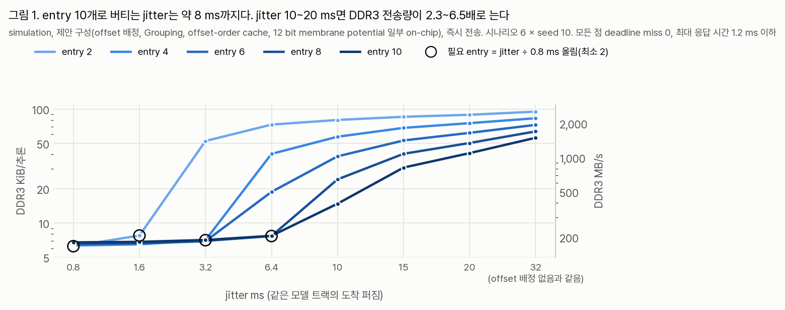

- 필요한 entry는 jitter ÷ 0.8 ms를 올린 값(최소 2)이다. 그 entry를 두면 DDR3 전송량이 6.3~7.7 KiB/추론으로 거의 같다(동그라미).
- BRAM에 둘 수 있는 entry는 10개까지다. 그래서 jitter가 약 8 ms를 넘으면 weight를 자주 다시 읽는다. entry 10에서 jitter 10 ms는 14.8 KiB/추론(394 MB/s), 20 ms는 41.1 KiB/추론(1,095 MB/s)이다.
- jitter 32 ms는 주기 전체에 고르게 퍼진 것이라 offset 배정이 없는 것과 같다. entry 4면 83.2 KiB/추론(2,218 MB/s)이다.
- 모든 점에서 deadline miss는 0이다. 최대 응답 시간은 1.14 ms 이하, DDR3는 최대 2,535 MB/s(실측 3,015 MB/s 안)다.

USB 마이크를 기본 buffer(10~20 ms)로 쓰고 즉시 전송하면 offset 배정의 이득이 대부분 사라진다.

### 3.2 Host offset 단위 모아 보내기 (대기 D)

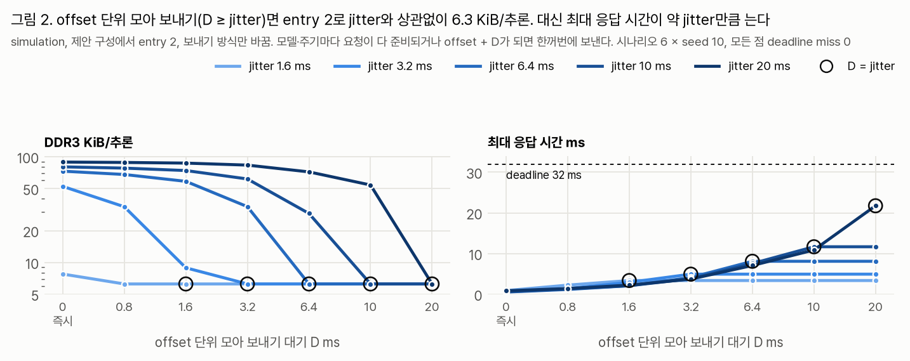

offset 단위 모아 보내기는 Host가 모델 하나의 요청이 모두 준비되거나 offset + D가 될 때까지 기다렸다가 한꺼번에 보내는 방식이다. 그 뒤에 준비된 요청은 바로 보낸다. entry 2로 돌렸다.

| jitter ms | 즉시 전송 KiB/추론 | offset 단위 모아 보내기(D = jitter) KiB/추론 | 평균 응답 시간 ms | 최대 응답 시간 ms |
|---:|---:|---:|---:|---:|
| 1.6 | 7.77 | 6.27 | 1.08 | 3.39 |
| 3.2 | 52.5 | 6.27 | 1.81 | 4.95 |
| 6.4 | 73.1 | 6.27 | 3.28 | 8.12 |
| 10 | 80.3 | 6.26 | 4.92 | 11.69 |
| 20 | 89.2 | 6.26 | 9.49 | 21.76 |

- D ≥ jitter면 DDR3 전송량이 jitter와 상관없이 6.26~6.27 KiB/추론(167 MB/s)이다. entry 4로 해도 6.4 KiB/추론으로 거의 같다.
- 응답 시간은 jitter만큼 는다. 가장 일찍 준비된 요청이 가장 늦은 요청을 기다리기 때문이다. jitter 20 ms에서도 최대 응답 시간 21.8 ms로 deadline 32 ms 안이고 miss는 0이다.
- D가 jitter보다 짧으면 효과가 일부만 난다. jitter 10 ms에 D 6.4 ms면 29.1 KiB/추론이다.
- D를 jitter보다 길게 잡아도 응답 시간은 더 늘지 않는다. 요청이 다 준비되면 D를 기다리지 않고 보낸다.

### 3.3 편중 배정의 offset 간격

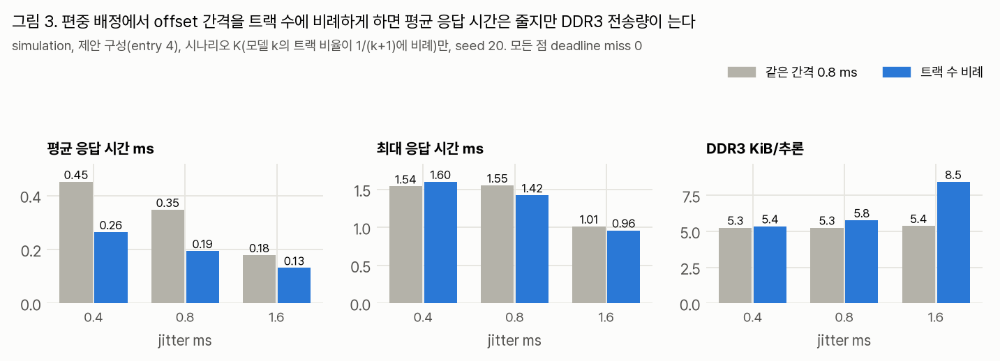

K 시나리오는 모델 k의 트랙 비율이 1/(k+1)에 비례한다. 가장 큰 모델은 트랙 240개쯤이라 batch 하나가 1.6 ms로 offset 간격 0.8 ms보다 길다. offset 간격을 모델의 트랙 수에 비례하게 바꿔 봤다.

| jitter ms | 평균 응답 시간 ms (같은 간격 → 비례) | 최대 응답 시간 ms | DDR3 KiB/추론 |
|---:|---|---|---|
| 0.4 | 0.45 → 0.27 | 1.54 → 1.60 | 5.27 → 5.37 |
| 0.8 | 0.35 → 0.19 | 1.55 → 1.42 | 5.27 → 5.78 |
| 1.6 | 0.18 → 0.13 | 1.01 → 0.96 | 5.39 → 8.45 |

평균 응답 시간은 줄지만 원래 0.5 ms 아래라 이득이 작다. 작은 모델의 offset 간격이 jitter보다 좁아져 여러 모델이 한꺼번에 섞여 오고, entry 4가 모자라 DDR3 전송량이 는다. 최대 응답 시간은 그대로다. 같은 간격을 유지한다.

### 3.4 트랙별 on-chip membrane potential과 DDR3 배치

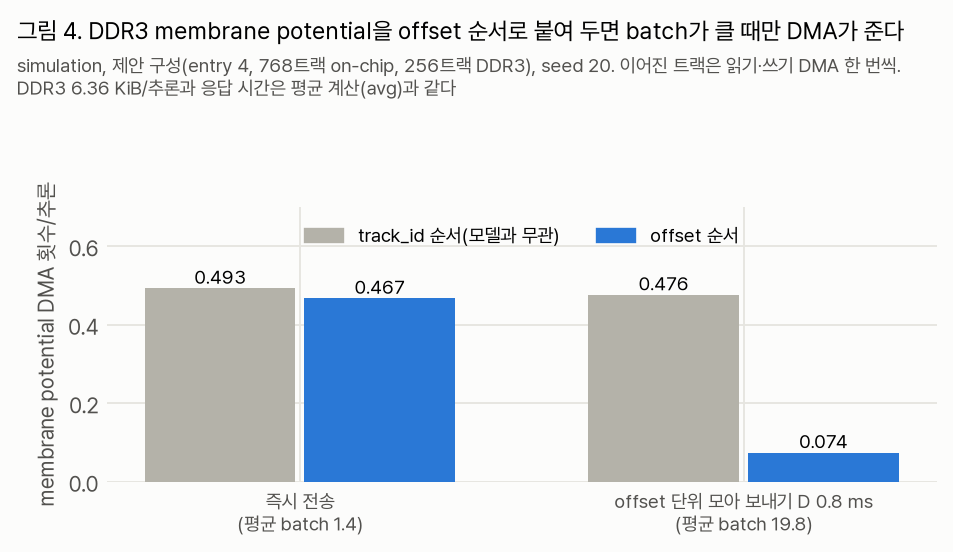

지금까지 simulation은 on-chip 트랙 비율(768/1,024)만큼 membrane potential 전송을 요청마다 평균으로 뺐다. 이번에는 트랙마다 on-chip인지 정하고, DDR3 트랙은 주소가 이어진 트랙끼리 읽기·쓰기 DMA를 한 번씩 하게 했다. DMA마다 0.244 µs를 더한다.

| 방식 | DDR3 KiB/추론 | 평균 응답 시간 ms | membrane potential DMA/추론 (즉시 → offset 단위 모아 보내기) |
|---|---:|---:|---|
| 평균(지금 simulation) | 6.36 | 0.181 | 세지 않음 |
| track_id 순서(모델과 무관) | 6.36 | 0.181 | 0.493 → 0.476 |
| offset 순서 | 6.36 | 0.181 | 0.467 → 0.074 |

- 평균 계산은 트랙별 계산과 DDR3 전송량·응답 시간이 같다. 지금까지의 simulation 결과는 그대로 쓴다.
- 즉시 전송에서는 batch가 평균 1.4개라 붙여 둬도 DMA가 거의 줄지 않는다. offset 단위 모아 보내기(batch 19.8개)에서만 84 % 준다.

### 3.5 layer별 membrane potential 저장 bit

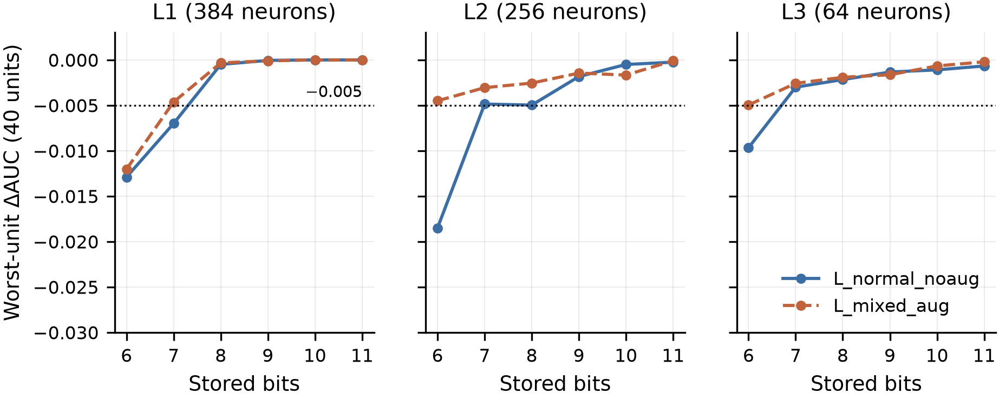

다음 timestep으로 넘기는 membrane potential을 layer마다 다른 bit로 저장했다. `9s1`은 9 bit로 저장하면서 아래 1 bit를 버린다는 뜻이다(범위 2배, 해상도 2). 손실 기준은 40대 중 가장 나쁜 장비의 AUC 하락 0.005 이하로 잡았다. 그림 5는 한 layer만 바꾸고 나머지는 12 bit(손실 없음)로 둔 결과다.

- L1은 8 bit로 충분하다(최저 ΔAUC −0.0005).
- L2는 9 bit에 아래 1 bit를 버려야 한다(−0.0018). 8 bit는 L_normal_noaug에서 기준에 걸친다(−0.0052).
- L3는 8~9 bit에 아래 1~2 bit를 버리면 된다(−0.0022 이하).

layer를 함께 바꾼 결과(L4는 12 bit):

| L1-L2-L3 | 트랙당 B | L_normal_noaug 평균 / 최저 ΔAUC | L_mixed_aug 평균 / 최저 ΔAUC |
|---|---:|---|---|
| 12-12-12 (지금) | 1,059 | 0 / 0 | 0 / 0 |
| **9-9s1-9s1** | 795 | +0.0008 / −0.0020 | +0.0005 / −0.0012 |
| 8-9s1-8s2 | 747 | +0.0008 / −0.0025 | +0.0007 / −0.0016 |
| 8-8s2-8s2 | 707 | +0.0009 / −0.0065 | +0.0006 / −0.0018 |
| 9-9-9 (버림 없음) | 795 | +0.0002 / −0.0297 | +0.0001 / −0.0095 |
| 10-10-10 | 883 | +0.0006 / −0.0017 | +0.0005 / −0.0025 |

9-9s1-9s1이 두 checkpoint에서 모두 손실이 없다. L2·L3는 bit 수보다 아래 bit를 버려 범위를 넓히는 것이 중요하다. P3.13에서 10 bit가 한 장비(valve_id06)에서 −0.023이었던 것은 출력 layer L4까지 10 bit로 줄였기 때문이다. L4는 2뉴런이라 12 bit로 둬도 크기가 거의 같다.

### 3.6 layer별 bit로 바꾼 BRAM 배분

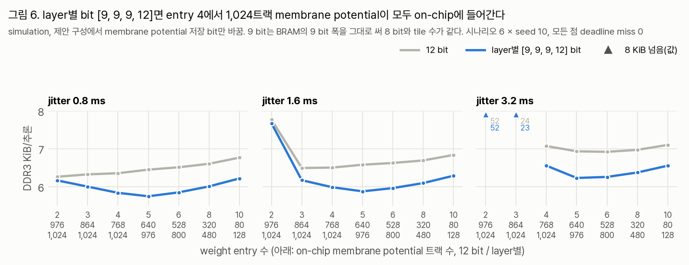

BRAM은 9 bit 폭(parity bit 포함)을 그대로 쓸 수 있다. 그래서 9 bit는 8 bit와 tile 수가 같다.

| entry | on-chip 트랙 (12 bit → [9, 9, 9, 12]) | DDR3 KiB/추론, jitter 0.8 / 1.6 / 3.2 ms (12 bit → [9, 9, 9, 12]) |
|---:|---|---|
| 4 | 768 → 1,024 | 6.36 → 5.84 / 6.51 → 5.99 / 7.08 → 6.56 |
| 5 | 640 → 976 | 6.45 → 5.75 / 6.58 → 5.88 / 6.94 → 6.23 |

entry 4에서 membrane potential이 모두 on-chip에 들어가 DDR3에는 weight만 남는다. DDR3 전송률은 7~8 % 준다(169 → 156 MB/s, jitter 0.8 ms). 응답 시간은 같다.

### 3.7 실시간 특징 정규화

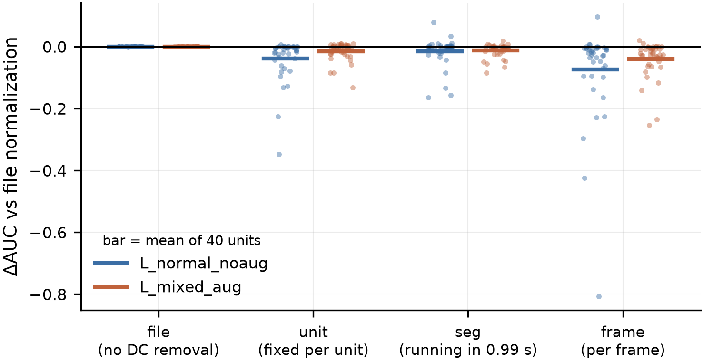

학습 특징은 10 s 파일 전체로 정규화했다(파일 평균 빼기, 파일 최대·최소 dB로 [0, 1]). 실시간 Host는 파일 전체를 모른다. 학습한 모델은 그대로 두고 test 특징만 바꿨다.

| 방법 | 쓰는 정보 | L_normal_noaug 평균 / 최저 ΔAUC | L_mixed_aug 평균 / 최저 ΔAUC |
|---|---|---|---|
| file (지금) | 파일 전체 | 0 / 0 | 0 / 0 |
| file, DC 제거 없음 | 파일 전체 | 0.0000 / −0.0015 | 0.0000 / −0.0004 |
| unit | 장비별 고정값(학습 파일 200개의 최대·최소 중앙값) | −0.038 / −0.347 | −0.015 / −0.132 |
| seg | segment(31 frame) 안에서 지금 frame까지의 최대·최소 | −0.015 / −0.165 | −0.012 / −0.084 |
| frame | frame마다 그 frame의 최대·최소 | −0.074 / −0.807 | −0.040 / −0.254 |

- DC 제거는 빼도 된다.
- seg가 평균 손실이 가장 작다. 크게 떨어지는 장비는 ToyCar다. unit은 pump_id00·valve가 크게 떨어진다. 파일마다 소리 크기가 달라 고정값이 맞지 않는다.
- 증강 학습판(L_mixed_aug)이 두 방법 모두에서 덜 떨어진다.
- 재학습 없이 손실 없는 방법은 없다. seg로 다시 학습해 40대 AUC를 확인해야 한다.

### 3.8 비교군과 SW·HW 협력 설계 비교

같은 BRAM(weight entry 4 + 12 bit membrane potential 768트랙 on-chip), 같은 trace·DDR3 조건에서 방법만 바꿨다. 비교군은 offset 배정 없이 돌린다. 모든 방법에서 scheduler가 결정에 드는 시간과 회로는 0으로 뒀다.

| 구분 | 방법 | 고른 이유·하는 일 |
|---|---|---|
| 비교군 | Dysta Method (MICRO'23) | 하드웨어로 구현된 multi-DNN 가속기 scheduler. 남은 시간·deadline 여유 점수로 고르고 기다리지 않는다. cache는 LRU |
| 비교군 | DeepRT Method (SEC'21) | 기다려 묶기의 대표. 모델별로 window(14.9 ms) 동안 온 요청을 모은다. cache는 LRU |
| ablation | offset 배정 없음 | offset 배정 없음 + LRU + Grouping |
| ablation | HW만 | offset 배정 없음 + offset-order cache |
| ablation | SW만 | Host offset 배정 + LRU |
| ablation | SW+HW (제안) | Host offset 배정 + offset-order cache + Grouping |

P3.11~P3.13에서 쓴 Clockwork Method·Timeout·Symphony Method·SlackBatch는 뺐다. Clockwork Method는 모든 실험에서 Dysta Method와 결과가 같았고, Timeout·Symphony Method는 DeepRT Method와 같은 기다려 묶기 계열이며, SlackBatch는 이전 제안이다.

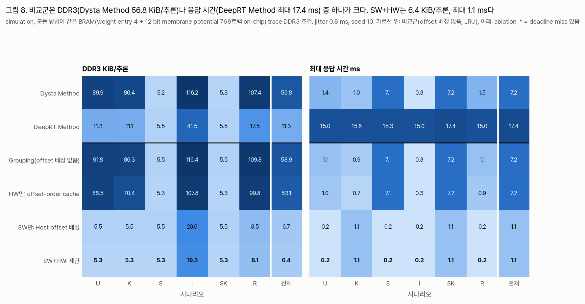

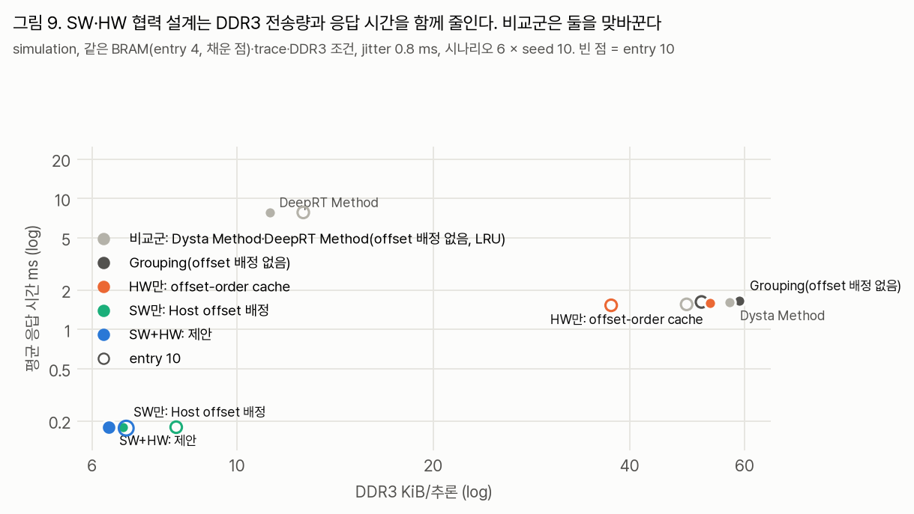

| 방법 | DDR3 KiB/추론 | DDR3 MB/s | 평균 응답 시간 ms | 최대 응답 시간 ms |
|---|---:|---:|---:|---:|
| Dysta Method | 56.8 | 1,515 | 1.61 | 7.2 |
| DeepRT Method | 11.3 | 300 | 7.84 | 17.4 |
| offset 배정 없음 | 58.9 | 1,571 | 1.66 | 7.2 |
| HW만 | 53.1 | 1,416 | 1.60 | 7.2 |
| SW만 | 6.69 | 178 | 0.179 | 1.08 |
| **SW+HW (제안)** | **6.36** | **169** | **0.179** | **1.08** |

- 비교군은 DDR3 전송량과 응답 시간을 맞바꾼다. Dysta Method는 기다리지 않아 응답 시간이 짧지만 DDR3가 많고, DeepRT Method는 기다려 DDR3를 줄이지만 응답 시간이 길다.
- SW+HW는 Dysta Method보다 DDR3 −89 %, 평균 응답 시간 −89 %다. DeepRT Method보다 DDR3 −44 %, 평균 응답 시간은 1/44이다.
- entry를 10으로 늘려도 Dysta Method는 48.9 KiB/추론이다.
- 동시 도착(S, SK)에서는 모든 방법의 DDR3가 5.2~5.5 KiB/추론으로 비슷하다. 다 같이 오면 한 번에 묶이기 때문이다. 대신 Dysta Method는 최대 응답 시간 7.1 ms이고, SW+HW는 Host가 offset을 다시 맞춰 0.2 ms다.
- jitter 0.8 ms에서는 이득 대부분이 SW(Host offset 배정)에서 온다. HW(offset-order cache)는 5 % 더 줄인다(6.69 → 6.36 KiB/추론).

비교군에 제안과 같은 최적화(Host offset 배정 + offset-order cache entry 4)를 넣고 scheduler만 남겨 다시 돌렸다(`p321_compare_offset`).

| scheduler (+ 같은 최적화) | DDR3 KiB/추론 | 평균 응답 시간 ms | 최대 응답 시간 ms |
|---|---:|---:|---:|
| Grouping(제안), Dysta Method | 6.36 | 0.179 | 1.08 |
| DeepRT Method | 6.36 | 7.96 | 15.8 |

같은 최적화를 넣으면 Dysta Method는 제안과 같고, DeepRT Method는 DDR3가 같고 응답 시간만 기다린 만큼 길다. 이득은 scheduler가 아니라 Host offset 배정과 offset-order cache에서 나온다. 이 최적화는 scheduler와 따로 붙일 수 있고, 제안은 그중 가장 단순한 Grouping을 쓴다.

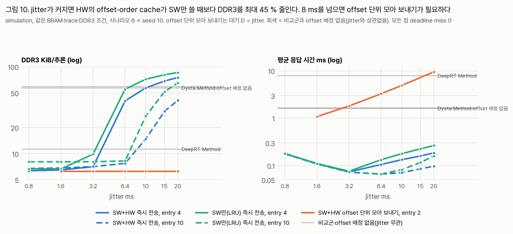

jitter가 커지면 HW의 몫이 커진다. LRU는 섞여 오는 모델을 못 지켜 weight를 다시 읽는다.

| jitter ms | entry | SW만(LRU) KiB/추론 | SW+HW KiB/추론 | 차이 |
|---:|---:|---:|---:|---:|
| 3.2 | 4 | 9.87 | 7.08 | −28 % |
| 6.4 | 4 | 55.2 | 40.5 | −27 % |
| 10 | 10 | 27.0 | 14.8 | −45 % |
| 15 | 10 | 51.6 | 30.7 | −41 % |

SW+HW(entry 10)는 jitter 20 ms에서도 Dysta Method(57 KiB/추론)보다 적다(41 KiB/추론). offset 단위 모아 보내기를 더하면 jitter와 상관없이 6.3 KiB/추론이다.

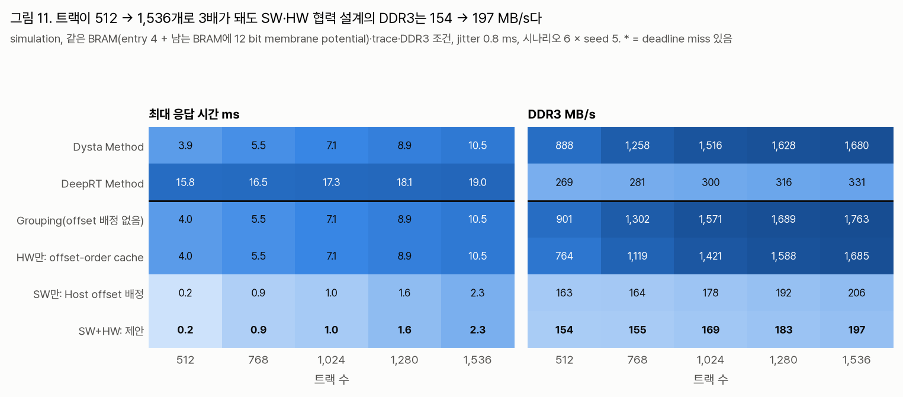

트랙이 512 → 1,536개로 3배가 되면 SW+HW의 DDR3는 154 → 197 MB/s, 최대 응답 시간은 0.24 → 2.3 ms다. Dysta Method는 888 → 1,680 MB/s, 3.9 → 10.5 ms, DeepRT Method는 269 → 331 MB/s, 15.8 → 19.0 ms다. 모든 점에서 miss는 없다.

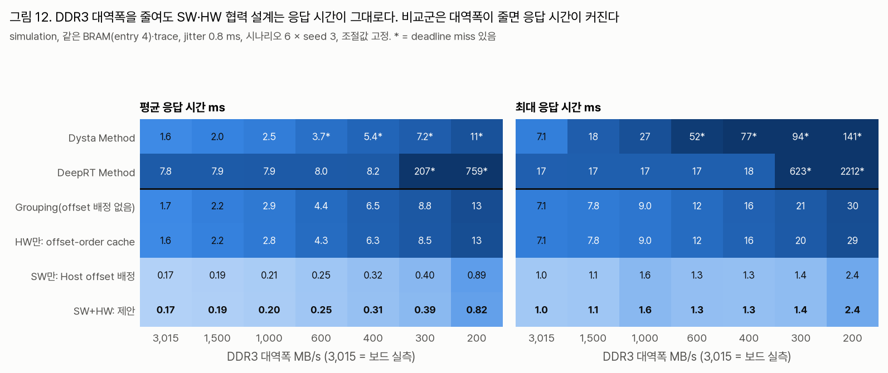

DDR3 대역폭을 3,015 → 200 MB/s로 줄여도 SW+HW는 최대 응답 시간이 1.0 → 2.4 ms다. 필요한 전송률이 169 MB/s뿐이기 때문이다.

- Dysta Method는 600 MB/s부터 miss가 난다. 요청을 버리지는 않지만 cache hit·큰 batch를 먼저 골라 다른 모델 요청을 deadline 넘게 미룬다(600 MB/s 최대 51.6 ms).
- DeepRT Method는 400 MB/s까지 응답 시간이 그대로(최대 17.6 ms)다가 300 MB/s에서 무너진다(평균 207 ms). 필요한 전송률(약 300 MB/s) 이하로 대역폭이 줄면 queue가 끝없이 쌓인다.
- offset 배정 없음과 HW만은 miss가 없다. 대역폭이 모자라면 대기 요청이 쌓여 batch가 커지고 그만큼 weight를 덜 읽는다. 대신 최대 응답 시간이 30 ms로 deadline에 붙는다.

miss 0을 지키는 가장 낮은 대역폭은 시험값(3,015~100 MB/s) 중 Dysta Method 800, DeepRT Method 400, 나머지 200 MB/s였다(`p321_compare_bw`). offset 배정 없음도 batch를 키워 200 MB/s를 버텨 이 지표로는 차이가 잘 드러나지 않아, 그림은 응답 시간으로 그렸다.

### 3.9 1,024트랙보다 늘릴 수 있나

같은 BRAM(entry 4)·trace에서 방법마다 deadline miss 0을 지키는 최대 트랙 수를 찾았다(시험값 1,024·1,536·2,048·…·6,144, seed 3).

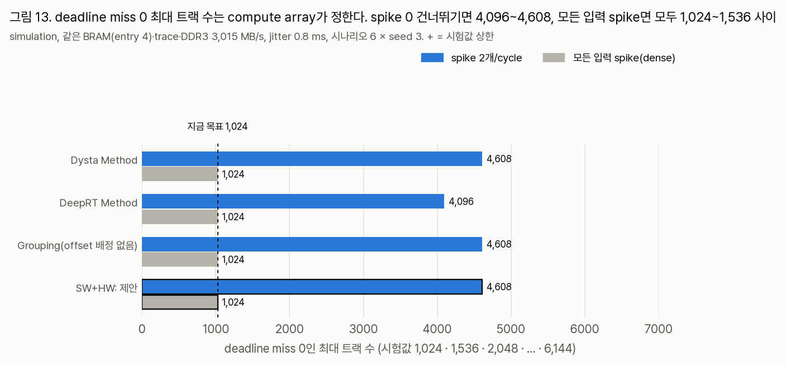

- DDR3 3,015 MB/s에서는 SW+HW, Dysta Method, offset 배정 없음이 4,608트랙, DeepRT Method가 4,096트랙까지 miss가 없다. 모두 compute array에서 막힌다(spike 0 건너뛰기 평균 6.8 µs/추론 → 32 ms에 약 4,700개).
- Dysta Method도 여기까지 가는 이유: 부하가 크면 대기 요청이 쌓여 batch가 커지고 weight를 덜 읽는다. 대신 응답 시간이 deadline 가까이 간다.
- 모든 입력이 spike인 worst case(dense)에서는 모든 방법이 1,024트랙은 되고 1,536트랙은 안 된다(계산상 한계 1,408). 1,024를 넘는 트랙은 spike가 드물다는 통계에 기대는 것이고, worst case 입력에서는 보장하지 않는다.

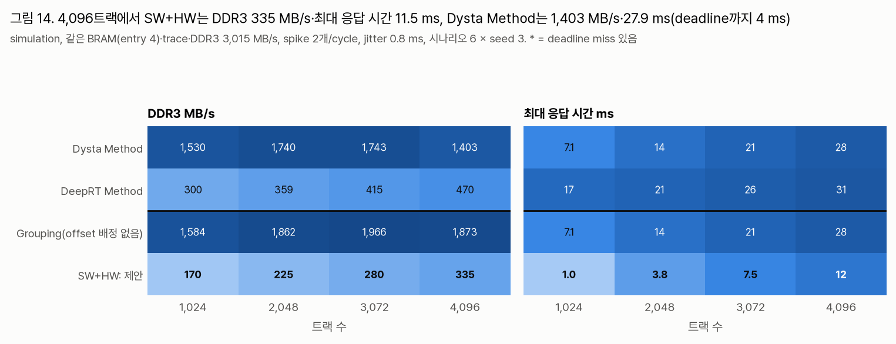

| 4,096트랙 | DDR3 MB/s | 평균 응답 시간 ms | 최대 응답 시간 ms |
|---|---:|---:|---:|
| Dysta Method | 1,403 | 6.7 | 27.9 |
| DeepRT Method | 470 | 11.3 | 31.3 |
| offset 배정 없음 | 1,873 | 6.4 | 27.8 |
| **SW+HW (제안)** | **335** | **2.9** | **11.5** |

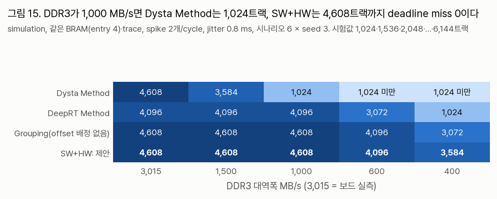

DDR3 대역폭이 줄면 차이가 트랙 수로 나타난다.

| DDR3 MB/s | Dysta Method | DeepRT Method | offset 배정 없음 | SW+HW |
|---:|---:|---:|---:|---:|
| 3,015 | 4,608 | 4,096 | 4,608 | 4,608 |
| 1,500 | 3,584 | 4,096 | 4,608 | 4,608 |
| 1,000 | 1,024 | 4,096 | 4,608 | 4,608 |
| 600 | 1,024 미만 | 3,072 | 4,096 | 4,096 |
| 400 | 1,024 미만 | 1,024 | 3,072 | 3,584 |

- Dysta Method는 대역폭이 모자라면 weight 적재가 비싸져 cache hit·큰 batch만 먼저 고르고, 다른 모델 요청을 deadline 넘게 미뤄 일찍 무너진다.
- DeepRT Method는 기다린 시간(window 14.9 ms)만큼 deadline 여유가 이미 줄어 있어, 트랙이 늘거나 대역폭이 줄면 남은 여유가 먼저 바닥난다.
- offset 배정 없음은 batch를 키워 버텨 트랙 수로는 SW+HW와 거의 같다. 대신 응답 시간이 deadline에 붙는다(4,096트랙 최대 27.8 ms).
- 넣지 않은 것: 트랙이 늘면 커지는 요청 표·송수신 buffer BRAM, Host의 mel 계산(4,096 stream), Ethernet 대역폭(4,096트랙 × 31.25 Hz × 약 100 B ≈ 13 MB/s로 1 GbE 안으로 추정).

정리하면, 트랙 수 자체는 compute array가 정해 방법 사이 차이가 작다. SW+HW의 확장 이득은 같은 트랙 수에서 DDR3를 Dysta Method의 1/4, 최대 응답 시간을 절반 아래로 쓰는 것이다. 그래서 DDR3를 다른 일과 나눠 쓰거나 대역폭이 낮은 보드에서는 비교군보다 많은 트랙을 받는다(1,000 MB/s에서 Dysta Method 1,024, SW+HW 4,608).

### 3.10 응답 시간이 악조건에서 제약이 되나

1,024트랙, 같은 BRAM(entry 4)에서 악조건을 겹치고 외부 지연을 더했다(`p321_adverse`, seed 10). 외부 지연은 Host·오디오·Ethernet이 32 ms에서 먼저 쓰는 시간이다(입력·결과에 반씩 더함).

| 조건 | Dysta Method 최대 ms / miss | DeepRT Method 최대 ms / miss | offset 배정 없음 최대 ms / miss | SW+HW 최대 ms / miss |
|---|---|---|---|---|
| 기준 | 7.2 / 0 | 17.4 / 0 | 7.2 / 0 | 1.1 / 0 |
| 모든 입력 spike(dense) | 23.1 / 0 | 28.3 / 0 | 23.1 / 0 | 9.2 / 0 |
| dense + 제어 20 % + DDR3 2.0 GB/s | 25.2 / 0 | 29.9 / 0 | 25.2 / 0 | 10.5 / 0 |
| 위 + 외부 5 ms | 30.2 / 0 | 34.9 / 0.8 % | 30.2 / 0 | 15.5 / 0 |
| 위 + 외부 10 ms | 35.2 / 5.1 % | 40.0 / 7.3 % | 35.2 / 5.1 % | 20.5 / 0 |
| 위 + 외부 20 ms | 45.2 / 21.5 % | 49.9 / 39.5 % | 45.2 / 21.5 % | 30.5 / 0 |

- 악조건 하나씩은 모든 방법이 deadline을 지킨다(P3.13과 같음).
- 겹친 worst case에서 FPGA가 쓰는 시간은 Dysta Method·offset 배정 없음 25.2 ms, DeepRT Method 29.9 ms, SW+HW 10.5 ms다. 그래서 외부 지연에 남는 몫이 Dysta Method 약 7 ms, DeepRT Method 약 2 ms, SW+HW 약 21 ms다.
- Dysta Method와 offset 배정 없음은 offset이 모델별로 모이지 않아 weight 적재(43.9 µs)를 자주 기다린다. DeepRT Method는 window만큼 일부러 기다린다.

제약이 되는지는 deadline의 시작점에 달렸다. "입력 생성 시각"이 소리가 끝난 frame 경계라면 오디오 buffer(기본 10~20 ms)가 외부 지연에 들어가고, 비교군은 겹친 worst case에서 deadline을 못 지킨다. Host가 frame을 받은 시각부터 센다면 외부 지연은 Host 계산과 Ethernet(수 ms 이하)뿐이라 Dysta Method도 된다. DeepRT Method는 외부 5 ms에서 이미 miss가 난다.

P3.22에서 deadline을 마이크 수음 + 32 ms로 정했다. 이에 맞춰 외부 지연을 입력에만 더한 실험(`p321_e2e`)도 돌렸다. 악조건 겹침의 miss는 위 표와 같다(지연 10 ms에서 Dysta Method 5.1 %, DeepRT Method 7.3 %, SW+HW 0). 평상시에도 DeepRT Method는 지연 20 ms에서 21.9 %가 miss다. 논문 초안 표 6은 이 실험을 쓴다.

## 4. 결론

1. entry 수는 jitter 측정으로 정한다. p99 jitter가 3.2 ms 이하면 지금처럼 즉시 전송 + entry 4가 맞다. 8 ms를 넘으면 BRAM 안의 entry로는 못 버티므로 offset 단위 모아 보내기(D ≥ jitter) + entry 2로 바꾼다. 이때 DDR3는 6.3 KiB/추론을 지키고, 응답 시간이 jitter만큼 는다.
2. offset 간격은 모델마다 같은 0.8 ms로 둔다.
3. membrane potential은 12 bit로 둔다(2026-10-16 사용자 결정). on-chip에 둘 트랙 수는 jitter를 재고 entry 수를 정한 뒤 남는 BRAM으로 정한다. [9, 9s1, 9s1, 12] bit는 손실 없이 DDR3를 7~8 % 줄이는 대안으로 기록만 남긴다.
4. DDR3 membrane potential을 offset 순서로 붙여 두는 것은 offset 단위 모아 보내기를 쓸 때만 의미가 있다.
5. 실시간 정규화는 seg 방식으로 재학습해 보는 것이 다음 일이다.
6. simulation의 on-chip membrane potential 평균 계산은 트랙별 계산과 같아 그대로 쓴다.
7. 같은 BRAM에서 SW+HW 설계는 비교군보다 DDR3 전송량과 응답 시간이 함께 작다. jitter가 작을 때는 Host offset 배정(SW)이, 클 때는 offset-order cache(HW)가 이 차이를 만든다. 같은 최적화를 Dysta Method에 넣으면 제안과 같으므로, 비교는 "scheduler 대 scheduler"가 아니라 "SW·HW 협력 유무"로 말한다.

## 5. 한계

- jitter는 균등분포 폭 하나로 넣었다. 실제 분포(M1·M3·M4)를 재면 다시 돌린다.
- 입출력 지연은 PCIe 64 B 실측 표본이다. Ethernet은 재지 않았다.
- offset 단위 모아 보내기는 Host가 모델별로 "다 준비됐다"를 안다고 가정했다. Host의 buffer와 CPU 시간은 넣지 않았다.
- spike 2개/cycle, 제어 비용 203 cycle은 여전히 가정이다.
- 비교군은 원문 정책을 이 simulator의 FPGA scheduler 자리로 옮긴 것이다(조절값은 P3.11). 결정에 드는 시간·회로는 0으로 뒀다. 원래 시스템(GPU, 선점 등)과 직접 비교한 것이 아니다.
- layer별 bit는 software reference에서만 확인했다. 아래 bit 버림과 9 bit bank는 RTL에서 다시 확인해야 한다. 손실 기준 −0.005는 이번에 정한 값이다.
- 정규화는 재학습 없이 평가했다. 실시간 STFT(frame 경계 padding)는 학습 특징과 같다고 봤다.

## 6. 바꾼 것과 재현

| 대상 | 내용 |
|---|---|
| engine | 환경 키 `gather_ms`(offset 단위 모아 보내기 대기 D), `mem_place`(avg·id·offset), `offset = "model_w"`(offset 간격 비례), `bits` 목록(layer별 bit). 요약 지표 `mdma`(추론당 membrane potential DMA). 옛 결과는 그대로 재현된다(`p313_tradeoff` 한 점을 다시 돌려 모든 지표 일치) |
| test | `test_engine.py` 손계산 56항목(새 키 5항목 추가), 환경 파일 37개 통과 |
| template | 기본 `bits`를 12로(설계 정본과 맞춤). `template.csv`를 다시 만들었다 |
| 환경 파일 | `p317_jitter_wide`, `p317_gather`, `p317_offset_width`, `p317_mem_place`, `p319_layer_bits`, 비교 `p321_compare`, `p321_compare_jitter`, `p321_compare_tracks`, `p321_compare_ddrbw`, `p321_compare_bw`(search), `p321_compare_offset`, 확장 `p321_scale`(search), `p321_scale_run`, `p321_scale_bw`(search), 악조건 `p321_adverse`, `p321_e2e`. 옛 환경 파일 22개에는 새 키를 기본값으로 넣었다. 결과는 같아 옛 CSV는 다시 만들지 않았다(새 키 열만 없다) |
| 모델 평가 | `software/model/eval/membrane_layer_bits.py` → `train_result/eval/membrane_layer_bits/`, `realtime_norm.py` → `train_result/eval/realtime_norm/` |
| 그림 | 그림 1 `jitter/fig2`, 2 `gather/fig1`, 3 `alignment/fig2`, 4 `membrane/fig3`, 5 `membrane/fig2`, 6 `entry/fig2`, 7 `normalization/fig1`, 8~12 `compare/fig1`~`fig5`, 13~15 `compare/fig6`~`fig8` |
| analysis 정리 | 문서·발표에 쓰이지 않는 그림 5개를 `analysis/discards/`로 옮겼다(accuracy fig2·fig3, training fig2, bram fig1·fig2) |

```bash
python3 simulation/engine/engine.py simulation/environment/p317_gather.toml --jobs 11
python3 software/model/eval/membrane_layer_bits.py --ckpt L_normal_noaug
python3 software/model/eval/membrane_layer_bits.py --ckpt L_normal_noaug --combos b9-b9s1-b9s1-b12
python3 software/model/eval/realtime_norm.py
```

## 7. 관련 문서

- [P3.13 보고서](<P3.13 Research Report.md>): offset 배정, entry 4, 12 bit membrane potential을 정한 실험
- [04_MEMORY.md](../design_references/04_MEMORY.md): BRAM 배분과 membrane potential 저장
- [06_HOST_INTERFACE.md](../design_references/06_HOST_INTERFACE.md) §9: jitter 측정 계획
- [07_SIMULATION.md](../design_references/07_SIMULATION.md): simulation 비용 모델
